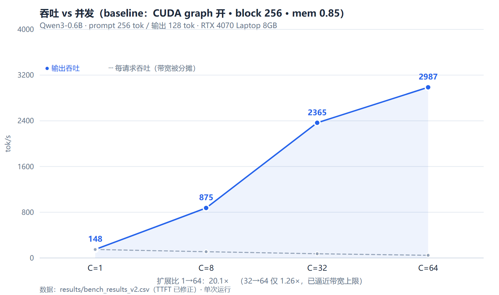
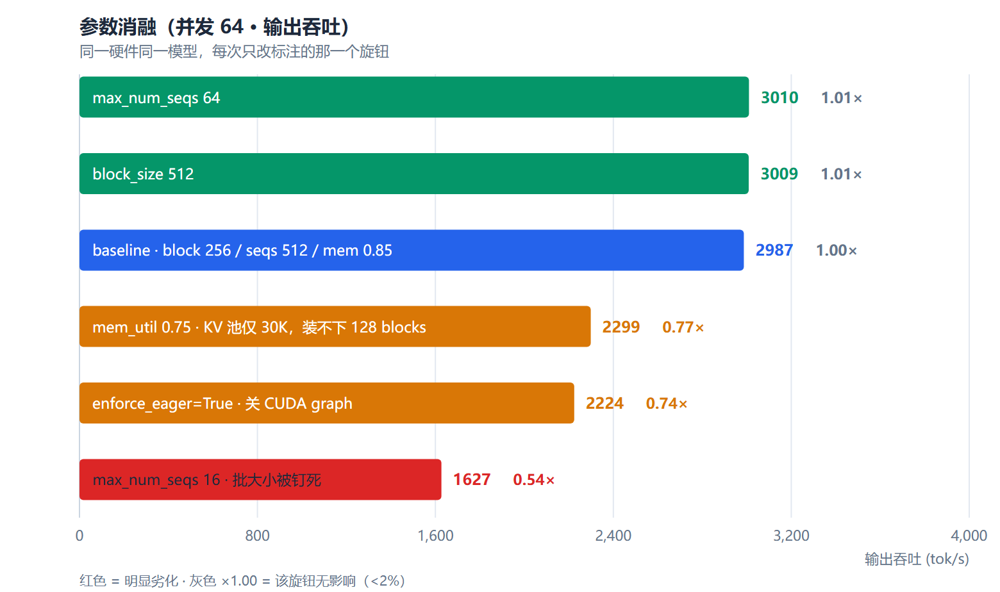

# byte-vllm

在 [nano-vllm](https://github.com/GeeeekExplorer/nano-vllm)（1450 行 PagedAttention 教学实现，MIT）上做**字节级优化**的一次完整工程实践：13 步优化链、每一步的可判定验收、以及「做 / 不做」的判断依据。

模型 Qwen3-0.6B，单卡 RTX 4070 Laptop 8GB。

> **核心结论**：decode 是纯带宽受限——实测有效带宽 **188 GB/s ≈ 峰值的 73%**，且与 batch 无关。所以所有真正兑现的优化都落在同一条线上：**减少每 token 要读多少字节**。weight-only int8 砍权重、fp8 KV 砍 cache、prefix caching 直接不读。算力侧的优化（W8A8、prefill CUDA graph）要么精度门不过，要么被别的瓶颈盖住。

## 结果

| 指标 | 基线（upstream 等价） | 优化后 |
|---|---|---|
| 单流吞吐（并发 1） | 148.3 tok/s | **239.6 tok/s**（+61.6%，int8） |
| 并发 64 吞吐 | 2987 tok/s | **3217 tok/s**（+7.7%，int8）；deploy 档 fp8 KV 下更高 |
| 并发 64 单步 decode | 15.15 ms | **10.06 ms**（−33.6%，fp8 KV） |
| 官方 README 协议（256 序列，seed 0） | 1372.8 tok/s | **1512.0 tok/s**（+10.1%，int8 + 编译） |
| 同上 + fp8 KV（必须关 `prefill_compile`） | 1309.7 tok/s | **2075.8 tok/s**（+58.5%） |
| prefix 命中 TTFT（2048 token 共享前缀） | 83.7 ms | **40.8 ms**（−51.3%） |
| 质量（512 段 ppl，配对） | EN 22.171 / ZH 81.221 | EN +0.32% / ZH −1.09%（端到端全开） |

官方同机复现基线 **1369.97 tok/s**，为官方公布 1434.13 的 **95.5%**（电源方案差异，未做对照）。完整 8 表 8 图见 [docs/REPORT.md](docs/REPORT.md)。





## 优化链

每一步都先钉死「时间花在哪」，再给判据，再决定做不做。

| 步 | 主题 | 做法 | 结论 | 关键数字 |
|---|---|---|---|---|
| — | 基线基准套件 | 6 配置 × 10 项测量，反推带宽模型 | 建立口径 | 148.3 → 2987.0 tok/s（20.1×） |
| A | prefix caching 开关 | `enable_prefix_caching` 三层透传 + 块级命中统计 | **采纳**，默认开 | TTFT 83.7 → 40.8 ms；未命中仅 +0.08 ms |
| 1 | prefill 开销归因 | `run_model` 外层插桩 + 逐层截断 | 定位到 Python 侧 | 提交 30 ms 平线，1.1–1.2 ms/层 |
| 2 | prefill 整层编译 | `prefill_compile=layer\|model` | **采纳**，只在短序列兑现 | 提交 −55.7%；TTFT@512 37 → 23 ms；≥2048 不动 |
| 3 | 量化质量口径 | ppl / logits KL / 生成一致性 + HF 独立对账 | 建立地板 | EN 22.171 / ZH 81.221（对账 0.000 / +0.02%） |
| 4 | int8 权重 | 自写 Triton w8a16 kernel | **采纳**（`quant=all`） | 1.19 → 0.60 GB；单流 +61.6%；质量 +0.46% / −0.12% |
| 5 | int4 分档 | per-channel / g128 / 只 MLP / 只 head | **不做** | ppl +5.09% / +20.2% / +44.2%，吞吐无一超过 int8 |
| 6 | KV 池容量 | 161 / 88 / 44 三档扫 | **收口**，容量不是杠杆 | 共享前缀负载稳态命中率恒 100% |
| 7 | int8 prefill tile 修复 | `_pick_tiles` 加 `N≤2048 ∧ M≥256` 分支 | **采纳** | C=64 prefill −61 ms；TTFT@2048 87.0 → 80.8 ms |
| 9b | prefill 时间去向 | GEMM / attention / 强制搬运 三段核算 | **收口**，没有浪费 | GEMM 58–59%、attn 17%、搬运 17% |
| 10 | 自写 paged decode | Triton online-softmax + block_table gather + GQA | **采纳** | 与 FA2 打平（+0.13%）；换来读 fp8 cache 的资格 |
| 11 | fp8 KV cache | e4m3 + per-(token,head) fp32 scale | **条件采纳**（并发 ≥ 8） | 每 token 每层 4096 → 2112 B；C=64 −33.6%；C=1 −47% |
| 12a | W8A8 | int8 / fp8 激活预演 + GEMM 微基准 | **不做** | GEMM 2.18× / 1.91×，但 512 ppl 最好组合 +2.28%，超 1% 精度门 |
| 12 | PLD 投机解码 | n-gram draft + 一次前向 verify γ+1 位置 | **默认关闭**（仅 greedy 等价） | C=1 15.1×、C=4 3.81×、C=16 1.42×、C=64 1.03× |
| 8/9/13 | chunked prefill / prefill CUDA graph / CPU-GPU 流水线 | 评估后不做 | **不做** | 编译已吃掉空隙；GPU 底 17.7 ms；decode CPU 占比 5–10% |

「不做」和「做了」同等重要：这三条是被实测判据否掉的，判据写在 [docs/REPORT.md](docs/REPORT.md) 对应小节。

## 快速开始

环境锁（动了就废）：`torch 2.5.1+cu124` ↔ `flash-attn 2.8.3.post2`，`transformers==4.57.6`。WSL2 Ubuntu 22.04 + CUDA 12.4。

```bash
git clone https://github.com/anziaa/byte-vllm && cd byte-vllm
python -m venv .venv && source .venv/bin/activate
pip install -e .
```

模型：把 Qwen3-0.6B 放到 `models/Qwen3-0.6B`（或任意本地路径，改 `--model`）。

```bash
# 最小示例（默认读 models/Qwen3-0.6B，可用 --model 或 $NANOVLLM_MODEL 覆盖）
python example.py --model models/Qwen3-0.6B

# 冒烟测试：加载 + 出中文回答
python scripts/smoke_test.py --model models/Qwen3-0.6B

# 基准套件：6 配置 × TTFT / 吞吐 / prefix 冷热
python bench_suite.py --model models/Qwen3-0.6B
python bench_suite.py --model models/Qwen3-0.6B --single '{"quant": "all"}'

# 官方 README 协议复现
python bench_official.py --model models/Qwen3-0.6B --num-seqs 256 --seed 0
python bench_official.py --model models/Qwen3-0.6B --quant all --prefill-compile model
```

> 带 `prefill_compile=model` 时首个真实批次要付 23–41 s 的 JIT，粒度是**每次进程启动**。官方协议是「warmup 3 token + 单次 generate」，会把这段算进吞吐，所以对比时必须用稳态值。

## 关键配置

全部字段与注释见 [`nanovllm/config.py`](nanovllm/config.py)。

| 配置 | 取值 | 说明 |
|---|---|---|
| `quant` | `none` / `lm_head` / `all` / `int4_*` / `fp8_fake` | weight-only 量化档位，默认 `none` |
| `int8_keep_bf16` | bool | 给 prefill 留一份 bf16 权重（+0.6 GB，换 prefill 不退步） |
| `prefill_compile` | `off` / `layer` / `model` | 每算子 / 每层 / 整模型编译，默认 `model` |
| `kvcache_block_size` | 256 的倍数 | 默认 256 |
| `enable_prefix_caching` | bool | 默认开 |
| `attn_backend` | `fa2` / `triton` | decode attention 后端，`triton` 才能读 fp8 cache |
| `kv_cache_dtype` | `bf16` / `fp8` | fp8 需要 `attn_backend=triton` |
| `pld_gamma` / `pld_tiers` | int / `"1:32,4:12,16:4"` | PLD 投机，默认关闭；只支持 greedy |

## 仓库结构

```
byte-vllm/
├── nanovllm/            # 引擎：config / engine / layers / models / utils
│   └── layers/          #   int8_linear.py（w8a16）、triton_attn.py（paged decode）
├── bench_suite.py       # 基准套件：6 配置矩阵，TTFT / 吞吐 / prefix 冷热，落 CSV
├── bench_official.py    # 官方 README 协议复现（含 KV 池反推实际并行度）
├── example.py           # 最小可用示例
├── docs/
│   ├── REPORT.md        # 实验报告：8 表 + 8 图 + 结论 + 口径说明
│   └── notes/           # 三篇机制长文：prefix caching、prefill 编译、int8 tile
├── results/             # 图表（SVG + 2× PNG）、关键原始数据
├── assets/corpus/       # 冻结的 ppl 评测语料（EN / ZH，token id 已固定）
└── scripts/             # 可复现脚本：基准 / 画图 / 质量评测 / 语料生成
```

## 复现

```bash
# 质量口径（与 bf16 基线做配对差）
python scripts/quality_eval.py --baseline results/quality_baseline.json --tag int8 --quant all

# 用 transformers 独立复算 ppl 对账
python scripts/ppl_hf_ref.py --corpus assets/corpus --out results/ppl_hf_ref.json

# 重画图（纯标准库手写 SVG，零绘图依赖）
python scripts/charts.py
python scripts/figs_concept.py
python scripts/fig8_step2.py
python scripts/svg2png.py

# 打开图表汇总页
results/figs/index.html
```

语料是冻结的：`assets/corpus/*.ids.json` 是权威输入，`.txt` 只是可读副本。重新生成用 `scripts/make_corpus.py`，但会改变分段，不要与已发布数字混用。

## 口径与限制

- **不要把 2987 和官方的 1434 并排比。** 官方协议是 256 请求、平均上下文 820 token；本机 baseline 是 64 请求、上下文 320。同配置同 seed 的对比是 1373 → 1512（+10.1%）。
- **`prefill_compile=model` 会破坏跨进程逐位复现**（两个相同 baseline 跨进程只有 54% token 一致，logits 双峰）。任何「逐 token 一致」的验收必须在**同一进程内**做 A/B。
- baseline 矩阵是单次运行；TTFT@512 仍有冷启动残留，跨配置不要横向比。测试机为笔记本，SM 时钟抖动会让同一份 prefill 波动 ±15%，绝对毫秒不可跨进程比较。
- 全部结果是 8GB 笔记本卡上的 Qwen3-0.6B，结论的边界是「小模型 + 带宽受限」。

## 关于本仓库

这是实验记录的整理版：一次性探针脚本与每步的原始 dump 已裁掉，保留引擎、复现脚本、图表、关键数据与三篇机制长文。报告里的「下一步」段落写于对应时点，最终结论以 README 与报告末尾为准。

## 许可

`nanovllm/` 源自 [nano-vllm](https://github.com/GeeeekExplorer/nano-vllm)（MIT），本项目的修改与 `docs/`、`results/`、`scripts/` 同样以 MIT 发布，见 [LICENSE](LICENSE)。
