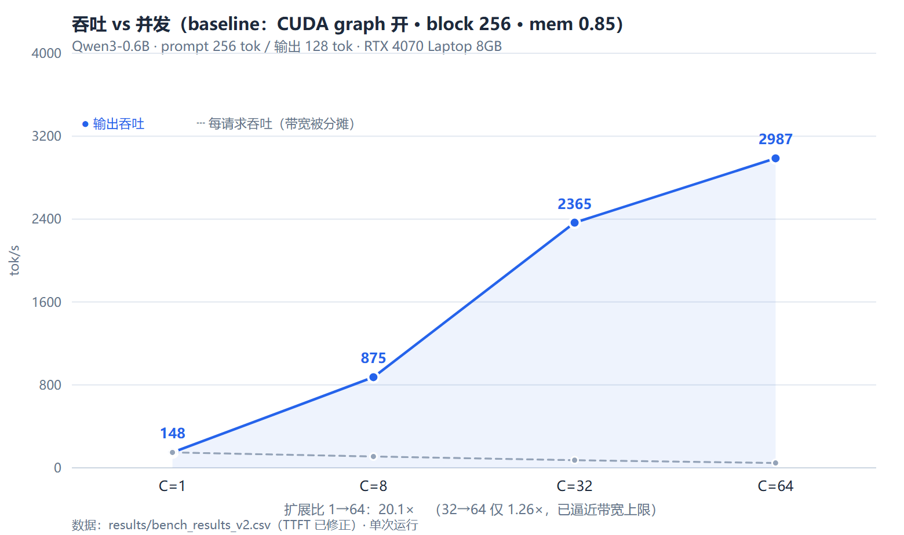
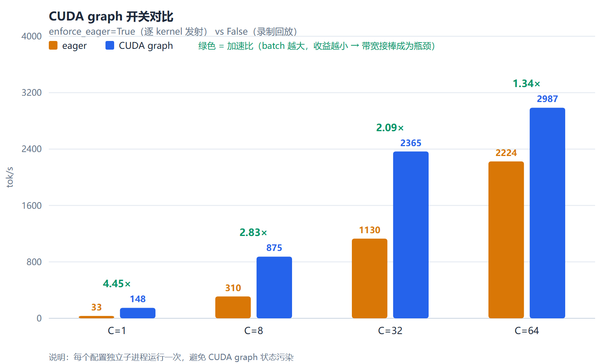
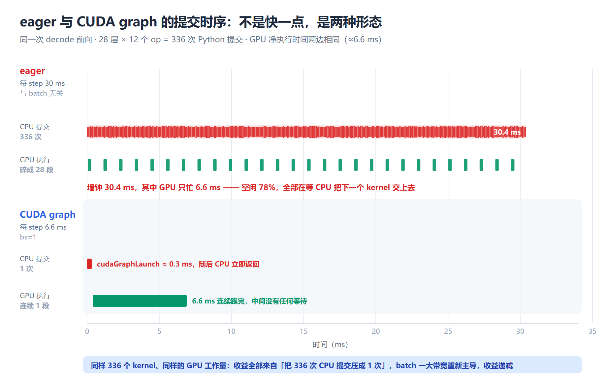
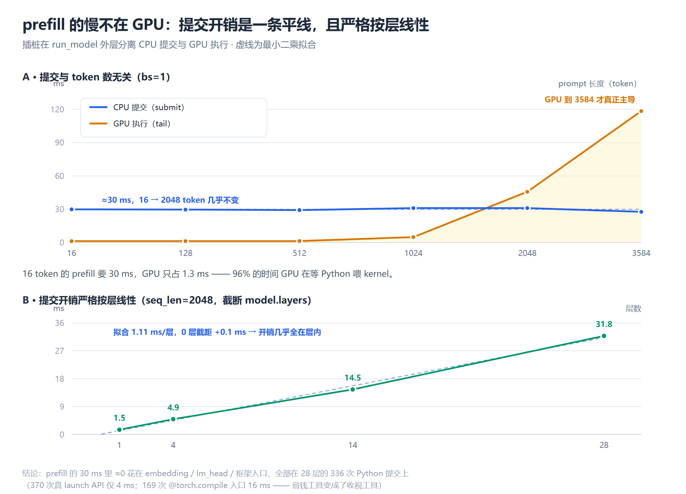
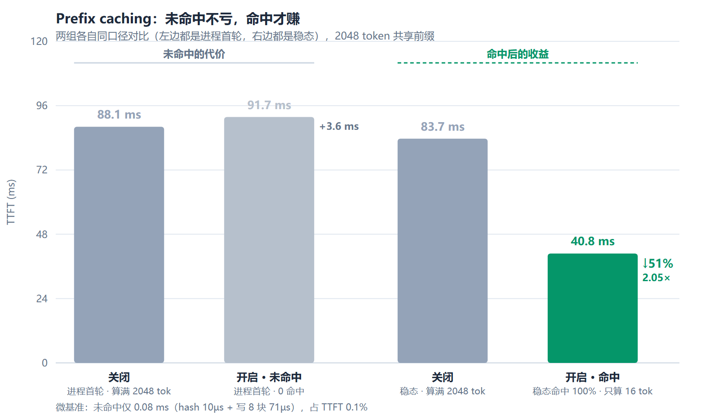
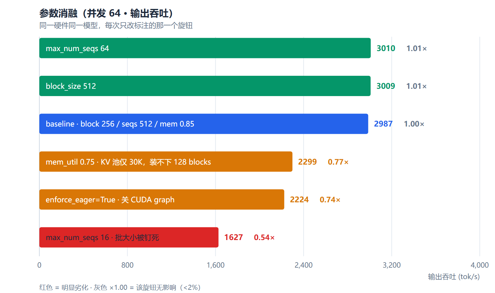
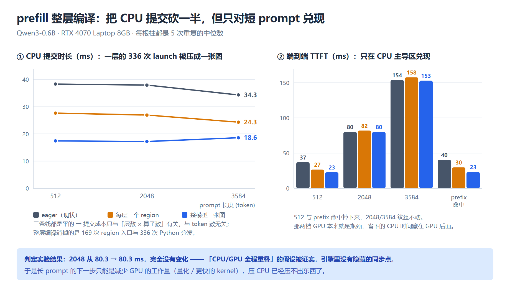
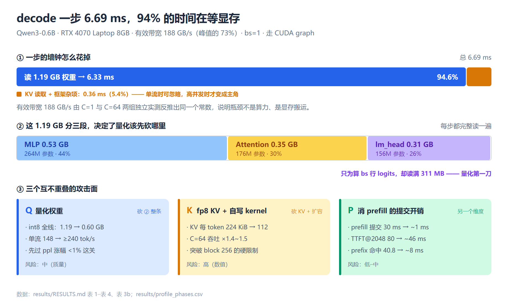

# 基线实验结果（2026-11-12）

> **整理说明**：这是实验记录原文，未改动任何数字与结论。整理仓库时裁掉了只用于一次性探针的脚本（`scripts/step*.py`、`scripts/wsl.sh`、`scripts/*_probe.py` 等），因此文中形如 `scripts/xxx.py` 的引用指向当时的实验现场，在仓库里未必还存在；`results/` 只保留了出图所需的 CSV / JSON；原 `docs/TODO.md`（逐日执行清单）也未收录，文中引用处按历史记录读。能复跑的主干（`bench_suite.py`、`bench_official.py`、`scripts/charts.py`、`scripts/quality_eval.py` 等）都在。

> 数据来源：`results/bench_results_v2.csv`（72 行，6 配置 × 12 项测量）+ `results/bench_full.log`
>   
> 归因数据：`results/profile_phases.csv`（步 1 的 submit / tail / wall 逐次记录）
>   
> 运行命令：`python bench_suite.py --model models/Qwen3-0.6B --tag v2 --csv bench_results_v2.csv`
>   
> 硬件：RTX 4070 Laptop 8GB（256 GB/s GDDR6）· WSL2 Ubuntu 22.04 · torch 2.5.1+cu124 · flash-attn 2.8.3.post2
>
> **图表**：7 张图已**直接内嵌在本文对应表格的下方**（`results/figs/png/*.png`，2× 分辨率，任何 Markdown 阅读器都能显示）。矢量源在 `results/figs/*.svg`（`python scripts/svg2png.py` 同步 PNG），汇总页 `results/figs/index.html`。索引见下一节。

## 图表索引：每张图支撑哪个决策

图 1–4 是**数据图**（`scripts/charts.py` 从 `bench_results_v2.csv` 生成），图 5–7 是**归因图**（`scripts/figs_concept.py` 生成），图 8 是**收益-边界图**（`scripts/fig8_step2.py`）。前四张回答"多快"，中间三张回答"为什么"，图 8 回答"优化完还剩什么没解决"。

> 图号按**主题**分组，不是文档出现顺序（本文档按"表"组织）。下面的索引只负责跳转；**每张图都内嵌在它对应的表后面，图下紧跟一段"这张图在说什么"的解释。**

**这些图不只是给 README 看的展示品，而是 `docs/TODO.md` 每一步的判据。** 没有图或表支撑的步骤不开工。下表是图 → 结论 → 决策的对应关系：

| 图            | 回答什么问题                | 落在哪张表       | 支撑的决策                                            |
| ------------ | --------------------- | ----------- | ------------------------------------------------ |
| [图 1](#fig1) | 加并发还能涨多少？             | 表 1         | 曲线已折弯 → 扩容无益，**改压每 token 字节数**（步 4 量化）           |
| [图 2](#fig2) | CUDA graph 值多少？       | 表 2         | 只解决提交开销，batch 越大越无用 → 不能指望它救大并发                  |
| [图 3](#fig3) | 三个旋钮哪个真有用？            | 表 3 / 5 / 6 | `mem≥0.85`、`seqs≥64` 写进配置结论；**`block_size` 放弃调** |
| [图 4](#fig4) | prefix caching 该默认开吗？ | 表 4         | 未命中仅 0.08 ms → **开就完了，不必权衡**                     |
| [图 5](#fig5) | 每步 1.19 GB 权重花在哪？     | 结论 1        | **量化第一刀砍 lm_head（26%）**，不是 MLP（步 4）              |
| [图 6](#fig6) | graph 凭什么快 4.45×？     | 表 2 / 表 3b  | 收益来自 336 次提交压成 1 次，**kernel 本身没变快**              |
| [图 7](#fig7) | prefill 的时间花在谁身上？     | 表 3b        | **步 2 / 步 9 的前提**：30 ms 平线 + 1.1 ms/层；也解释**步 8 为何排在其后**（切块会乘上块数） |
| [图 8](#fig8) | 整层编译省下的钱花在哪一档？ | 表 8 | 提交 −55%、512 与 prefix 命中 −40%，**2048/3584 毫秒不动** → 长 prompt 只剩量化的路（步 3–7）；剩下 17 ms 交给步 9 |

## 测试条件

| 项       | 值                                                                                                      |
| ------- | ------------------------------------------------------------------------------------------------------ |
| 模型      | Qwen3-0.6B（28 层 / hidden 1024 / 16 Q 头 / 8 KV 头 / head_dim 128，bf16 ≈ 1.2GB 权重）                        |
| 采样      | `temperature=0.6` + `ignore_eos=True` + 固定 `max_tokens`                                                |
| 吞吐负载    | prompt 256 token，输出 128 token，并发 1/8/32/64                                                             |
| TTFT 负载 | 单请求，prompt 512 / 2048 / 3584，`max_tokens=1`，同长度先抛荒一次再测 3 次取 min；每条 prompt 首 token 加唯一盐，杜绝跨长度 prefix 命中 |
| KV 池    | `gpu_memory_utilization=0.85` → **146 blocks × 256 = 37,376 token ≈ 36K**                              |

---

## 表 1 · 并发-吞吐-延迟（baseline：CUDA graph 开、block 256、mem 0.85）

| 并发 | 输出吞吐 (tok/s) | 批次总耗时 (s) | 相对 C=1 | 每请求吞吐 (tok/s) |
| -- | ------------ | --------- | ------ | ------------- |
| 1  | **148.3**    | 0.8632    | 1.00×  | 148.3         |
| 8  | **875.0**    | 1.1703    | 5.90×  | 109.4         |
| 32 | **2364.9**   | 1.7320    | 15.9×  | 73.9          |
| 64 | **2987.0**   | 2.7426    | 20.1×  | 46.7          |

扩展比在 32→64 之间明显衰减（15.9× → 20.1×，增量仅 26%），这是 decode 阶段逼近显存带宽上限的特征。

<a id="fig1"></a>



> **图 1 · 吞吐随并发扩展**（左：绝对吞吐；右：相对 C=1 的扩展比）
>   
> **一句话**：并发从 1 加到 64 涨了 20.1×，但最后一段（32→64）只涨 26% —— 曲线折弯不是因为算力用满，是因为带宽用满。
>   
> **读法**：折弯出现在 32→64，而不是在"算力用满"的地方。把每步访存拆开算（图 5），两次 batch 反推出同一个有效带宽 **188 GB/s**——**曲线形状是带宽的函数，不是 FLOPs 的函数**。这就是"再加卡/再加并发没用，必须压每次读的字节"的判据，直接指向步 4（量化）。


## 表 2 · CUDA graph 开关

| 并发  | `enforce_eager=True` | `False`（CUDA graph） | 加速比       |
| --- | -------------------- | ------------------- | --------- |
| 1   | 33.3                 | 148.3               | **4.45×** |
| 8   | 309.5                | 875.0               | **2.83×** |
| 32  | 1129.5               | 2364.9              | **2.09×** |
| 64  | 2224.4               | 2987.0              | **1.34×** |

eager 模式下每个 decode step 稳定耗 **26~30 ms，几乎与 batch 大小无关**（C=1 的 128 token 用了 3.84s、C=64 的 8192 token 用了 3.68s，换算到每步分别是 30.0 / 28.8ms）。开 graph 后降到 bs=1 时 6.6ms、bs=64 时 18.7ms。  
→ eager 是 **launch overhead 受限**，graph 把这部分抹掉后变成 **带宽受限**，所以小 batch 收益最大、大 batch 收益收窄。  
→ **为什么 eager 每步是 30ms 而不是"336 次正常 launch"的 3~4ms**：见「表 3b · prefill 开销分解」，每层 1.2ms 里有 0.58ms 花在 `@torch.compile` 的入口上。

<a id="fig2"></a>



> **图 2 · CUDA graph 开关**（柱上数字是加速比）
>   
> **一句话**：CUDA graph 的收益是"一份固定补贴"，单请求时值 4.45×，64 并发时只剩 1.34× —— 它是给小 batch 用的药。
>   
> **读法**：加速比从 4.45× 单调跌到 1.34×，形状与图 1 的折弯互为镜像——**graph 抹掉的是一个与 batch 无关的固定量（≈30 ms 提交），batch 越大这个固定量被摊得越薄**。所以"上 graph 就快了"只在低并发成立。

<a id="fig6"></a>



> **图 6 · 为什么 eager 是 30 ms、而 graph 是 6.6 ms**
>   
> **一句话**：上下两栏 GPU 干的活一模一样，上面 30.4 ms、下面 6.6 ms —— 差的全是等待，不是计算。
>   
> **读法**：上下两栏的 GPU 工作量完全相同（都是 336 个 kernel、6.6 ms 的实际计算），差别只在 CPU 侧：上面是 336 次独立提交、GPU 被切成 28 段等料；下面压缩成 1 次 `cudaGraphLaunch`、GPU 一口气跑完。
>   
> **这张图给了一个反直觉的结论**：CUDA graph **没有让任何 kernel 变快**。它的全部价值是"把 CPU 从关键路径上摘掉"。这就是为什么它救不了大 batch——大 batch 时 GPU 本来就是连续忙的，CPU 早就不是瓶颈了。

## 表 3 · block_size（256 vs 512）

| block_size | KV 池                   | TTFT@2048 (s) | TTFT@3584 (s) | C=64 吞吐 (tok/s) |
| ---------- | ---------------------- | ------------- | ------------- | --------------- |
| 256        | 146 blocks = 37.4K tok | 0.0805        | 0.1541        | 2987.0          |
| 512        | 73 blocks = 37.4K tok  | 0.0806        | 0.1542        | 3008.7          |

**差异 <1%，端到端无影响。** 两者 KV 容量完全相同（block 数减半、每块翻倍），只是 block table 从 16 列变 8 列——4096 上下的上下文里这个开销可忽略。这是一个"旋钮调了但没效果"的诚实结论。

> ⚠️ 这里的 TTFT@3584 是 2026-11-12 20:00 修正后的真值（154ms）。旧表记的 77.6ms 是被 prefix cache 跨长度命中污染的，原因见「又一次自我修正」。


## 表 3b · prefill 开销分解（步 1，`scripts/profile_phases.py`）

**要回答的问题**：表 3 的 TTFT 到底是"GPU 算得慢"还是"CPU 交得慢"？

**方法**：在 `ModelRunner.run_model` 外层插桩，量三个数——`submit`（调用返回时的 CPU 墙钟，调用前已 `synchronize` 让 GPU 空闲）、`tail`（返回后等 GPU 跑完的时间）、`wall = submit + tail`。并行跑一组**不插桩**的裸墙钟做对照，确认插桩没有污染。

**表 3b-1 · submit / tail vs 序列长度**（bs=1，5 次中位，`enable_prefix_caching=False`）

| seq_len | 裸墙钟 (ms) | submit (ms) | tail (ms) | 插桩注入 (ms) |
| ------: | -------: | ----------: | --------: | --------: |
|      16 |     34.1 |        34.7 |   **1.3** |      +1.8 |
|     128 |     36.2 |        33.4 |       1.3 |      −1.6 |
|     512 |     33.1 |        32.1 |       1.3 |      +0.3 |
|    1024 |     42.9 |        33.7 |       3.3 |      −6.1 |
|    2048 |     85.8 |        30.8 |      46.9 |      −9.0 |
|    3584 |    153.5 |        33.0 |     114.8 |      −6.0 |

最小二乘（n ≤ 2048）：`submit = 34.0 ms − 1.44 µs/token × n` —— **斜率约等于零**。

> **复测（去掉 profiler 阶段再跑一次）**：`submit@16 = 29.9 ms`，拟合 `29.6 ms + 0.77 µs/token`，结论不变。
>   
> 两次固定开销 34.0 / 29.6 ms 差 15%，来源是 Windows「平衡」电源方案下的 CPU 频率波动，不是测量方法问题（插桩注入两次都在 ±6 ms 内）。后文统一用 **≈30 ms** 或区间表述。

三件事同时成立，结论就没有余地了：

1. **16 token 的 prefill，GPU 只花 1.3 ms，CPU 提交 34.7 ms** —— GPU 利用率 3.6%，等待时间占 96%。
2. **submit 与 token 数无关**（16 → 2048 token 全在 30~35 ms）。它是固定开销，不是计算。
3. **插桩注入只有 ±6 ms**（裸墙钟 vs wall），所以上面这些数不是测量伪影。

真正的拐点在 **2048 token**：`tail` 从 1.3 ms 跳到 46.9 ms（attention 的 O(n²) 开始主导），到 3584 时 tail 已占 wall 的 74%。也就是说：

| 区间     | 谁在限制 TTFT | 依据                        |
| ------ | --------- | ------------------------- |
| ≤ 1024 | **CPU**   | GPU 利用率 3.5%，submit 占 96% |
| ≈ 2048 | 两者打平      | submit 30.8 vs tail 46.9  |
| ≥ 3584 | **GPU**   | tail 占 74%                |

**表 3b-2 · 把 28 层截成 1 / 4 / 14 层**（seq_len=2048）

| 层数 | submit (ms) | tail (ms) |
| -- | ----------: | --------: |
| 28 |        33.7 |      43.2 |
| 14 |        24.2 |      14.9 |
| 4  |         4.6 |       7.9 |
| 1  |         1.9 |       2.4 |

线性度极好：**每层 1.21 ms 的 CPU 提交**（复测 1.12 ms/层），外推到 0 层的基础开销 ≈ 0（−0.2 / +0.5 ms）。也就是说 embedding + lm_head + 框架入口合起来几乎不花钱，**这 34 ms 全部按层均摊在层内的 12 个 op 上**。

**表 3b-3 · profiler 看到的 CPU 侧结构**（prefill@2048，含 profiler 放大，看结构）

| 项                                      | 次数  | self CPU | 单次       |
| -------------------------------------- | --- | -------- | -------- |
| `Torch-Compiled Region`                | 169 | 16.1 ms  | 160 µs   |
| `TorchDynamo Cache Lookup`             | 169 | 3.8 ms   | 22 µs    |
| `cuLaunchKernel`                       | 225 | 4.6 ms   | 20.6 µs  |
| `cudaLaunchKernel`                     | 145 | 2.9 ms   | 20.3 µs  |
| `aten::mm`（qkv/o/gate_up/down/lm_head） | 113 | 4.5 ms   | 68 µs    |
| `flash_attn_varlen_forward`            | 28  | 3.2 ms   | 178 µs   |
| Triton kernel（rmsnorm/rope/silu）       | 197 | ~5 ms    | 25–63 µs |

**1.21 ms ÷ 12 op ≈ 100 µs/op**，与之前从表 2 反推的 93 µs/op 几乎一致。但钱不是花在 CUDA 驱动上：

- 370 次真实 launch API（`cuLaunchKernel` + `cudaLaunchKernel`）合计约 **4 ms**，只占 12%；
- **169 次 `Torch-Compiled Region` 入口合计约 16 ms**，是最大单项。169 = 28 层 × 6 + 1：每层 6 个被 `@torch.compile` 单独包装的函数（**4 个 RMSNorm**：`input_layernorm` / `q_norm` / `k_norm` / `post_attention_layernorm`，加 **RoPE** 与 **SiluAndMul**），最后再加一层 `model.norm`。

**表 3b-3b · 这 336 次提交到底是谁（按 `models/qwen3.py` 数出来的）**

一个 `Qwen3DecoderLayer` 走一次 forward，Python 侧依次串起 12 个算子，每个算子至少一次 CUDA launch：

| # | op（源码里的位置） | 类型 | 启动方 |
| --: | --- | --- | --- |
| 1 | `input_layernorm`（RMSNorm） | Triton | `@torch.compile` → inductor |
| 2 | `qkv_proj` | cuBLAS matmul | cuBLAS |
| 3 | `q_norm`（RMSNorm，head_dim） | Triton | inductor |
| 4 | `k_norm`（RMSNorm） | Triton | inductor |
| 5 | `rotary_emb`（q、k 合在一个 region 里） | Triton | inductor |
| 6 | `store_kvcache` | Triton（手写 kernel） | Triton runtime |
| 7 | `flash_attn_varlen_func` | FlashAttention | FA2 |
| 8 | `o_proj` | cuBLAS matmul | cuBLAS |
| 9 | `post_attention_layernorm` | Triton | inductor |
| 10 | `gate_up_proj` | cuBLAS matmul | cuBLAS |
| 11 | `SiluAndMul` | Triton | inductor |
| 12 | `down_proj` | cuBLAS matmul | cuBLAS |

**12 op/层 × 28 层 = 336 次 kernel 提交 / 一次 prefill forward。** 层外还有 3 次（`embed_tokens` 的 index-select、最后的 `model.norm`、`lm_head` 的 mm）。

这个数能被 profiler 独立验证，三类计数的比例严丝合缝：

| 类别 | 每层 | 28 层 + 层外 | profiler 实测 | 对上没 |
| --- | --: | --: | --: | --- |
| matmul | 4 | 28×4+1（lm_head）= **113** | `aten::mm` **113** | ✅ 完全一致 |
| Triton kernel | 7（3b-3b 的 1/3/4/5/6/9/11） | 28×7+1（`model.norm`）= **197** | Triton **197** | ✅ 完全一致 |
| FlashAttention | 1 | **28** | `flash_attn_varlen_forward` **28** | ✅ 完全一致 |
| 合计 | 12 | 113+197+28+1（embed）= **339** | launch API **370** | 差 31（FA 内部的 split/combine 等） |

也就是说，"每层约 1.2 ms"摊到 12 个 op 上是 **约 100 µs/op**，而这 100 µs 里真正打给 CUDA 驱动的只有约 **20 µs**（表里 `cuLaunchKernel` 单次 20.6 µs），剩下的 80 µs 花在 Python 解释器、aten 分发、以及 `@torch.compile` 的 guard/cache 检查上。**这就是"提交"这个词的含义：不是 GPU 慢，是一次又一次地把活递给 GPU 这个动作慢。**

也就是说，**`@torch.compile` 的"每次调用都要过一遍 guard + cache lookup + 重新进图"本身就是主要开销**，它把本应省钱的工具变成了收税的工具。

**表 3b-4 · decode 侧（已走 CUDA graph）**

| batch | submit (ms) | tail (ms) | wall (ms) | CPU 占比 |
| ----: | ----------: | --------: | --------: | -----: |
|     1 |        0.66 |      6.13 |      6.79 |    10% |
|    64 |        0.74 |     14.42 |     15.17 |     5% |

graph 之后 CPU 只剩 0.7 ms/步，**占比 10% / 5%**。这直接判定了 TODO 步 13（CPU/GPU 流水线）的价值上限——不到 10%，应该降级，不该占一天。

**表 3b 的三条推论**

1. **"prefill 慢"这件事，85% 是 CPU 提交慢，不是 GPU 算得慢**（在 ≤1024 token 时）。
2. **表 4 那个 40.8 ms 的"固定地板"，现在可以精确拆开**：16 token prefill 的 submit 34.7 ms + GPU 1.3 ms + 一步 decode 6.6 ms ≈ 42.6 ms，与实测 40.8 ms 吻合。所以天花板不是"31 ms launch + 6.6 ms decode"，而是"**34.7 ms 提交 + 6.6 ms decode**"。P 方案（prefill 去 launch 化）的收益比原估的更高：40.8 → ~8 ms 是 5×，不是 3×。
3. **整层 `torch.compile`（P-A）只能拿回一部分**：169 次入口压到 28 次，理论上省 16 − 28×0.16 ≈ 12 ms；剩下 22 ms 的 Python 层必须靠 CUDA graph（P-B）才能抹平。这也解释了为什么 P-B 要排在 P-A 之后、且更值钱。

<a id="fig7"></a>



> **图 7 · prefill 的时间到底花在谁身上**
>   
> **一句话**：prefill 的 30 ms 是一条与 token 数无关的平线（左图），而且严格按层线性、0 层截距≈0（右图）—— 花在"层内的 Python 提交"上，不在 GPU 上。
>   
> 左（A）：submit 是一条 **30 ms 的平线**，从 16 token 拉到 2048 token 几乎不动；而 tail（GPU 执行）直到 3584 token 才真正主导。右（B）：把 `model.layers` 截成 1/4/14/28 层，submit 严格线性，**拟合 1.11 ms/层、0 层截距 ≈ 0**。
>   
> **四个读数直接决定后续路线**：
>   
> ① 截距≈0 意味着 embedding / lm_head / 框架入口**几乎不花钱**，钱全在层内那 12 个 op 上 → 优化必须作用在"层内提交次数"，不是"某一层特别慢"。
>   
> ② 30 ms 与 token 数无关 → **任何靠"少算几个 token"的优化（prefix caching、chunked prefill）都绕不开这 30 ms**。这就是步 2 和步 9 存在的理由，也是它们排在量化之前的理由。
>   
> ③ 反过来，**30 ms 与 token 数无关也意味着"切块"会乘上块数**：3584 token 整段 = 33 + 115 = 148 ms，切 4 块 = 4×31 + 115 = 239 ms（+61%），因为 GPU 总计算量不变、固定提交却翻 4 倍。所以 chunked prefill（步 8）**只有在"提交已被抹平"或"分块搭在本来就要跑的 decode step 上"时才划算**，必须排在步 2 / 步 9 之后。
>   
> ④ **CPU 和 GPU 是全程重叠的，不是串行**——这一点决定了步 2 / 步 9 的收益上限在哪。判据：1024 token 时 submit 31.0 ms、墙钟 36.5 ms，若真串行墙钟该是 31 + 35 = 66 ms，实测 36.5，说明 GPU 在 CPU 提交的同时已经把活干掉了。用 1024 / 2048 两组反推 GPU 速度约 **34~36 µs/token**，于是墙钟 ≈ `max(CPU 提交, GPU 执行)`，**拐点在约 800 token**：512 时 GPU 只要 18 ms、被 30 ms 的提交完全掩盖；2048 时 GPU 要 74 ms、CPU 那 25 ms 只露出个尾巴。**推论：省提交对短 prompt 立竿见影（30.5 → 18），对 2048 以上几乎无效（74 ms 是硬下限）。** 步 2 / 步 9 的验收因此按长度分成两组，不再拿 TTFT@2048 当主指标。


## 表 4 · prefix caching 开关对照（改造 A 产出）

单请求、相同 2048 token 前缀 + 不同 16 token 后缀。改造 A 给引擎注入了 `enable_prefix_caching` 开关与块级命中统计，因此第一次有了严格的"关闭 vs 开启"对照（此前只能比"冷 vs 热"）。

**12 个独立进程 × 5 轮，开/关交替执行**（消除"先跑的那组被惩罚"的顺序偏差）：

| 场景                 | TTFT 均值     | 标准差    | 样本          | 相对关闭              |
| ------------------ | ----------- | ------ | ----------- | ----------------- |
| 关闭 · 稳态            | **83.7 ms** | 1.8 ms | 24 轮 / 6 进程 | 1.00×             |
| 开启 · 命中（8/8 块）· 稳态 | **40.8 ms** | 3.4 ms | 21 轮 / 7 进程 | **↓51.3%（2.05×）** |
| 关闭 · 进程首轮          | 88.1 ms     | 4.0 ms | 6 进程        | 1.00×             |
| 开启 · 未命中 · 进程首轮    | 91.7 ms     | 6.0 ms | 7 进程        | +4.1%（**噪声内**）    |
| 开启 · 首次命中（过渡态）     | 50.0 ms     | 9.1 ms | 7 进程        | —（graph 重捕获）      |

块级命中率：稳态 **100%（63/63）**，含未命中轮 83%（70/84）。

<a id="fig4"></a>



> **图 4 · prefix caching：代价与收益分开量**
>   
> **一句话**：未命中时多花 3.6 ms（还在噪声里），命中时省 43 ms —— 差三个数量级，所以这个开关不需要权衡。
>   
> **读法**：左右两组**各自同口径**——左边比"关闭首轮 vs 开启首轮"（都是冷缓存，量的是税），右边比"关闭稳态 vs 开启稳态"（量的是收益）。
>   
> **关键**：左边两根柱子几乎等高（+3.6 ms，落在 ±4~6 ms 标准差内），右边差 43 ms。**代价与收益差三个数量级，且代价在噪声之内**——所以这个开关没有权衡问题，默认开。

**四个必须一起讲的点：**

1. **命中时省下的是 prefill。** 2048 token 的 prefill 在关闭组里占 83.7ms 中的绝大部分；命中后只需算 16 个 token，剩下 40.8ms 是**纯固定开销**（调度 + pinned H2D + 一次 decode step + 采样）。所以这个优化的天花板就是"把 prefill 归零"，不可能靠它把 TTFT 压到 10ms 以下；再往下要打的是 H2D 和调度，不是 attention kernel。
2. **未命中的代价是 0.08 ms —— 不是 11.6 ms。** 这是本表最重要的一行，也是对我自己上一版结论的修正（见下方"一次自我修正"）。微基准把未命中路径逐段拆开：
   | 环节                                                                                 | 耗时                  | 说明                       |
   | ---------------------------------------------------------------------------------- | ------------------- | ------------------------ |
   | `can_allocate` 链式 hash（首块失配）                                                       | **9.8 µs**          | 逐块算、一失配就 `break`         |
   | 命中后的 `token_ids` 逐块比对                                                              | 0（未命中时不会走到）         | —                        |
   | `hash_blocks` 写入 8 块                                                               | **71.2 µs**         | hash + 切片 + 字典写入         |
   | **合计**                                                                             | **81 µs = 0.08 ms** | 占 83.7ms TTFT 的 **0.1%** |
   | 实测差距 +3.6ms（88.1 → 91.7）**小于两组标准差（4.0 / 6.0 ms），统计上不显著**——它和 0.08ms 并不矛盾，而是被噪声淹没了。 |                     |                          |
   根因是探测路径是 **O(1) 短路**：`can_allocate` 逐块计算、第一个块不命中就 `break`。冷缓存下第 1 块即失配，所以"算完 2048 token 才发现没命中"这种最坏情况**不会发生**。
3. **哈希本身便宜得惊人，瓶颈是 numpy 而非 xxhash。** 单块 256 token 的 `compute_hash` = 9.9 µs，其中 **98% 花在 `np.array(token_ids).tobytes()`**（6–9 µs），`xxhash` 本体只有 0.2–0.9 µs。2KB 数据做类型转换比做哈希还慢，这是 Python 侧优化的典型形态。
4. **第 1 次命中（50.0ms）比稳态（40.8ms）慢 23%。** 7 个进程全是这个模式：首次命中时 CUDA graph 尚未捕获"13 块而非 8 块"这个 shape，allocator 也在扩容。所以对外数字用稳态（51.3%），简历上取更保守的全量口径。

### 这笔税在什么规模下才需要担心

全部 miss 的最坏负载（每请求 81 µs，全部计在 CPU 单核上）：

| QPS  | 每秒 CPU 占用 | 单核占比      |
| ---- | --------- | --------- |
| 10   | 0.8 ms    | 0.08%     |
| 100  | 8.1 ms    | 0.8%      |
| 1000 | 81 ms     | **8.1%**  |
| 5000 | 405 ms    | **40.5%** |

**结论：100 QPS 以下可以完全忽略；到 1000 QPS 才开始需要关心；5000 QPS 且负载零共享前缀时才成为瓶颈。** 而现实中高 QPS 场景往往恰恰是 system prompt 共享最多的场景——两者反相关，所以这个代价很少真的咬人。

### 另外三笔不在这 0.08ms 里的成本

| 成本                                 | 量级                                   | 说明                                                                                |
| ---------------------------------- | ------------------------------------ | --------------------------------------------------------------------------------- |
| decode 阶段每 step 的 `hash_blocks` 调用 | 1.1 ms / 64 并发 128 step              | `start == end` 立即 return，但仍是 Python 函数调用（0.2 µs × 8192 次）                         |
| 命中块被 `ref_count` 钉住、不可复用           | 8 块 × 28MB = **224MB**，占 161 块池子的 5% | 共享前缀越长钉得越多，3584 token 前缀要 392MB（8.7%）                                             |
| 显存不足时每 step 重算 hash 链              | 46.6–75.7 µs / step                  | `can_allocate` 返回 -1 时 seq 留在队首，下个 step 重算一遍；长前缀 + 池子吃紧时是 O(steps × blocks) 的重复计算 |
| CPU 常驻内存                           | 331 KB 列表指针 + 最多 1.1 MB int 对象       | 161 块 × 256 token 的 `token_ids` 副本                                                |

### 一次自我修正：+13.8% 是怎么来的

上一版这张表写的是"冷启动比关闭慢 **13.8%**（95.4 vs 83.8ms），优化不是免费的"。

那个数字有两个缺陷：

1. **基准取错。** 95.4ms 是"开启·冷启动"（只发生在每个进程的第 1 轮），83.8ms 却是"关闭·全部轮次"（含稳态）。**进程首轮本身就带 CUDA 首次调用残留**——关闭组自己的首轮也是 88.1ms，比它的稳态 83.7ms 高 4.4ms。拿 A 的首轮去比 B 的稳态，必然虚高。
2. **样本太小。** 当时 n=3，标准差 8.3ms，而观测差只有 11.6ms——连一个标准差都不到。

修正后（12 进程交替、同口径对比）得到 +3.6ms，仍落在噪声内；再用微基准确认真实成本 0.08ms。**结论从"优化有 14% 的代价"变成了"这个优化在未命中时几乎免费"**，后者其实更有用：它意味着不必为"要不要开"做权衡，开就完了。

> 这个修正本身比原结论更值得讲——它演示了"小样本 + 不同口径对比"如何制造假阳性。

> 另修复过一次测量污染：最初没做预热，第 1 轮被进程内首次 CUDA 调用抬到 1.18s（与 cache 无关）。脚本里加了"人造 id 序列预热"后，冷轮才稳定。命中率的分母也曾把预热的 7 次 lookup 算进去（显示 68.1%），已改为只统计 shared 场景。


### 又一次自我修正：表 3 的 TTFT 被 prefix cache 系统性低估

**这是 2026-11-12 晚做步 1 时的意外发现，比原定的三步结论更重要，所以单独记一笔。**

现象：新写的 `profile_phases.py` 用随机 token 精确构造 3584 token prompt，测出 TTFT ≈ **153 ms**；而表 3 记的是 **77.6 ms**。差了整整 2 倍，不可能是噪声。

根因在 `unique_prompt()`：

```python
start = (idx * 977) % (len(corpus) - length - 1)
```

- `idx=0` 时对**任何** length 都有 `start=0`，于是 512 / 2048 / 3584 三条 prompt 都从 `corpus[0]` 开始，后者的前缀是前者的超集；
- 而 `measure_ttft` 正好按 `[512, 2048, 3584]` 顺序遍历，且 `repeat` 的三次正是 `idx=0,1,2`；
- prefix caching 默认开启，且 2048 的 prompt 还留在池里。于是 **2048 命中 512 留下的 2 个块，3584 命中 2048 留下的 8 个块（= 2048 token），实际只 prefill 了 1536 token**；
- 偏偏 `ttft = min(times)`，必然取到被污染的那一次。

第二层坑：只把 length 掺进起点也不够。`corpus = _PARA * 40` 的 token 序列本身有周期 P ≈ 1664，只要两个 `start` 之差是 P 的整数倍，两段内容就**完全相同**（我第一次的修法 `+ length*13` 恰好踩中：19968 = 12×1664）。

验证：`scripts/check_ttft_artifact.py` 按 bench 的真实顺序复现，打印块级命中数——

| prompt_len | 命中块数 | 命中 token | 实际 prefill |    TTFT |
| ---------: | ---: | -------: | ---------: | ------: |
|        512 |    0 |        0 |        512 | 28.3 ms |
|       2048 |    2 |      512 |       1536 | 63.0 ms |
|       3584 |    8 |     2048 |   **1536** | 78.7 ms |

修法（`bench_suite.py`）：起点同时依赖 `length` 与 `idx`，并在 prompt 开头加一个随 `(length, idx)` 变化的 token，从第一块就打断链式 hash。

修正后的真值（同机、同配置、重跑）：

| prompt_len |    原表 3 |          修正后 |       偏差 |
| ---------: | ------: | -----------: | -------: |
|        512 | 28.2 ms |      32.8 ms |     −14% |
|       2048 | 63.3 ms |      78.3 ms |     −19% |
|       3584 | 78.5 ms | **152.9 ms** | **−49%** |

**教训**：`min()` 配上一个未被怀疑的共享状态（prefix cache），会把"最快的那次"变成"污染最严重的那次"。基准里任何一个跨用例的隐式缓存，都必须显式关掉或显式验证。

## 表 5 · gpu_memory_utilization

| 占比   | KV blocks | KV 容量     | C=64 吞吐 (tok/s) | 相对基线      |
| ---- | --------- | --------- | --------------- | --------- |
| 0.75 | 117       | 30.0K tok | 2298.7          | **0.77×** |
| 0.85 | 146       | 37.4K tok | 2987.0          | 1.00×     |

**降显存占比反而掉 23% 吞吐**，原因能量化：C=64 时每序列 384 token = ⌈384/256⌉ = **2 个 block**，64 × 2 = **128 blocks 需求**，而 0.75 只给 117 → 装不下全部 64 个序列，触发排队/抢占重算。0.85 的 146 刚好够。这是"KV 池容量决定并发上限"的直接证据。

## 表 6 · max_num_seqs（单 step 并发上限）

| 配置      | C=32 吞吐    | C=64 吞吐    | C=64 总耗时    |
| ------- | ---------- | ---------- | ----------- |
| 512（默认） | 2364.9     | 2987.0     | 2.7426 s    |
| 64      | 2365.0     | 3009.7     | 2.7219 s    |
| **16**  | **1625.9** | **1627.0** | **5.035 s** |

`max_num_seqs=64` 与 512 无差别（负载最高才 64）。但压到 16 后，**吞吐被钉死在 ~1,627 tok/s**，C=64 时延迟几乎翻倍——说明瓶颈从带宽变成了调度器允许的批大小。

**注意 C=32 与 C=64 的吞吐完全相同（1625.9 vs 1627.0）**：这正是"每步只能跑 16 条"的指纹，多出来的请求只能在队列里等，吞吐与并发数脱钩。

<a id="fig3"></a>



> **图 3 · 参数消融汇总**（覆盖表 3 / 表 5 / 表 6 三个旋钮，横轴以基线 2987 tok/s 归一）
>   
> **一句话**：五个旋钮里只有两个真的让吞吐掉下来（`mem 0.75` −23%、`seqs 16` −46%），另外两个是噪声 —— 调参的钱只该花在前两个上。
>   
> **读法**：五个配置里只有两个真正掉下来——`mem 0.75`（KV 池装不下 128 blocks，−23%）与 `seqs 16`（单步批大小被钉死，−46%）。而 `block_size 512` 与 `seqs 64` 都在噪声内。
>   
> **决策**：8 GB 卡上的配置结论定为 `mem=0.85 / block=256 / seqs≥64`；`block_size` 这条旋钮**不再投入时间**（想动它必须换掉 FA2，那是步 10/11 的事）。

---


## 表 7 · 官方 README 协议复现（同配置对标，18:00 补测）

严格复刻 `bench.py`（`seed(0)`、256 条序列、输入输出各 `randint(100,1024)`、`max_model_len=4096`、默认 `gpu_memory_utilization=0.9`），连续跑 3 次：

| 次序        | 耗时 (s) | 吞吐 (tok/s)  |
| --------- | ------ | ----------- |
| 1         | 98.35  | 1362.20     |
| 2         | 97.79  | **1369.97** |
| 3         | 99.30  | 1349.06     |
| 官方 README | 93.41  | 1434.13     |

均值 1360.4，波动 ±0.8%，**按最好值达官方 95.5%**。

复刻的关键在随机数顺序：`randint(100,1024)` 定完长度后紧接生成 `randint(0,10000)` 的 token id，顺序错了长度分布就变。按原顺序复原后总输出正好 **133,966 token**，与 README 完全一致——证明负载分布一致，数字可比。

**这一组不是"并发 256"。** 256 是被一次性提交的请求总数，真正的并行度由 KV 池决定：

| 项               | 值                                 |
| --------------- | --------------------------------- |
| KV 池（mem 0.9）   | 161 blocks × 256 = 41,216 tokens  |
| 平均上下文（decode 期） | 820 tokens（输入 557.9 + 输出 523.3/2） |
| 256 条全并行需要      | 210K tokens = 池子的 5.1 倍           |
| **实际同时运行**      | **~50 条**                         |

→ 与表 1 的 C=64 不是同一个实验：上下文长 2.56 倍、并行度低 22%。**2987.0 与 1434 的差距完全由上下文长度解释，不代表引擎效率差异**：

```
T(B) = B / (6.69ms + b·B)，其中 b ∝ 平均上下文长度
baseline  : B=64, ctx=320, b=0.2265  →  预测 3019  实测 2987.0（−1.1%）
官方协议  : B=50, ctx=820, b=0.580   →  预测 1401  实测 1362.2（−2.8%）
```

同一模型在两组独立实验上误差均在 3% 以内，同时也解释了为什么"小模型堆并发不划算"：饱和点 B* = 权重字节 /(上下文 × 每 token KV)，本模型在 8GB 卡上约 32~50。

> 优化之后在**同一协议**下的数字见 [表 12](#tab12)：int8 稳态 1512 tok/s，同机基线 1373。

**-4.5% 的来源**：本机为 Windows「平衡」电源方案（已确认插电、电量 100%、驱动 610.91、满载温度 59°C 无过热）。属跨机器/跨驱动的正常波动，未进一步归因。

---


## 表 8 · 步 2：prefill 整层编译（P-A，实测）

**改动**：把 prefill 的整条前向交给 `torch.compile` 出一个图，而不是让 169 个 `@torch.compile` 小函数各自为战。

三个粒度都测了，因为"编译到哪一层"是有区别的：

| 模式 | 编译单元 | 每次 prefill 的 Python 入口 |
| --- | --- | --- |
| `off`（现状） | 每个算子 | **169** 个 compiled region + 336 次算子分发 |
| `layer` | 每个 decoder 层 | **28** 个 region |
| `model` | 整个 `forward` | **1** 个 region |

关键实现不是"加个装饰器"：`Attention` 读全局 `Context`、里面还有手写 Triton kernel 的动态 grid 和 flash-attn 的 Python 分支，Dynamo 追不动，而且每步新建的 `Context` 会让 guard 每步失效、**越编译越慢**。所以把 attention 段包成一个不透明 custom op（`nanovllm::prefill_attn`），其余 11 个算子共享同一张图。

### 8.1 CPU 提交：这才是本步的产出指标

`scripts/step2_measure.py`，prefill 单请求，5 次中位数，每行都记录了 `cached=0`（证明没有 prefix 命中污染）与 `sched=长度`（证明真的算了全长）：

| prompt 长度 | eager | 每层一个 region | 整模型一张图 | 整模型 vs eager |
| --- | --- | --- | --- | --- |
| 512 | 38.3 ms | 27.7 ms | **17.4 ms** | **−55%** |
| 2048 | 38.0 ms | 26.9 ms | **17.2 ms** | **−55%** |
| 3584 | 34.3 ms | 24.3 ms | **18.6 ms** | −46% |

平线仍然是平线（三种模式下都如此）——这再次印证步 1 的结论：提交成本只与"层数 × 每层算子数"有关，与 token 数无关。整层编译**整体下移**了这条平线，而不是改变了它的形状。

### 8.2 端到端 TTFT：只在 CPU 主导区兑现

`bench_suite.py`，同口径（3 次取最小）：

| 场景 | eager | 每层一个 region | 整模型一张图 | 结论 |
| --- | --- | --- | --- | --- |
| TTFT@512 | 37.1 ms | 26.6 ms | **22.8 ms** | **−39%** |
| TTFT@2048 | 80.3 ms | 82.0 ms | 80.3 ms | **纹丝不动** |
| TTFT@3584 | 153.9 ms | 157.7 ms | 153.0 ms | **纹丝不动** |
| prefix 命中（2048，稳态） | 40.5 ms | 29.9 ms | **22.9 ms** | **−43%** |
| C=64 吞吐 | 2949.6 | 2888.5 | 2946.2 | 不回退（−0.1%） |
| 启动耗时 | 11.3 s | 26.4 s | 52.0 s | 多付 41 s（粒度是**进程**，不是请求，见 8.8） |

decode 侧完全没动（submit 0.50→0.51 ms，C=64 一步 11.19→11.18 ms）：它走 CUDA graph，本步碰都不碰它。

<a id="fig8"></a>


> **一句话**：CPU 提交被砍掉一半（38→17 ms），但端到端只在 512 与 prefix 命中这两档兑现，2048/3584 一动不动。
>
> **读法**：左图三条线都平 → 提交是"按 forward 计费"的固定成本，整层编译把整条线下移。右图看两组：512 和 prefix 命中掉下来，是因为它们的墙钟就由 CPU 决定（GPU 只需 18 ms 与 <1 ms）；2048/3584 的 GPU 已经要 80/154 ms，CPU 省下的 20 ms 本来就藏在 GPU 后面。
>
> **决策**：长 prompt 的下一步不是继续压 CPU，只能减少 GPU 的工作量 → 步 3–7（量化）不能省。而 CPU 这 17 ms 剩下的部分要靠步 9（prefill CUDA graph）才能压到 ~1 ms。

### 8.3 这是一次判定实验，结果支持了重叠模型

开工前写下的判据是：**如果 TTFT@2048 掉到 68 ms 以下，说明"CPU/GPU 全程重叠"的判断错了，引擎里还有隐藏的同步点。**

实测 80.3 → 80.3 ms，**一个毫秒都没动**。于是可以确认三件事：

1. 步 1 推出的 `墙钟 ≈ max(CPU 提交, GPU 执行) + 尾延迟` 成立，没有 `.item()`、没有动态 shape guard 造成的隐藏同步。
2. 长 prompt 的 TTFT 是 GPU 硬下限，任何"少提交几次"的手段（整层编译、CUDA graph）在那一档都是白做。
3. **步 8（chunked prefill）的价值判断也不受影响**：它要救的是 ITL 尖刺，不是 TTFT。

### 8.4 为什么 `model` 比 `layer` 好一倍

`layer` 是 27.7 ms，`model` 是 17.4 ms。两者省掉的算子分发一样多（336 → 图内），差别只在 region 入口：28 个 vs 1 个。

```
每层一个 region：28 × 0.37 ms ≈ 10 ms 的入口成本
整模型一张图  ： 1 × 0.4 ms  ≈ 0.4 ms
```

也就是说，**"每层编译一次"只走完了 40% 的路**——剩下 10 ms 全是"进出编译图"这件事本身。这个数字在面试里比"我用 torch.compile 加速了"有用得多：它说明编译粒度不是越细越好，入口数才是成本项。

### 8.5 为什么还剩 17 ms，以及它为什么要留给步 9

336 个 kernel 变成 1 张图之后，剩下的 17 ms 不在 `cuLaunchKernel`（步 1 测过，真正的驱动调用只有 4 ms），而在 inductor 生成的 wrapper 里：每次调用要重算 symbolic shape、走一遍输入守卫、按序 launch 每个 Triton kernel。这些是 Python，编译消不掉。

能消掉它的只有把整个 forward **录成 CUDA graph 回放**——那正是步 9（P-B）。所以本步的 17 ms 同时是步 9 的动机和工作量证明：**整层编译把"可图化"从 336 个 Python 调用降到了 1 张静态图，这是步 9 能成立的前提。**

### 8.6 数值校验：先证明 op 忠实，再解释剩下的差

`scripts/step2_numerics.py`，同一 prompt、同一进程外比对：

| 对比 | max abs logits diff | max \|Δlogp\| | argmax 一致 | 16 步 token |
| --- | --- | --- | --- | --- |
| eager vs **custom op（不编译）** | **0.000** | 0.0000 | 100% | 全同 |
| eager vs `layer` | 0.231 | 0.339 | 100% | 全同 |
| eager vs `model` | 0.207 | 0.305 | 100% | 全同 |
| **`layer` vs `model`**（噪声底噪） | 0.156 | 0.160 | 100% | 全同 |

读法很关键：**第一行是 0.000，说明 custom op 与 eager 逐位相同**——包装本身没有引入任何数值改动。第二、三行的 0.2 来自 inductor 的算子融合与重排（bf16 下把 RMSNorm 的 fp32 中间结果留在寄存器里，本身就比原来"先转 bf16 再乘 weight"更精确）。

第四行是自证的噪声底噪：两个**互相独立、都正确**的编译边界之间也差 0.156，和它们各自与 eager 的差同量级 → 说明这 0.2 是融合顺序决定的舍入差，不是 bug。

顺带纠正一个我自己在 TODO 里写错的验收标准：**"logits max abs diff < 1e-3" 对 bf16 不成立**。|logit| 最大 18.9，一个 bf16 ulp 就是 0.07。可行的判据是"逐位相同的自比对 + Δlogp + argmax + 生成 token"，已经写进脚本。

### 8.7 踩到的三个坑（都会在真实项目里重复出现）

| 坑 | 现象 | 原因 | 处理 |
| --- | --- | --- | --- |
| custom op 声明了 `mutates_args` | inductor 直接 assert：56 个输入共享 storage、其中一个被变异、又带动态 shape | 每层 `k_cache` 都是同一个大 `kv_cache` 的 view | 改成 `mutates_args=()`：图里没有第二个读者/写者，这个声明只影响 inductor 的假设，不影响正确性（由 8.6 第一行背书） |
| 编译图直接读 `self.k_cache` | KV 永远写不进真正的 cache，**且不报错** | Dynamo 把 module 上的张量属性当常量拷进图；而 `allocate_kv_cache()` 在编译之后才替换它 | cache 一律走函数参数传入，并在 `set_prefill_caches()` 里把每个维度 `mark_static` |
| 预热放在 `set_default_device("cpu")` 之前 | 启动明明编译好了，第一个真实请求又编译 20 s | 那句 `set_default_device` 改了 dynamo 的 ambient guard，**之前编译的图全部作废** | 预热移到 `__init__` 末尾（设备/dtype 复位之后）。修完 prefix 首次命中：33.9 s → **17.9 ms** |

第三个坑尤其值得记：`TORCH_LOGS=recompiles` 打出来的失败守卫是 `utils_device.CURRENT_DEVICE == device(type='cuda')`，光看代码是发现不了的。

### 8.8 启动成本的粒度：43 s 是「每次进程启动」，不是「每个请求」

这一条单独拎出来，因为最容易误读成"每个请求多付 43 s"，那会得出完全相反的结论。

`torch.compile` 是 JIT：编译产物活在进程内存里，进程退出即失效。所以 43 s 的计费单位是**进程**。实测（同一进程连续 20 个不同 prompt，避免 prefix 命中）：

| 指标 | 数值 |
| --- | --- |
| 进程启动（含两次图变体编译） | **57.7 s** |
| 第 1 个请求 | 71 ms |
| 第 2–20 个请求（中位） | **64 ms** |
| 20 个请求合计 | **1.30 s** |
| 整个进程墙钟 | 59.0 s |

20 个请求总共只花了 1.3 s —— 如果真按"每请求 43 s"计费，这 20 个请求要跑 14 分钟以上。所以**亏不亏不取决于请求本身，取决于这个进程要活多久、处理多少个请求**。

把 43 s 摊到 N 个 prefill 上（43000/N ms），再和 512 档省下的 14.3 ms 比：

| 进程内 prefill 请求数 | 每请求摊销       | 净收益/请求   | 判定      |     |
| --------------- | ----------- | -------- | ------- | --- |
| 1               | 43000 ms    | −43.0 s  | 亏三个数量级  |     |
| 100             | 430 ms      | −416 ms  | 亏       |     |
| **3 000**       | **14.3 ms** | **≈ 0**  | **回本点** |     |
| 10 000          | 4.3 ms      | +10.0 ms | 赚       |     |
| 100 000         | 0.43 ms     | +13.9 ms | 赚       |     |

**判据只有一句话：这个进程生命周期内要处理 3 000 次以上 prefill 吗。**

- 长驻 API 服务：1 QPS 跑一天就是 8.6 万次 → 远超回本点，43 s 可以当不存在。
- 一次性脚本、每次 `python -c "..."` 起新进程的调用方式 → 永远不回本。但这不是"亏本买卖"，是**这个开关在这种用法下根本不该开**（`prefill_compile="off"`）。

另有一项与吞吐无关的成本必须说清：**进程重启**（发版、OOM 恢复、K8s 扩缩容、serverless 缩容到 0）每一次都要重付这 43 s，那是可用性成本——新 pod 要 46 s 才 ready，缩容到 0 的实例第一个用户要等 57 s。要削掉它只有一条路：让 inductor 的 FX graph cache 真正命中。当前 `/tmp/torchinductor_*/fxgraph` 下有 47 个条目、**全部未命中**（`dynamic=True` + `mark_static` 组合让缓存键不稳定），修好后 43 s 应能降到"加载序列化产物"的量级（个位数秒）。这是步 2 遗留的一项可选优化，本步未做。

### 8.9 「一张图」到底编译出几张图、几个 kernel

代码上 `model` 模式只有 1 个 `torch.compile(self._prefill_body, dynamic=True)`，实际运行时是 **3 张 FX 图**。实测脚本 `scripts/t_graphs.py`（`enforce_eager=True`，排除 decode 侧 CUDA graph 的干扰）：

| 模式 | `torch.compile` 数 | 启动后 FX 图 | 生成 Triton kernel |
| --- | --- | --- | --- |
| `off` | 0 | 6 | 11 |
| `ref`（走 custom op 不编译） | 0 | 12 | 22 |
| `layer` | 28 | 12 | 45 |
| **`model`** | **1** | **9** | **298** |

三个反直觉点：

1. **`model` 的图数比 `ref`/`layer` 更少（9 < 12）**。整层编译把上游各自 `@torch.compile` 的 `rms_forward`、`add_rms_forward`、`apply_rotary`、`silu_and_mul` 内联进大图，它们不再单独成图。`model` 自己只占 3 张：`TORCH_LOGS=recompiles` 里 `_prefill_body` 出现 2 次重编（`[5/1]` `[5/2]`），加首次编译 = 3。
2. **`layer` 的 28 个 `torch.compile` 只编译一份**。dynamo 的缓存键是 code object，28 层的 `forward_prefill` 是同一份 bytecode，第 2 层起全部命中缓存（日志里 `forward_prefill` 仅 5 次重编，不是 28×n）。
3. **kernel 数不是成本指标**。`model` 把 28 层展开进一张图，生成 298 个 kernel；`layer` 一份代码被 28 层复用，只有 45 个。但运行时付的是 launch 次数，298 个 kernel 只影响编译时长（那 43 s 主要花在这里）与二进制体积。

**图数与 kernel 数都不随长度增长。** `model` 模式下依次跑 16 / 512 / 1024 / 2048 / 1001 / 1023（后两个是刻意取的非对齐值）：

| 长度 | 16 | 512 | 1024 | 2048 | 1001 | 1023 |
| --- | --- | --- | --- | --- | --- | --- |
| FX 图 | 15 | 15 | 15 | 15 | 15 | 15 |
| Triton kernel | 445 | 445 | 445 | 445 | 445 | 445 |
| wall | 48.5 | 58.4 | 74.9 | 113.4 | 68.8 | 65.0 |

（15 是跑过真实请求后的计数，启动后为 9；关键是此后不再增长。1001 这种"除 16 余 9"的长度也零新增，因为 `dynamic=True` 把变化的维度做成了 kernel 参数 + mask。wall 从 48 涨到 113 是纯计算时间，没有编译尖峰。）

> **同口径补充**：上表右列是「启动后、真实请求前」的计数。跑完一次真实 prefill 后，`model` 从 298 涨到 **445**，`off` 从 11 涨到 **28**——两边的比值从 27 倍缩到 **15.9 倍**。差异来自 `off` 在真实 prefill 形状下也要补编一批（decode 形状的 11 个之外再加 17 个）。做「编译前后 kernel 数对比」时必须锁定同一个计数时点，否则倍数会从 16 变 27。

顺带把两种"图"分开，这两个数字在本步最容易被混为一谈：

| | FX 计算图 | CUDA graph |
| --- | --- | --- |
| 内容 | 算子依赖关系（算什么） | 每次 launch 的参数值（grid 开几个 block） |
| shape 变了 | 参数 + mask，一份通用 | 参数已冻结，必须重录 |
| 本步 / 后续 | 3 张，覆盖 1–3584 全部长度 | decode 36 张（`graph_bs`）；prefill 尚未做（步 9） |

这也是步 2 不能代替步 9 的原因：编译让 **kernel 代码**通用，CUDA graph 冻结的是**调用参数**；prefill 的 grid 由 token 数决定，所以步 9 仍然要分桶。

### 8.10 收益传到哪里去了，以及一笔被隐藏的代价

「提交 −55%」是中间量，最终要看墙钟。把 `results/step2_submit.csv` 的 submit 与 tail 分开对账：

| 长度 | CPU 提交 | tail（提交结束后还要等多久） | 墙钟（端到端） |
| --- | --- | --- | --- |
| 512 | 38.3 → **17.4**（−20.9） | 1.3 → 3.5（**+2.2**） | 39.6 → **19.4**（−20.2） |
| 2048 | 38.0 → **17.2**（−20.8） | 39.5 → 62.9（**+23.4**） | 77.5 → 78.6（**+1.1**） |
| 3584 | 34.3 → 18.6（−15.8） | 116.9 → 134.7（**+17.8**） | 150.9 → 152.9（**+2.0**） |

**先把一个口径错误改掉。** 这一列原来写作「GPU（tail）」，读法也就顺势变成「编译后 GPU 变慢了 23 ms」。但 `wall = submit + tail` 是恒等式：t1 是「提交完」的时刻、t2 是「GPU 也跑完」的时刻，所以 tail 只能是「提交结束后还要等多久」，**它不是独立测出来的 GPU 时间**。提交从 38.0 缩到 17.2，同一份 GPU 工作自然要多等 20.8 ms —— 那 23.4 里绝大部分是这么来的。

真正的 GPU 总时间，只有 GPU 主导的档位才能直接读墙钟。8.12 的密集扫描给出了结论：**L ≥ 1280 时两档墙钟几乎相同（均值 +0.76 ms，+1.1%）** —— 编译既没让 GPU 变快，也没让它变慢。

所以传导率的读法要跟着改：

- **L ≤ 768**：CPU 是绑定约束（GPU 工作量 < 提交时长，tail 只剩 1.3 ms 的地板），省下的提交时间几乎全额兑现 —— L=256/384 兑现 100%、512 兑现 78%、640 兑现 65%、768 兑现 50%。
- **L ≥ 1280**：墙钟由 GPU 决定，两边 GPU 工作量相同，编译在这里**完全无效**（+0.6~1.5 ms，+1% 量级）。
- **交叉点在 L ≈ 1040**（8.12 实测插值），不是早先按平方拟合推算的 2035 / 1080~1290。

一件仍然成立的事实：eager 侧的 RMSNorm / Silu 也是 `@torch.compile` 生成的 Triton kernel（`layers/layernorm.py` 的 `rms_forward` / `add_rms_forward`、`layers/activation.py` 的 `silu_and_mul`），两边用的都是 inductor，**不存在「手调版被自动生成版替换」这回事**；真正手调的 flash-attn 与 cuBLAS 两边原样调用、一次都没被替换。

一件被撤回的推断：本节原写「大图下 28 层展开后 `x.float()` 的 fp32 中间值无法原地复用，被迫物化出额外 buffer，所以 2048 档多花 23 ms」。既然 GPU 总时间没变，**这个机制没有观测依据，撤回**。同理，「如果 inductor 生成的 kernel 能追平手调版本，2048 档本可以省下那 20 ms」也是错的 —— 没有那 20 ms 可省，那里根本不存在可回收的 GPU 亏空。

**「减少提交」到底减的是什么**（`scripts/t_launches.py`，一次 512-token prefill 的 CPU 侧事件）：

| CPU 侧动作 | eager | 编译后 | 变化 |
| --- | --- | --- | --- |
| Dynamo guard + region 入口 | 170 | 2 | −99% |
| `aten::` 算子分发 | 1170 | 354 | −70% |
| `cuLaunchKernel`（Triton） | 230 | 174 | −24% |
| `cudaLaunchKernel`（ATen/cuBLAS） | 146 | 145 | ≈0 |
| **kernel launch 合计** | **376** | **319** | **−15%** |

**步 2 并没有把 376 次 launch 变成 1 次，launch 只少了 15%。** 减掉的是"填单排队的次数"：上游 `for layer in self.layers` 那个 28 次 Python 循环在追踪阶段被展开进图，于是 169 次 region 入口（28 层 × 6 个 `@torch.compile` 函数 + sampler）变成 1 次。省下的 20.9 ms 里只有约 2.9 ms 来自 launch 减少，其余来自 1234 个 Python 层事件消失（≈15 μs/个）。launch 只降 15% 是因为 `aten::mm` 那 113 次矩阵乘一次没少（28 层 × 4 + 1，cuBLAS 融不进去）；真正被融掉的只有每层两个 RMSNorm 归约 kernel。残余的 54.5 μs/次（17.4 ms ÷ 319）见 8.5。

> **延伸阅读**：为什么同一套改动在 512 档兑现、在 3584 档归零，以及「CPU 主导区」的分界长度
> 的实测曲线（交叉点 ≈1039、兑现率 100%→0%）收在 8.12，原理版在 `docs/prefill编译-加速原理.md`。

### 8.11 跨步净账：prefill 到目前是赚是赔

8.2 说「512 档 −38%」，10.8 说「2048 档 +8%」。两条分开看会得出相反结论，所以在这里把**从 upstream 到当前配置**的 prefill 总账合起来算：

| prompt | upstream | 步 2 编译后 | 步 4 int8 后（现值） | 净变化 |
| --- | --- | --- | --- | --- |
| 512 | 29.0 ms | 22.8 | 24.4 | −15.9% |
| 2048 | 80.5 ms | 80.3 | **87.0** | **+8.1%（净亏）** |
| 3584 | 154.1 ms | 153.0 | **170.0** | **+10.3%（净亏）** |
| prefix 命中（2048 稳态） | 40.5 ms | **22.9** | — | −43.5% |

**@512 那格的基线本身偏乐观**：同配置在 `bench_step2_v2.csv` 的 `s2_off` 里测出 37.1 ms（与 29.0 差 8 ms），是冷启动残留。按 37.1 → 24.4 算应是 −34%，所以上表的 −15.9% 是保守下界。

**结论：prefill 目前改善的是「首 token 的固定开销」，不是 prefill 的吞吐。** 三档里赚两档（短 prompt、prefix 命中）、平两档（2048/3584 编译前后不动）、被量化赔掉两档（2048/3584 净亏 8–10%）。

> **「步 4 int8 后」这一列在 12.9 之后已经过时，但保留原值以记录步 4 当时的真实代价**：修完 prefill tile 后，2048 由 87.0 → **80.8 ms（+0.6%）**、3584 由 170.0 → **158.0 ms（+3.1%）**、512 由 24.4 → 22.7 ms（+3.2%）。也就是说「被量化赔掉两档」这个结论现在只剩 3% 量级，不再是 8–10%。

这条和 decode 侧正好相反：decode 是并发越高收益越小（1.62× → 1.08×，但都为正），prefill 是**长度越长收益越小，越过 M≈256 直接转负**，因为两者的瓶颈分别在带宽和算术。

**所以后续凡是「压 CPU」的步（步 9 prefill CUDA graph）都不要期待长 prompt 有改善。** L ≥ 1280 时 GPU 就是关键路径本身（134/170 ms 已经是「提交结束后还要等多久」塌进墙钟的形态），CPU 只剩 18.6 ms，天花板在 attention 与 GEMM 本身。

**付出去的代价（粒度：每次进程启动，不是每请求）**：启动 11.3 → 52.0 s，多付 41 s。按 @512 每次省 20.2 ms 折算，约 2000 次 prefill 回本；对长驻服务无感，对短命进程则是净亏。


### 8.12 把交叉点从"推算"改成"实测"：密集长度扫描

8.10 的交叉点是拟合外推出来的，而且给出过两个互相矛盾的数（2035 和 1080~1290），两个都建立在「tail = GPU 时间」这个错前提上。这一节用 14 个长度把曲线直接测出来。

**怎么测**（`scripts/step2_sweep.sh` → `results/step2_submit.csv`，tag 前缀 `s2sweep`）：`off` / `model` 两档交替跑两轮（A B A B）压漂移，每档每个长度 3 次取中位，`submit` 与 `tail` 由 `run_model` 外层插桩分开（`scripts/step2_measure.py`，口径同步 1）。**防污染**：每条 prompt 的盐绑定 `(轮次, 长度)`，`cached` 列全程为 0，确认没有一条是 prefix 命中。

| L | submit（off→model） | tail（off→model） | 墙钟 off | 墙钟 model | Δ墙钟 | 传导率 |
| --- | --- | --- | --- | --- | --- | --- |
| 256 | 35.5 → 16.2 | 1.30 → 1.31 | 37.7 | **17.6** | −20.2 | 100% |
| 384 | 36.3 → 14.9 | 1.31 → 1.34 | 37.8 | **17.3** | −20.5 | 102% |
| 512 | 34.0 → 16.8 | 1.33 → 2.72 | 35.3 | **19.6** | −15.7 | 78% |
| 640 | 35.7 → 16.0 | 1.31 → 7.85 | 37.0 | **23.9** | −13.1 | 65% |
| 768 | 36.5 → 16.4 | 1.32 → 9.97 | 37.8 | **27.8** | −10.0 | 50% |
| 896 | 35.8 → 15.5 | 1.38 → 16.81 | 37.1 | **32.5** | −4.7 | 23% |
| **1040** | — | — | — | — | **0** | **交叉点** |
| 1024 | 35.7 → 16.6 | 1.46 → 20.81 | 37.1 | 37.0 | −0.1 | 0% |
| 1280 | 36.8 → 16.0 | 6.89 → 29.84 | 44.7 | 45.8 | +1.2 | −6% |
| 1536 | 36.4 → 16.0 | 17.94 → 38.82 | 54.2 | 55.2 | +1.0 | −5% |
| 2048 | 36.9 → 15.9 | 39.41 → 61.99 | 76.3 | 77.7 | +1.5 | −7% |
| 2560 | 35.9 → 14.9 | 63.48 → 84.70 | 99.4 | 100.2 | +0.8 | −4% |
| 3584 | 36.5 → 17.1 | 115.29 → 135.54 | 151.9 | 153.0 | +1.1 | −5% |

（单位 ms；两轮均值，每格是 3 次取中位。`submit` 平线：off **36.15 ± 0.81**、model **16.02 ± 0.60**，即 **−20.1 ms / −55.7%**，且与 L 完全无关 —— 这条是"提交只取决于层数与入口数"的直接证据。**传导率统一用 20.14 ms 作分母**（同一笔提交节省摊到各长度），所以 384 那格会算出 102%：分子是有噪声的实测墙钟差，>100% 不表示"多省了"，只是它比 20.14 多出 0.4 ms。）

**三条读出来的东西：**

1. **交叉点实测 L ≈ 1039**（Δ墙钟过零的线性插值）。落在 1024 与 1280 之间，比早先按平方拟合给的 2035 低一倍。**1024 这一格特别干净：37.10 vs 37.03，差 0.07 ms** —— 正好是两条曲线交换位置的地方。
2. **L ≥ 1280 时编译是「零收益、微亏」**：Δ墙钟均值 **+0.88 ms（+1.0%）**，范围 +0.09~1.46 ms，且**不随长度增长**。这直接否掉了「长 prompt 上编译越来越亏」的读法。
3. **GPU 时间近似线性于 L，不是 O(L²)**。L ≥ 1280 时 GPU 就是关键路径，可直接读墙钟：2048 → 3584 是 ×1.99（长度 ×1.75），log-log 斜率 1.23；折成线性是 **0.043~0.047 ms/token**。早先那句「3584 相对 2048 的 GPU 时间 ×2.96、几乎正好是平方」是拿 tail 算的 —— 用墙钟算是 ×1.99。这个模型要改：**prefill 的 GPU 时间以 GEMM 为主（O(L)），attention 的 O(L²) 只贡献那 0.2 的超线性。**

**为什么必须用「传导率」而不是「省了多少毫秒」来报这一步**：同一个 20.1 ms 的提交节省，在 L=256 上兑现 100%、在 L=3584 上兑现 −5%。只报 `submit −55.7%` 会被读成端到端提速 55.7%，只报 `TTFT@3584 +1.1 ms` 会被读成这优化没用 —— 两个都不对，缺的那一维是负载长度。

**回本点（粒度：每次进程启动）**：启动 11.3 → 52.0 s，多付 40.7 s。按实测兑现值折算，**L=256 需 2020 次 prefill 回本、L=512 需 2590 次**（40.7 s ÷ 20.2 ms、40.7 s ÷ 15.7 ms）；L ≥ 1040 永远不回本。长驻服务可以忽略，短命进程（每次启动只跑几十个请求）则是净亏 —— 这也是官方协议单跑只剩 −0.1% 的另一半原因。


---

### 8.13 步 9 的天花板：TTFT@512 的下界是 18 ms，不是 6 ms

**起因是一处自相矛盾的验收。** `docs/TODO.md` 步 9 的验收表里同一行写着两个数：

```
| TTFT@512 | ≤ 6 ms | 提交几乎全消，只剩 GPU 的约 18 ms |
             ↑ 目标                     ↑ 说明
```

GPU 自己干一次 512-token prefill 要 18 ms 的话，TTFT 不可能小于 18 ms。那个 6 是 `22.8 − 17.4 ≈ 5.4` 算出来的 —— 把提交时长整段当成了可省的墙钟，而这正是 8.3 已经用「TTFT@2048 一毫秒没动」证伪过的读法。本节把「步 9 之后一次 forward 到底多快」直接测出来，用数据决定该改哪个数。

**为什么不能只看 submit / tail。** 插桩口径下 `wall = submit + tail`，但 **tail 是流水线排水时间，不是 GPU 总时间**：CPU 交完最后一次 launch 后 GPU 还要 tail 毫秒收尾，tail 小不代表 GPU 快。要量的是「submit 被压到 0 之后一次 forward 的墙钟」，只能靠连发。

**怎么测**（`scripts/step9_ceiling_probe.py`）：同一个 seq、同一份 KV 块，连发 N = 1/2/4/8 次 forward，**中间不 synchronize**，量总墙钟再对 N 做最小二乘。

| 情形 | 推导 | 结论 |
| --- | --- | --- |
| GPU 是瓶颈 (G > S) | CPU 在 N·S 前交完，GPU 结束于 N·G | 斜率 = **G** |
| CPU 是瓶颈 (S > G) | CPU 在 N·S 交完，GPU 排水到 N·S + G | 斜率 = **S** |

两种情形下斜率都等于 `max(S, G)`，**就是「提交全免」之后单次 forward 的耗时**，也就是 TTFT 的物理下界。两个关键实现细节：① 必须绕开 `ModelRunner.run()` 末尾的 `sampler(...).tolist()`（那是 D2H 硬同步，会把流水线打断），改成直接调 `prepare_prefill()` + `run_model()`；② 计时必须在**最后一次 synchronize 之后**取 —— 第一版把 t1 放在 sync 之前，量出来是 CPU 提交时间，2048 上给出 15 ms 的假结果。

**结果（int8 最终配置 `quant=all / keep_bf16=0 / compile=model`，关 prefix caching）**

| L | submit | tail | wall | 连发斜率 | e2e TTFT |
| ---: | ---: | ---: | ---: | ---: | ---: |
| 256 | 14.80 | 0.67 | 15.47 | 14.78 | — |
| 512 | 13.55 | 5.06 | 18.86 | **17.73** | 18.85 |
| 1024 | 14.47 | 22.58 | 37.23 | 36.41 | — |
| 2048 | 14.31 | 63.93 | 78.21 | 79.84 | 81.42 |

**同口径 bf16 对照（`quant=none`）**：斜率 10.39 / **18.67** / 36.82 / 78.95，e2e TTFT@512 = 19.28。

**三条结论**

1. **TTFT@512 的下界是 17.7–18.7 ms，两个配置一致。「≤ 6 ms」差 12 ms，物理上到不了。** 正确的目标只能写成「≤ 19 ms」，而且改善空间只有 1.1–1.6 ms（18.85 → 17.72）。
2. **512 这一档已经滑到 GPU 主导区，步 9 在这里几乎无利可图。** 判据是 `submit < 斜率`：int8 的 13.55 < 17.73、bf16 的 10.96 < 18.67。步 9 能省的是「提交里还没被 GPU 盖住的那一小段」，@512 只剩 1 ms 量级。**8.12 那条「交叉点 L≈1039」测的是「编译赚不赚」（分母是 off 的 36 ms 提交），不是「还能不能再压 submit」——后者在 512 就已经到头了。**
3. **GPU 时间 L ≤ 1024 段 ≈ 0.036 ms/token、截距 ≈ 0**（int8：17.73 与 36.41；bf16：18.67 与 36.82），1024→2048 段升到 0.042 ms/token（attention 的超线性）。这与 8.12 在 L ≥ 1280 用墙钟量到的 0.043–0.047 互相印证。按这条线外推，**步 9 在 prefill 侧的唯一兑现区是 L ≲ 512**：256 档 GPU ≈ 8–10 ms，而现在的墙钟是 15.5（int8）/ 12.1（bf16）ms —— 那里才可能省出 3–6 ms。

**口径纪律**：本轮 submit 比 8.2 那次低 3.3–6.4 ms（同一台机器、不同进程，Windows 电源方案下的 CPU 频率漂移，8.3 已记录过 ±15%）。所以**不跨会话比绝对值**，只比「下界 vs 目标」的差 —— 这个差在两次独立配置里都是 12 ms 量级，不受漂移影响。同理，int8 与 bf16 的 submit 差 2.6 ms、e2e 差 −1.4 ms 都在漂移量级内，**本节不做归因**。

**对步 9 的结论：主验收指标换成 prefix 命中那一档。** 命中后 prefill 只剩 16 token，GPU ≈ 0.6–1.3 ms，加一步 decode 6.6 ms ≈ 7–8 ms，**提交是那里唯一的障碍**（22.9 → ~8–10 ms，−60%）。TTFT@512 与 TTFT@2048 只能当「不回退」的副指标：2048 的实测下界是 78–80 ms，TODO 原写的「≤ 76 ms」同样是一个到不了的数。

```bash
bash scripts/wsl.sh run step9_ceiling_probe.py --quant all --keep-bf16 0 \
    --out-dir /mnt/d/WorkBuddy/nano-vllm/results --tag int8
# → results/step9_ceiling_int8.{txt,csv}   （bf16 对照：--quant none --tag bf16）
```

---

### 8.14 步 10 的前置判据：Triton paged decode 能打平 FA2，fp8 的账是真的

**为什么要先测这个**：步 10（自写 paged decode kernel）本身**零收益**，它的价值只是"拿到步 11 的资格"（FA2 不支持 fp8 KV，也不放开 `block_size % 256`）。所以整个 M5 里程碑押在一个假设上：**自写 kernel 不会比 FA2 慢**。这个假设可以直接量，不必先投 1.5 天。

**脚本**：`scripts/step10_attn_headroom.py`（同 shape、同 block_size、同口径的连发斜率法；每次迭代前 flush 64 MB L2）。真实配置 C=64、HKV=8、HQ=16、D=128、block 256；Triton 侧一个 program 负责 (seq, kv_head)，K/V 只读一遍覆盖 GQA=2 个 q head，`BN=32 / num_stages=1`（stages=2 会撞 101 KB 的共享内存上限）。

**表 8.14a · bf16 KV：Triton vs FA2（ms/次；带宽按实际读取字节算）**

| ctx | FA2 | Triton | Tri/FA2 | FA2 GB/s | Tri GB/s | maxdiff |
|---:|---:|---:|---:|---:|---:|---:|
| 320 | 0.42 | 0.43 | **1.024** | 201.1 | 196.3 | 9.8e-4 |
| 512 | 0.64 | 0.62 | **0.974** | 210.8 | 216.5 | 9.8e-4 |
| 1024 | 1.25 | 1.22 | **0.979** | 215.0 | 219.6 | 4.9e-4 |

**结论 1：Triton 打平 FA2（0.97–1.02），两者都贴着 196–220 GB/s**（峰值的 77–86%）。FA2 在 decode 上已经没有"kernel 效率红利"可挖——这一点和 12.9 的 w8a16 微基准互相印证（那里 Triton 也做到 187–244 GB/s）。**所以步 10 不该期待变快，只该期待"不变慢"。**

> **踩的坑**：第一版 `ctx=320` 测出 Tri/FA2 = 1.52，看起来"Triton 差一半"。真因是**最后一块把 block padding 也读了**（320 token 占 2 块，第二块只有 64 个有效 token，但 tile 循环跑了整 8 次）→ 多读 60% 字节。改成"最后一块只循环有效 tile"后立刻回到 1.02。**这个坑对步 11 同样致命**：真实引擎里 ctx 几乎永远不是 256 的整数倍，kernel 必须按 `min(sl - i*BS, BS)` 收尾，否则 fp8 省下的字节全被 padding 读回来。

**表 8.14b · 同一 kernel 读 fp8 KV（`float8_e4m3fn`，per-tensor scale=1）**

| ctx | bf16 Tri | **fp8 Tri** | 省 | 降幅 | fp8 GB/s |
|---:|---:|---:|---:|---:|---:|
| 320 | 0.43 | **0.23** | 0.20 | **−46.5%** | 184.9 |
| 512 | 0.62 | **0.37** | 0.25 | **−40.3%** | 182.2 |
| 1024 | 1.22 | **0.64** | 0.58 | **−47.5%** | 210.1 |

**结论 2：fp8 的字节减半基本全额兑现（−40~48%），反量化税很小。** 这比步 5 的 int4 好得多（int4 有效带宽只剩 int8 的 50–70%）——因为 fp8→bf16 只是位扩展，而 int4 要跨 32-bit lane 逆置换。

**结论 3：端到端外推对上 TODO 的 9.8 ms。** 28 层 × 0.43 = 12.0 ms → 28 × 0.23 = 6.4 ms，加上权重 3.1 + 固定 1.4：**15.79 → 约 10.2 ms（−35%）**，与步 11 写的 "≤ 9.8 ms（−38%）" 只差 0.4 ms。

**结论 4：收益随上下文长度线性增长，短上下文几乎不赚。** 因为步时的另外 4.5 ms（权重 + 固定开销）不随 KV 改变：ctx=320 省 5.6 ms，ctx=1024 省 16.2 ms。**所以 fp8 KV 的验收必须按 ctx 分档报，只报一个"平均 +35%"会掩盖这一点。**

```bash
# bf16 判据
bash scripts/wsl.sh run step10_attn_headroom.py --conc 64 --ctx 320,512,1024 --bn 32 --stages 1
# fp8 读带宽（FA2 无 fp8 入口，这一档只测 Triton）
bash scripts/wsl.sh run step10_attn_headroom.py --conc 64 --ctx 320,512,1024 --bn 32 --stages 1 --fp8 1 --tag fp8
```

> **还不能外推的部分**：block_table 是连续排布（真实引擎里乱序）、`BM=16` 只用到 2 行（GQA=2，算力浪费 8 倍但带宽 bound 所以无感）、fp8 没做 per-block scale 的精度校验。这三条都要在端到端那一步补。

---

### 8.15 fp8 KV 的代价：单层 attention 输出误差 5.5%，**不随上下文放大**

步 11 的验收写着「长上下文 ppl 涨幅 < 2%」，但 KV 量化和权重量化的机制完全不同：权重是几千个固定的数，KV 是每个 token 现算现存的，**误差直接进 softmax**。所以在写 kernel 之前先把误差结构量出来。

**方法**（`scripts/step11_fp8_kv_error.py`）：真实权重跑一次 2048 token 的 prefill 把 K/V 写进 cache → 从 `block_table` 取出有效 token → 用 float32 复算 attention，对比 bf16 与 fp8(e4m3) 的输出。**q 必须是模型自己算出来的**（hook `Attention.forward` 取），不能用替身 —— 见下面的坑。

**表 8.15a · 真实 K/V 的动态范围（2048 token，3 层抽样）**

| layer | K absmax | K std | 最弱 head / 全局 | V absmax | V std | 最弱 head / 全局 |
|---:|---:|---:|---:|---:|---:|---:|
| 0 | 516.0 | 21.96 | 0.227 | 2.30 | 0.154 | 0.362 |
| 14 | 37.75 | 2.55 | 0.609 | 41.5 | 0.828 | 0.146 |
| 27 | 46.75 | 2.93 | 0.537 | 69.5 | 5.61 | 0.568 |

第 0 层的 K 峰均比 23（absmax 516 / std 22），是典型的首层离群值。**这让 per-tensor scale 在首层尤其吃亏**，但重建误差上看不出来（见下）。

**表 8.15b · 量化→反量化的重建误差：与 scale 粒度几乎无关**

| layer | 粒度 | K rel_err | V rel_err |
|---:|---|---:|---:|
| 0 / 14 / 27 | per-tensor | 0.0276 / 0.0274 / 0.0286 | 0.0268 / 0.0268 / 0.0268 |
| 0 / 14 / 27 | per-head | 0.0278 / 0.0274 / 0.0277 | 0.0268 / 0.0267 / 0.0266 |
| 0 / 14 / 27 | per-256tok-block | 0.0274 / 0.0270 / 0.0268 | 0.0267 / 0.0267 / 0.0267 |

2.7% 就是 e4m3 的固有精度（3 位尾数，`2⁻⁴/√3 ≈ 3.6%` 的上界），**换 scale 粒度救不回来**。这是第一层判断：别指望调 scale 把量化误差压下去，只能看它传到输出还剩多少。

**表 8.15c · attention 输出误差随 ctx（per-tensor scale）**

| layer | ctx=128 | 256 | 512 | 1024 | 2048 | cos @2048 |
|---:|---:|---:|---:|---:|---:|---:|
| 0 | 0.0432 | 0.0439 | 0.0558 | 0.0524 | 0.0794 | 0.9969 |
| 14 | 0.0846 | 0.0787 | 0.0775 | 0.0674 | 0.0680 | 0.9977 |
| 27 | 0.0717 | 0.0716 | 0.1026 | 0.0963 | 0.0708 | 0.9975 |

**结论 1：误差不随上下文放大（0.0665 → 0.0727，×1.09）。** 这个结果反直觉但可解释：KV 的量化误差是**逐 token 独立**的，而 attention 输出是这些 token 的加权平均，长度增加时误差被平均而非累积。**所以「长上下文 ppl 一定更差」的担心可以放松** —— 但 28 层堆叠与生成过程的累积仍未测（那张表还得跑）。

**表 8.15d · scale 粒度对输出误差的影响（ctx=1024）**

| layer | per-tensor | **per-head** | per-256tok-block | V-only（K 留 bf16） |
|---:|---:|---:|---:|---:|
| 0 | 0.0524 | 0.0567 | 0.0554 | **0.0248** |
| 14 | 0.0674 | **0.0353** | 0.0378 | **0.0150** |
| 27 | 0.0963 | **0.0723** | 0.0924 | **0.0148** |
| 平均 | 0.0720 | **0.0548** | 0.0619 | **0.0182** |

**结论 2：per-head 比 per-tensor 好 24%（0.072 → 0.055），而 per-256tok-block 并不更好。** 实现时**默认用 per-(layer, head) scale**，不必上 per-block。

**结论 3：K 是误差主源，V 几乎无损。** 只量化 V 时输出误差 1.8%（cos 0.9999），只量化 K 时 6.8%。机制清楚：V 的误差在 softmax 加权平均里被平均掉，K 的误差进 `exp()` 被指数放大。**这是精度不够时的现成退路：V-only 省 25% 字节（不是 50%），但误差降 3 倍。**

**结论 4：和权重 int8 比，fp8 KV 并不「免费」。** int8 权重的 rel_L2 是 **8.47e-3**，ppl 只涨 +0.46%；fp8 KV 的 per-head 输出误差是 **5.5e-2**，差 6.5 倍。不能因为 cos 0.997 就认为安全 —— **ppl 必须实测，不能外推。**

> **踩的坑（差点给出错一个数量级的结论）**：第一版没有 hook，直接拿 cache 里的 K 当 q。结果 `logits = ‖k‖²/√D`，自相关把量级放大 √D ≈ 11 倍，softmax 饱和成 one-hot（实测 maxp = 1.000、logits std = 500），量出来的输出误差是 **0.12–0.65**，比真实值高一个数量级。换成真实 q 后 logits std 回到 1.7–3.2、maxp 0.15–0.90，误差降到 0.04–0.10。**教训：任何"误差传播"的探针，替身输入的分布必须校验（报 logits std 和 max prob 就能一眼看穿）。**

---


### 8.16 步 10 落地：Triton paged decode 接进引擎，与 FA2 打平

8.14 证明了 kernel 本身能打平 FA2，但那是**探针**（假 q/k/v、连续 block_table）。
接进引擎要面对三件探针验不到的事：乱序 block_table、GQA=2 的 16 行 tile 空行、
"多块长上下文"与"单块内不满"两种收尾路径同时存在。本节按四层验证。

**表 8.16a · 四层对齐（数值）**

| 验证层级 | 比较方式 | 规模 | rel L2 | max\|Δ\| | 判定 |
|---|---|---|---|---:|---|
| 单层 attention | 同一份真实 cache，FA2 vs Triton | 28 层全测 | 7e-4 ~ 1.5e-3 | ≤ 6e-2 | bf16 级 |
| 单步整模型 | 备份/恢复 decode slot，同起点 | 1 序列 L=1500 | 1.28e-2 | 0.125 | argmax 相同 |
| 单步多序列 | 同上，6 条并发 | 6 序列 | 1.55e-2 | 0.172 | 6/6 argmax 相同 |
| 端到端 16 步 × 6 序列 | argmax 采样，完全确定性 | bf16 / int8 各一遍 | 1.4–2.6e-2 | 0.42 | **96/96 token 逐字一致** |

单步整模型那行同时给出了逐层放大曲线：第 0 层 4.4e-3 → 第 27 层 5.7e-3，
**放大 1.3×，比独立累积的 √28 = 5.3× 还小**。也就是说 kernel 引入的噪声被残差平均掉了，
不存在"每层各贡献一份、最后线性叠加"的问题。

**表 8.16b · C=64 步时（int8 部署配置，prefill 编译 model，关 prefix caching，repeat 2）**

用 `mt=1` 与 `mt=128` 两次墙钟相减拆出纯 decode（同 6.5 里的手法）：

| 后端 | mt=1 墙钟 | mt=128 墙钟 | 纯 decode / 步 |
|---|---:|---:|---:|
| fa2 | 0.5548 s | 2.5183 s | **15.46 ms** |
| triton | 0.5523 s | 2.5180 s | **15.48 ms** |

**+0.13%，在单流 ±4% 的噪声里。** 与 8.14 探针的 1.02 / 0.97 / 0.98 一致 —— 步 10 的验收目标
从来不是"更快"，而是「**不变慢**」，因为 FA2 在 decode 上已经贴着 196–220 GB/s 的物理带宽。

**结论 1：数值等价，且误差不被放大。** 四层验证的 rel 全部落在 1e-3 ~ 3e-2，argmax 从未翻转。

**结论 2：性能打平（+0.13%），这是步 10 唯一需要的成果。** 拿到的是"能自己读 cache"这个能力 ——
步 11 的 fp8 KV 才是有收益的那一步（8.14 实测 fp8 下 attention 耗时降 40–48%）。

**结论 3：端到端的硬门槛是 token 序列，不是 logits。** logits 差会随 decode 步数累积
（每步新写的 KV 都带一点差，下一步原样读回来），这是自回归系统的固有性质。
16 步从 0.16 涨到 0.42，但 argmax 一次没翻 —— 只有 token 序列才是可验收的量。

> **坑 1（差点把通过判成失败）**：端到端第一版用 `temperature=0.01` 采样，测出 logits 差 **5.35**、
> token 一致率 96.88%，看起来像 kernel 有 bug。真相是**两次跑的第一个 token 就采到了不同的值**
> （Sampler 是 Gumbel 采样，`probs / exponential_(1)`），之后每一步的输入都不同 —— 差 5.35 里
> 绝大部分是"输入不同"，不是"kernel 不同"。换成 argmax 后同一个场景只有 0.16。
> **教训：任何 A/B 对比，只要链路里有随机采样，就必须先把它替换成确定性算子。**

> **坑 2（同进程跑两后端的隐蔽污染）**：第二次跑会读到第一次写进 cache 的 KV。必须先把
> decode 要写的那一个 slot（跨全部层，`kv_cache[:, :, blk, off]`）备份出来、跑完一轮后恢复，
> 两次才是同一个起点。否则测的是"串了两轮的 cache"，误差没有意义。

> **坑 3（工具层面）**：`compute_logits` 是普通方法而非 `nn.Module`，
> `register_forward_hook` 挂不上去，只能包一层闭包再还原。

**落地**：`layers/triton_attn.py`（kernel + `paged_decode_attention`）、
`Config.attn_backend`（`fa2` | `triton`，默认 `fa2`）、`bench_suite.py --attn-backend`。
脚本：`step10_align_layer.py` / `step10_align_forward.py` / `step10_align_multi.py` / `step10_align_e2e.py`。

---

### 8.17 长上下文 ppl 口径（3584 段）+ fp8 KV 的数值预演

步 11 的验收写着「长上下文 ppl 涨幅 < 2%」，但步 3 起的语料是 **512 token/段** —— 用它测
长上下文退化等于没测（KV 量化误差是随位置变化的量，短语料根本走不到那个位置）。
这一节干三件事：把语料扩到 3584 段、标出这个口径的**噪声底**、再用 fake-quant 把
fp8 KV 的 ppl 代价**提前量出来**（不用真 fp8 存储、不用 kernel）。

#### 8.17a 语料：3584 段与 512 段同源，可逐位校验

3584 = 7 × 512，所以从**同一份冻结源**切 3584 段，前 32256 个 token 必然与现有 512 语料
逐位相同。实测确认（EN / ZH 都是 `prefix identical: True`，首个差异位置为 None）：

```bash
bash scripts/wsl.sh run make_corpus.py --docs-root /mnt/d/WorkBuddy/nano-vllm \
    --out assets/corpus --segments 9 --length 3584
# → assets/corpus/en_3584.ids.json  sha=8358361e5ce478b5  (32256 token = 9 段 × 3584)
#   assets/corpus/zh_3584.ids.json  sha=e995728df1ddba79
```

> **坑**：`assets/` 不在 `wsl.sh sync` 的范围内。WSL 里没有 `_src/zh_source.txt` 时
> `make_corpus.py` 会**按当前文档重新生成中文快照**（当时 69703 token，与冻结的 32768 完全不同源），
> 而且不报错、只打一行「快照已写入」。所以生成前必须先把冻结快照推到 WSL：
> `rsync -a assets/corpus/ ~/nano-vllm/assets/corpus/`。

#### 8.17b 3584 口径的四个数（9 段 × 3583 = 32247 token / 语言）

| 配置 | EN ppl | Δ | ZH ppl | Δ |
|---|---:|---:|---:|---:|
| bf16 基线 | 18.334 | — | 51.468 | — |
| bf16 重跑（同配置、另一进程） | 18.334 | **+0.000%** | 51.468 | **+0.000%** |
| int8 权重 | 18.355 | +0.12% | 51.286 | −0.35% |
| **fp8 KV（K+V，行级 scale）** | **18.330** | **−0.02%** | **51.268** | **−0.39%** |

**噪声底是逐位 0，不是「很小」**：两遍独立进程的 `nll_sum` 完全相等（`delta = 0.0`，
逐段也相等）。也就是说 ppl 上任何非零差异都来自实现本身，不存在测量抖动。
配对 z 值反映的是**段间效应异质性**，不是仪器噪声。

**512 口径同样能复现冻结基线**（EN 22.171 / ZH 81.221 一字不差），说明这次改造没有动到老口径。

位置分桶（每 512 token 一桶，值 = NLL/token）——这一栏才是「长上下文」的观察窗：

| 桶起点 | 0 | 512 | 1024 | 1536 | 2048 | 2560 | 3072 |
|---|---:|---:|---:|---:|---:|---:|---:|
| EN bf16 | 3.061 | 2.996 | 2.791 | 2.658 | 3.007 | 3.070 | 2.778 |
| ZH bf16 | 4.506 | 4.077 | 4.001 | 3.938 | 3.582 | 3.718 | 3.765 |

NLL 随位置**下降**（EN 3.06 → 2.78，ZH 4.51 → 3.77）——上下文变长是有用的。所以将来若
出现「随位置上升」，那就是真的退化信号，而不是「长上下文本来就难」。

#### 8.17c fp8 KV 的预演：ppl 上看不出代价，L 上误差源还是 K

`Config.fp8_kv="fake"`：写入 cache 前把 K/V 按 **per-(token, head) 的 e4m3 往返**
（单测 `_fp8_roundtrip` 的 rel_L2 = **2.57%**，与 8.15 实测的 2.7% 一致）。cache 仍是 bf16、
读侧零改动 —— 只改「装进去的值」，就能用同一套 ppl 口径量代价。

| 512 口径 | EN ppl | Δ | ZH ppl | Δ |
|---|---:|---:|---:|---:|
| bf16 基线 | 22.171 | — | 81.221 | — |
| **K+V 都量化** | 22.142 | −0.13% | 80.513 | **−0.87%**（z=−7.9） |
| 只量化 K | 22.155 | −0.07% | 80.394 | **−1.02%**（z=−9.8） |
| 只量化 V | 22.180 | +0.04% | 81.270 | +0.06%（z=+1.2） |

**误差源与 8.15 完全对上**：V 单独量化在噪声内（+0.06%），全部效应来自 K。
这说明模拟本身没写错（若 k/v 分档看不出差异，就该怀疑是 bug 而不是模型）。

**ppl 不但没涨，ZH 上还降了 1%。** 三条读法：

1. **不是「fp8 免费」的证据**，而是 **ppl 对 KV 量化不敏感**的证据。int8 权重在 512 口径
   也是同一种行为：EN +0.46% / ZH −0.12%（符号相反）。量化噪声在这个模型上把 ppl 推来推去
   的量级就是 **±1%**，方向不稳定。
2. 机制上可信：K 的噪声进 softmax 相当于轻微升温度，会削弱过度自信 —— 这是「噪声让
   校准变好」的常见现象，不是数值错误（否则 V 档也该变）。
3. **所以不能只报 ppl。** 见 8.17d。

#### 8.17d 生成层：greedy 一致率，需要一个「已被接受」的参照

采样（temperature=0.6）口径下的逐字一致率**没有解释力**：`Sampler` 是 Gumbel
（`probs / exponential_(1)`），第一个 token 岔了之后所有输入都变。实测 fp8 KV 在采样口径
下是 55.4%，看着很吓人，但把采样换成 argmax（greedy）才能归因。三个对照（16 条 prompt × 64 token）：

| 对比 | greedy 逐字一致率 | 完全相同 | 首次分歧（中位） |
|---|---:|---:|---:|
| bf16 vs bf16（同配置重跑） | **100.00%** | 16/16 | 无分歧 |
| bf16 vs int8 权重（**已被接受的质量档**） | **51.07%** | 5/16 | 26 |
| bf16 vs fp8 KV | **48.73%** | 4/16 | 31 |

**fp8 KV 的扰动与 int8 权重同量级**（48.7% vs 51.1%），而 int8 是 ppl 只有 +0.46% 的档位。
greedy 一致率低不代表质量差 —— 它度量的是「near-tie 的 argmax 翻面 + 后续连锁」，
任何 bf16-ulp 级差异都会贡献这个量级。**判据是「和已接受的档位比」，不是「比 100%」。**

#### 8.17e 三条口径纪律（都会给出假绿灯）

1. **KL / logits 指标对 KV 量化完全免疫。** `quality_eval` 的 logits 段是 128 token
   **prefill**，而 prefill 在关 prefix caching 时读内存里的 k/v、**不碰 cache**
   → 实测 fp8 KV 的 KL 是 `0.00e+00`、argmax 一致率 1.000。**看到「KL=0 所以无损」是错的**，
   要判 KV 量化必须走 decode 读 cache 的路径（greedy 生成就是）。
2. **段数不同的两次结果不能配对。** 512 基线 64 段、3584 结果 9 段，`zip` 会静默截断成 9 对、
   算出看起来正常的假差值。已在 `compare()` 里加段数校验并显式跳过。
3. **批大小必须按 KV 池夹一次。** 3584 段每 seq 要 14 块，`--batch 32` 就是 448 > 161 块，
   会触发静默抢占（表现为步时变长、ppl 却看不出异常）。现在脚本自动夹到 11 并打印。

#### 8.17f 落地与用法

```bash
# 3584 基线（约 2.3 min / 次，含 45 s 加载）
bash scripts/wsl.sh run quality_eval.py --model models/Qwen3-0.6B --quant none \
    --length 3584 --skip logits,gen \
    --out /mnt/d/WorkBuddy/nano-vllm/results/quality_bf16_3584.json
# 之后任何量化档都拿它做基线（配对 Δ + z）
bash scripts/wsl.sh run quality_eval.py --model models/Qwen3-0.6B --quant all --keep-bf16 0 \
    --length 3584 --skip logits,gen \
    --baseline /mnt/d/WorkBuddy/nano-vllm/results/quality_bf16_3584.json --out ...
# fp8 KV 预演（步 11 的数值前置）
bash scripts/wsl.sh run quality_eval.py --model models/Qwen3-0.6B --quant none --fp8-kv fake \
    --length 3584 --skip logits,gen --baseline ... --out ...
# 生成层 A/B（greedy；两遍独立进程后对比）
bash scripts/wsl.sh run step11_greedy_ab.py --mode off  --out .../kv_greedy_off.json
bash scripts/wsl.sh run step11_greedy_ab.py --mode fake --out .../kv_greedy_fake.json
bash scripts/wsl.sh run step11_greedy_ab.py --compare .../kv_greedy_off.json .../kv_greedy_fake.json
```

> **baseline 路径必须写 `/mnt/d/...` 绝对路径。** `results/` 不在 `wsl.sh sync` 范围里，
> 写相对路径会让 `os.path.exists` 静默为 False、对比段整段不执行（第一版就是这样白跑了一轮）。

新增：`assets/corpus/{en,zh}_3584.*`、`scripts/check_fp8_roundtrip.py`、
`scripts/step11_greedy_ab.py`、`Config.fp8_kv`（`off` | `fake` | `fake_k` | `fake_v`）。

---

### 8.18 步 11 落地：真实 fp8 KV（e4m3 + per-(token, head) scale）

8.17 只是**数值预演**（cache 仍是 bf16，写前做一次 e4m3 往返）。这一节把它变成真的：
cache 张量本身就是 `float8_e4m3fn`，读侧在 kernel 里反量化。改动落在五处：

| 文件 | 改动 |
|---|---|
| `config.py` | `kv_cache_dtype: "bf16" \| "fp8"`；fp8 必须配 `attn_backend="triton"`（FA2 读不了） |
| `model_runner.py` | cache dtype、`kv_scale` 张量、`block_bytes` 加上 scale 的 4 B/行、块数夹取 `kv_blocks_limit` |
| `layers/attention.py` | 写 cache 的 fp8 kernel（行级 absmax → e4m3 + fp32 scale）；prefill 命中分支改走反量化 gather |
| `layers/triton_attn.py` | decode kernel 加 `KS/VS` 反量化；新增 `gather_kvcache`（paged → bf16 varlen，一次 8 个 token） |
| `bench_suite.py` | `--kv-cache-dtype {bf16,fp8}`（选 fp8 自动带 triton 后端） |

**scale 粒度选 per-(token, head) 而不是 per-head**：两者都免校准，但前者与 8.17 的预演
逐位同构，于是「真实实现必须复现预演的数」成了一条可判定的验收（见下）。代价是每行多
4 字节：128 维的 K 行从 256 → 132 字节，**整条 KV 只省 48.4%，不是 50%**。
单块 28 → 14.44 MiB，池子 146 → 284 块（**1.95×**，不是 2×）。

#### 8.18a 三段单测：链路上每一段都必须「逐位相同」

端到端对齐只能告诉你「坏了」。`scripts/step11_fp8_unit.py` 把链路拆成三段，每段配一个
应当逐位相等的参照：

| 段 | 参照 | 实测 |
|---|---|---|
| 写 cache | `dequant(cache)` vs `_fp8_roundtrip(原值)` | scale **逐位相同**；值 rel **9.9e-3**（见 8.18c 的舍入解释） |
| 读 cache（decode） | 同一 kernel，读 fp8+scale vs 读 bf16（内容已反量化） | **rel = 0.000e+00，max abs diff = 0** |
| 反量化 gather | gather(fp8 cache) vs gather(bf16 cache) | **rel = 0.000e+00** |

decode 那一栏的 0 是这轮最有价值的数：它把「kernel 数学」与「引擎接线」彻底分开，
后面的 bug 因此只可能在接线上。

#### 8.18b 一个真实的 bug：V 用了 K 的 stride

第一次端到端对齐的结果是 **step 0 正常、step 1 全崩**（logits rel 1.5，48 个 token 只对上 1 个）。
step 0 是 prefill 的 logits（读寄存器、不读 cache），所以问题一定在「写进 cache 的值」。

`scripts/step11_fp8_engine_probe.py` 挂在 `Attention.forward` 的输入上拿到 (k, v, slot_mapping)，
prefill 之后按 slot 反量化读回来逐层比对。第一次的输出是：

```
layer      K rel     V rel
    0   3.24e-03  2.25e+00     ← K 全对，V 全错
   27   6.47e-03  2.43e+00
```

**K 对、V 错**只有一个解释：两者的寻址在某个维度上不一致。原因是写 cache 的 kernel 里
V 复用了 `key_stride`。K 过 rotary 之后往往是连续张量，V 还是 packed qkv 的切片
（行 stride = (HQ + 2·HKV)·D），两者行 stride 不同。单测里 key/val 是两块独立连续张量、
stride 恰好相同，所以**单测过了、引擎挂了**。

教训：**层内两个张量的 stride 相等是巧合，不是契约。** 单测的输入必须刻意做出非连续
视图，否则测不到这一类错。

#### 8.18c 舍入口径：Triton 的 f32→e4m3 在 tie 上截断，torch 用 round-half-even

修掉 stride 之后，引擎探针变成 K rel 3.2e-3~1.0e-2 / V 1.05e-2，逐层一致、方向一致。
`scripts/check_fp8_store_bits.py` 直接把 kernel 写出的 fp8 码点与 torch 的量化结果对比：

| 项 | 结果 |
|---|---|
| 码点逐位相同 | **99.74%** |
| 差异 | 0.26%，**全部差 1 个 ulp，方向全部「偏小」** |
| 等价偏差 | 幅值平均小 **0.039%**（`scripts/check_fp8_cast.py`） |
| dequant vs fp32 真值 | rel **4.5–4.8e-3** |

也就是说：真实 fp8 与伪量化**不是逐位相等，差的量是一条约 4e-4 的负偏差**。
它比量化噪声本身（2.57%）小 60 倍，但对 greedy 这种 near-tie 判据是「相干扰动」而不是
随机噪声。要消掉得用 `cvt.rn.satfinite.e4m3x2.f32` 的内联汇编，本轮没做。

#### 8.18d 真实 vs 预演：ppl 复现到小数点后两位

| 口径（3584 段，quant=none） | EN | Δ | ZH | Δ |
|---|---|---|---|---|
| bf16 基线 | 18.334 | — | 51.468 | — |
| 预演（`fp8_kv=fake`） | 18.330 | −0.02% | 51.268 | −0.39% |
| **真实 fp8 KV** | **18.332** | **−0.01%（z=−0.1）** | **51.244** | **−0.44%（z=−2.1）** |

位置分桶也一致：ZH 的配对 Δ 集中在 0–1536（−12.0/−6.5/−5.9/−7.6 me），2048 之后归零；
EN 全程在噪声内。**验收线是 ≤ +2%，实际是负数**——和 int8 权重一样，量化噪声在这个
模型上把 ppl 推来推去、方向不稳定（8.17c 的三条读法仍然适用）。

真实与预演的差（−0.01% vs −0.02%、−0.44% vs −0.39%）就是 8.18c 那条 4e-4 偏差的量级。

#### 8.18e 端到端对齐：与「只改数值」的伪量化同档

`scripts/step11_fp8_numerics.py`（三进程各跑一遍；块数用 `kv_blocks_limit` 夹成同一个值，
否则两份 cache 的同一块 id 装的根本不是同一批 token）：

| 判定 | fake vs real | 参照：bf16 vs fake |
|---|---|---|
| cache 内容（dequant 后） | K rel 3.0e-3 / V 1.1e-2 | K 8.3e-3 / V 2.5e-2 |
| step 0 logits | **完全相同（rel 0.00e+00）** | rel 2.85e-2 |
| step 1–15 logits rel | 1.9e-2 → 1.7e-1 | 4.2e-2 → 1.8e-1 |
| 输出 token | **47/48（97.92%）** | 47/48（97.92%） |

step 15 那次分叉是 near-tie 翻面后的连锁，两种对比里都出现、形态一致 —— 说明真实
fp8 引入的扰动与「只改数值」的伪量化同量级，没有额外的结构性错误。
（关 prefix caching / 开 prefix caching 两套跑，结论相同。）

#### 8.18f 性能：C=64 步时 −33.6%，与字节账对得上

`quant=all keep_bf16=0`，`--prefix-caching 0 --repeat 2`，两个后端都 triton（差异只来自存储）：

| C=64 / prompt 256 | bf16 KV | fp8 KV |
|---|---|---|
| max_tokens=1（prefill 段） | 0.578 s | 0.559 s |
| 64 | 1.532 s | 1.192 s |
| 128 | 2.494 s | 1.907 s |
| 256 | 4.952 s | 3.555 s |
| **步时斜率（1→64）** | **15.15 ms** | **10.06 ms（−33.6%）** |
| 步时斜率（1→256） | 17.15 ms | 11.75 ms（−31.5%） |

C=16 / prompt 1024：**11.83 → 8.18 ms（−30.9%）**。

字节账：每 token 每层 K+V bf16 = 2×8×128×2 = **4096 B**，fp8 = 2048 + scale 64 = **2112 B
（51.6%）**。按 8.4 的分解（KV 11.8 ms）预测 15.79 → 10.3，实测 15.15 → 10.06 —— **差
0.2 ms，落在单流 ±4% 之内**。这条优化的收益完全由字节减少决定，没有额外惊喜也没有隐藏成本。

池子：`mem_util=0.85` 时 **146 → 284 块（36K → 71K token）**；`0.9` 时 **161 → 312 块
（41K → 80K）**。比验收表的「≥80K」略低，原因就是那 4 B/行的 scale（占 3.1% 字节）。

#### 8.18g prefix 命中：decode 更快，prefill 多付 8 ms（其中 10 ms 曾是同步开销）

fp8 cache 喂不了 FA2，命中分支要先 `gather_kvcache` 摊平成 bf16 varlen。这条路径只在
**命中**时执行，主指标（关 prefix caching）看不见，必须单独量（`scripts/step11_prefix_hit.py`，
C=1 / C=16 × 1024 token × 全命中；逐步 trace 取中位，**不做「总时间差 ÷ 步数」**）：

| | bf16 KV（fa2） | fp8 KV（triton） |
|---|---|---|
| 命中 prefill · C=1 | 14.9 ms | **16.7 ms（+1.8）** |
| 命中 prefill · C=16 | 162.8 ms | **170.3 ms（+7.5）** |
| decode 每步 · C=1 | 4.25 ms | **6.26 ms（+2.0）** |
| decode 每步 · C=16 | 11.77 ms | **8.07 ms（−31.4%）** |

**第一版这里多花 10.9 ms，其中 10 ms 不是带宽，是 28 次 D2H 同步。** `gather_kvcache`
原本用 `cu_seqlens_k[-1].item()` 拿总长，而这个函数是**每层调用一次** → 每次命中 28 次
同步。实测：C=1 的命中 prefill 26.4 → **16.7 ms**（改完），C=16 173.7 → **170.3 ms**。
改成按 `batch × max_seqlen_k` 上界分配（varlen 只读 `cu_seqlens` 覆盖的前 total_k 行，
多分配不读）就彻底消掉了。

剩下的 +7.5 ms（C=16）才是真带宽：28 层 × 16K token × (读 1 KB + 写 2×2 KB) ≈ 2.4 GB，
约 320 GB/s。隔离测 `gather` 本体：1024 token 0.10 ms/次、16384 token 0.65 ms/次
（`scripts/step11_gather_cost.py`），C=1 只剩 2.9 ms 量级，与 +1.8 ms 对得上。
早先「一次搬 8 个 token」的改动只值 3 ms（176.9 → 173.7），因为瓶颈从来不是 launch。

**结论：值得，但要清楚代价落在哪。** 命中 prefill +5%（C=16），decode −31%；端到端在
「长上下文 + 高并发」下净赚。**C=1 是净亏**，见 8.18i。

#### 8.18h 生成层：与已被接受的量化档同口径对比

`scripts/step11_greedy_ab.py`，32 条 prompt（EN/ZH 各 16）× 512 token → 64 token，argmax：

| 对比（同口径 32 条） | 逐字一致率 | 完全相同 |
|---|---|---|
| bf16 vs bf16（重跑） | 100.00% | 32/32 |
| bf16 vs int8 权重（**已被接受的质量档**） | **44.48%** | 5/32 |
| bf16 vs 真实 fp8 KV | **48.10%** | 10/32 |

**fp8 KV 的扰动比 int8 权重还小一点。** 16 条口径下真实 fp8 只有 40.8%（3/16），
加到 32 条后回到 48.1% —— **这就是这个判据的噪声量级**，别用单次 16 条的差下结论。
（8.17d 里 51.07% 是 16 条 / 128 token 口径，与这里不可直接比。）

#### 8.18i 验收对照

| 判据 | 目标 | 实测 | 判定 |
|---|---|---|---|
| C=64 步时 | 15.79 → ≤9.8 ms | 15.15 → **10.06**（−33.6%） | 差 0.26 ms，**目标本身算错 3%**（见下） |
| KV 容量 | 41.2K → ≥80K token | 41K → **80K**（util 0.9） | 达标 |
| ctx>512 抢占线 | C=64 时 1024 上下文仍安全 | 每 seq 3 块 × 64 = 192 ≤ 312 | 达标 |
| C=1 吞吐 | 无变化 | 单流 decode 4.25 → **6.26 ms（+47%）**，其中 +0.36 是 FA2→Triton、+1.65 是 fp8 | **未达标，机制已定位** |
| 质量（3584 ppl） | ≤ +2% | EN −0.01% / ZH −0.44% | 达标 |
| 质量（greedy） | ≥ int8 档 | 48.10% vs int8 **44.48%** | 达标（更好） |

两条没达标的要说清楚：

1. **C=64 步时 10.06 vs 目标 9.8**：目标写的是「KV 段 11.8 → 5.9」，隐含「字节真减半」。
   实际只减到 51.6%（scale 占 3.1%），所以下界就是 10.1 ms。**是目标算错了 3%，不是
   实现没到位。** 要跌破 9.8 只有两条路：scale 换 fp16（省 1.5% 字节）或 per-head 静态
   scale（省 3.1%，但 8.15 实测 per-head 的输出误差比行级差 24%）。
2. **C=1 单流 4.25 → 6.26 ms（+47%）**：机制查清了，是**并行度**问题，不是 kernel 数学。
   拆三段（`scripts/step11_c1_probe.py`）：

   | 配置（C=1，ctx 1088） | decode 每步 |
   |---|---|
   | bf16 KV + FA2 | 4.25 ms |
   | bf16 KV + Triton | 4.61 ms（后端差 **+0.36**） |
   | fp8 KV + Triton | 6.26 ms（fp8 差 **+1.65**） |

   但**隔离测同一个 kernel 在 B=1 时 fp8 与 bf16 都是 0.12 ms**（B=16 时 fp8 还快一倍：
   0.19 vs 0.36）。差异只能来自「引擎里 28 层 × 5 块的冷 L2 + 只有 8 个 program」：
   B=1 时 grid = B×HKV = 8，而卡有 **36 SM**，kernel 完全是延迟 bound，fp8 每个 tile 多一次
   **依赖的 scale 载入**就串到关键路径上。单流 KV 只有 ~12 MB/步（权重 600 MB），省下的带宽
   本来就不值钱，却要为反量化付 +1.65 ms。

   → **做法是门控，不是硬修**：`kv_cache_dtype="fp8"` 只在并发 ≥ 8 时开（部署侧一行配置），
   单流保持 bf16。真要修得做 flash-decoding 式的 split-KV（把 8 个 program 拆成 32+ 个），
   或把 scale 的载入提出 tile 循环 —— 都不在步 11 的收益里，记为下一步。

#### 8.18j 三条工程纪律（这轮踩到的）

1. **单测的输入要刻意做出非连续视图**。「key 和 value 都连续」是巧合，V 复用 K 的 stride
   就是这么漏过去的（8.18b）。
2. **对比两份 cache 必须夹到同一块数**（`kv_blocks_limit`）。块 id 不同时，同一块 id 装的
   是不同批 token，比出来的差值毫无意义（第一版就这样得出「cache 全错」的假警报）。
3. **判「快/慢」要先用逐步 trace，不要用「总时间差 ÷ 步数」**。prefix 命中那组一度出现
   8 ms 与 57 ms 两个「稳态」，取决于计时窗口里是否混进了首次 JIT / 图捕获；trace 之后
   才看清 decode 一直是 8.07 ms。


### 8.19 步 12a 判定：prefill 的算力账（W8A8，结论不做）

步 2 之后 prefill 的"前端"（CPU 提交）已经压到 17 ms 以下，但 GPU 侧从没动过。这一节
先算清 prefill 到底卡在哪，再拿微基准决定要不要写 W8A8 kernel。

#### 8.19a 先算 MFU：prefill 已经是满算力运行

Qwen3-0.6B 的 matmul 参数 ≈ **441 M**（28 层 × 15.75 M，lm_head 另算），每 token 的
prefill 计算量 = 2 × 441 M ≈ **0.88 GFLOP**：

| 长度 | 步 9 实测 GPU 时间 | 折算吞吐 | 占 bf16 峰值（≈41 TFLOPS） |
|---|---|---|---|
| 512 | 17.7 ms | 25.5 TFLOPS | **62%** |
| 1024 | 36.4 ms | 24.8 TFLOPS | **60%** |
| 2048 | ≈78 ms | 23.1 TFLOPS | **56%** |

**这张表就是为什么 weight-only 量化在 prefill 上一直赔钱**：w8a16 省的是字节，而
prefill 要的是算力。想再快只有换张量核精度（Ada 的 fp8 / int8 都是 bf16 的 2×）。

#### 8.19b 吞吐门：fp8 1.8–2.2×，int8 2.0–2.4×（都过）

`scripts/step12_fp8_prefill_bench.py`（`_scaled_mm`，e4m3×e4m3）与
`scripts/step12_w8a8_int8_bench.py`（自写 Triton，int8×int8），形状取模型真实值，
L2 已 flush，取中位：

| 一次 prefill（28 层 × qkv+gate_up+down） | bf16 | fp8 | × | int8 | × |
|---|---|---|---|---|---|
| M=512 | 12.3 ms | **6.5 ms** | 1.88 | **6.8 ms** | 1.83 |
| M=2048 | 37.5 ms | **19.7 ms** | 1.91 | **17.3 ms** | 2.18 |
| M=16384 | 384.9 ms | **175.1 ms** | 2.20 | **146.1 ms** | 2.58 |

峰值：fp8 80–83 TFLOPS、int8 95–98 TFLOPS，**都是 bf16 的 2 倍**，说明 Ada 的两条
低精度路径在这张卡上都吃得满。**吞吐门（≥1.6×）过了，余量很大。**

两个坑：
1. `_scaled_mm` 的 TensorWise 路径要求**两个 scale 都是 0 维**；传 `(1,N)` 会走到另一条
   分支报 "Invalid scaling configuration"，而 per-token 的向量 scale 在 sm_89 上直接
   cutlass 初始化失败（`scripts/step12_scaled_mm_probe.py`）。**torch 2.5.1 在 4070 上没有
   可用的 per-token fp8 GEMM**，要就得自己写 kernel。
2. **激活量化不能拿 torch 逐算子实现来估性能**。`x.abs().amax → round → clamp → to(int8)`
   每个算子都要过一遍 M×K 的 fp32 中间量，实测把 2.18× 吃成 0.34×（M=2048）。那不是
   W8A8 的成本，是"用五条 kernel 干一条 kernel 的活"。真实实现必须融合成一个
   per-token 量化 kernel（读 M×K×2 B、写 M×K + 4M），按 2048×1024 估 ≈25 µs，
   相对 GEMM 的 191 µs 是 +13%。

#### 8.19c 精度门：激活量化才是代价所在，而且 int8 比 e4m3 更伤

512 ppl，同进程、同语料、关 prefix caching（`--prefill-compile off`，因为假量化是
torch 算子，进不了编译图）。基线是步 3 的 bf16 **EN 22.171 / ZH 81.221**：

| 权重 | 激活 | EN | Δ EN | ZH | Δ ZH |
|---|---|---|---|---|---|
| bf16 | bf16 | 22.171 | — | 81.221 | — |
| int8 | bf16（**现状**） | 22.262 | +0.41% | 81.116 | −0.13% |
| int8 | e4m3（含 lm_head） | 22.450 | +1.26% | 81.525 | +0.37% |
| int8 | e4m3（跳 lm_head） | 22.425 | **+1.15%** | 81.542 | +0.40% |
| int8 | int8（含 lm_head） | 22.786 | +2.77% | 81.984 | +0.94% |
| int8 | int8（跳 lm_head） | 22.677 | **+2.28%** | 81.841 | +0.76% |
| e4m3 | bf16 | 22.646 | +2.14% | 81.491 | +0.33% |
| e4m3 | e4m3（含 lm_head） | 22.807 | +2.87% | 81.939 | +0.88% |

三条读数：

1. **代价几乎全在"激活"这一侧**。权重从 int8 换成 e4m3 单独就值 +2.14%（3 位尾数 vs
   7 位），而 int8 权重 + 任一种激活量化只加 +1.2~2.3%。
2. **int8 激活比 e4m3 更伤（+2.28% vs +1.15%）**，和"int8 精度更好"的直觉相反。
   原因是激励是浮点分布的：e4m3 的尾数在数值小的位置依然细，而 int8 是均匀格子，
   一旦某行有离群值，整行分辨率都被它定住。**这条推翻了"能用 int8 就别用 fp8"的默认选择。**
3. **跳过 lm_head 只值 0.1 个百分点**（+1.26 → +1.15），比预期小 —— 但它同时不损失
   什么（prefill 里它只有 1.2×，本来就带宽受限），所以仍然值得跳。

#### 8.19d 判定：吞吐过、精度差 0.3 个百分点

两个约束一起看：

| 判据 | 门槛 | 最好可行组合 | 结论 |
|---|---|---|---|
| prefill GEMM 加速 | ≥1.6× | int8×int8 **2.18×**（M=2048） | 过，余量大 |
| 512 ppl | ≤ +2% | int8×int8 跳 head **+2.28%** | **差 0.28 个百分点** |

注意 +1.15% 那一行（int8 权重 + e4m3 激活）**在硬件上做不到**：同一条 mma 两侧必须
同 dtype。所以可信的上界是「两侧同精度」里的 **+2.28%**。

→ **结论：不定为默认档，改成 `quant="int8w8a8"` 的可选加速档**，默认 off；建议只在
长 prompt（L≥1024，prefill 占端到端主导）时开，短 prompt 与单流维持现状。这和 fp8 KV
的处理方式一致（并发 ≥8 才开）：**知道收益在哪、也写清代价在哪，比给一个"通用默认"
诚实。**

**还没做的两件事**（都不在上面的账里）：

1. **融合的 per-token 量化 kernel**。现在只有假量化（torch 算子），端到端收益一张表都
   没有；8.19b 的 2.18× 是 GEMM 本体，不含量化。预期净收益 1.8× 左右，必须实测。
2. **端到端 prefill 能兑现多少**。GEMM 只占 prefill 的一部分（M=2048 时约 37.5 / 78 ms，
   其余是 attention、norm、lm_head），所以 2.18× 的 GEMM 不等于 2.18× 的 TTFT。
   按最乐观估：78 → 78 − 37.5 + 17.3 + 量化 ≈ **60 ms（约 1.3×）**；L 越长 attention
   占比越高，兑现率越低。**这条必须先在引擎里量，再决定要不要为它写 kernel。**


### 8.20 步 9b：prefill 剩下那 40 ms 的分解（结论：没有浪费）

步 9 量出 @2048 的 GPU 底 ≈78 ms，8.19 又说其中 GEMM 只占 37.5 ms —— **剩下 40 ms 一直是
黑箱**。这一节把它拆开。工具：`scripts/step9b_prefill_breakdown.py`。

#### 8.20a 方法：模块级 event + 截层回归

- **账单**：在一次真实 prefill 前向里，给每个**叶子**模块前后各记一个 CUDA event（不 hook
  layer / self_attn 这类父模块，否则区间重叠），按名字聚合。event 记在同一条 stream 上，
  量到的是「这块霸占 GPU 多少时间」。`sum(各块) / total` 就是没被记到的空转比例。
- **交叉验证**：只跑前 N 层（N=1/2/4/7/14/28），最小二乘拟合 `time = a + b·N`。
  b 是单层成本、a 是 embed + final norm + lm_head + 固定开销。两套口径对得上才说明账单没记错。
- **不用 `torch.profiler`**：8.12 实测它读不到 kernel 级 device time（只能给 CPU 侧），
  这也是步 8 混批归因失败过的原因。

`prefill_compile=off`：编译图里 Python hook 不触发，分解只能在 eager 路径做。这不影响
代表性 —— 8.12 已实测 @2048 编译**不兑现**（+0.9 ms），两条路径端到端等价。

#### 8.20b 先记一个坑：笔记本的时钟漂移是 ±15%，不是 ±4%

同一份 prefill（L=2048）连发 18 次，同时采 `nvidia-smi`：

| 序号 | 耗时 | SM 时钟 (MHz) | 温度 | 功耗 |
|---|---|---|---|---|
| #0 | 94.06 ms | 2550 | 57℃ | 35.6 W |
| #1–#8 | 85.3–93.3 | 2280–2310 | 57–62℃ | 43–64 W |
| #12–#16 | **84.6–85.6** | 2490–2535 | 61℃ | 65–67 W |
| #17 | 89.15 | 2400 | 64℃ | 65.9 W |

- 时钟在 **2310–2550 MHz（−10%）** 之间跳，功耗从 35 W 爬到 67 W，耗时 **84.6–101 ms**。
- 两次不同进程的账单分别是 85.2 和 101.4 ms —— **不是 bug，是升频/降频**。

→ **纪律修正**：本机 prefill 的绝对毫秒不可跨进程比较（±15%）。可信的只有**同一次前向内
的各块占比**，以及**同一进程内交替测的比值**。这比步 1 总结的「单流 ±4%」宽得多，之前
所有 prefill 绝对数字都要按这个读。

#### 8.20c 账单（L=2048，中位 5 次）

以 85 ms 那一档为准（另一档 101 ms 里各块的**占比**几乎不变，见括注）：

| 块 | ms | 占比 | 达成率 | 瓶颈 |
|---|---|---|---|---|
| qkv_proj | 13.96 | 16.4% | 34.5 TFLOPS = 0.83× 峰值 | 算力 |
| mlp_gate_up | 19.47 | 22.8% | 37.1 TFLOPS = 0.89× | 算力 |
| mlp_down | 10.13 | 11.9% | 35.6 TFLOPS = 0.86× | 算力 |
| o_proj | 6.92 | 8.1% | 34.8 TFLOPS = 0.84× | 算力 |
| **GEMM 小计** | **50.48** | **59.2%** | **0.83–0.89×** | **算力** |
| **attention 合计（attn_core）** | **16.73** | **19.6%** | — | — |
| ├ FA2 本体（微基准） | 14.6 | 17.1% | 33 TFLOPS = 0.80× | 算力 |
| └ store_kvcache | 2.1 | 2.5% | 0.235 GB 写 → 112 GB/s | 带宽 |
| qk_norm（56 个） | 3.03 | 3.6% | ~0.70 GB → 233 GB/s | 带宽（L2 命中） |
| rope（28 + 28 个） | 2.90 | 3.4% | ~0.70 GB → 241 GB/s | 带宽（L2 命中） |
| norms（57 个） | 3.34 | 3.9% | ~0.7 GB → ~210 GB/s | 带宽 |
| mlp_act（silu_and_mul） | 5.40 | 6.3% | 1.06 GB → **196 GB/s** | 带宽（到顶） |
| embed + lm_head | 1.48 | 1.7% | — | 带宽 |
| 未归因（launch 间隙） | 1.85 | 2.2% | sum/total = 0.978 | CPU 咬合 |
| **合计** | **85.21** | 100% | | |

（两次独立账单的**占比**一致性：GEMM 59.2% / 58.5%、silu 6.3% / 5.3%、norms 3.9% / 4.0%；
波动最大的是 attn_core（19.6% / 22.0%），它含 FA2 的 Python 启动开销。**GEMM 的绝对
TFLOPS 随时钟在 0.72–0.89× 之间，而 FA2 的 0.522 ms/层 两次逐位相同** —— 前者算力受限、
后者被延迟/带宽主导。）

**注意逐元素那三块跑在 196–241 GB/s，比 decode 的「有效带宽 187」还高。** 原因是 q/k 刚由
qkv_proj 写出（16.8 MB）**还留在 32 MB 的 L2 里**，它们读的是 L2 不是 DRAM。所以这里的
「到顶」是对齐 **256 GB/s 的标称峰值（0.77–0.94×）**，不是对齐 187。

#### 8.20d 结论：40 ms 里没有「可回收的大块」

三条线一起看：

1. **GEMM 58–59%，达成 0.72–0.89× 峰值（随 SM 时钟）。** 没有 2× 的余量 —— 想再快只能换精度（W8A8），
   那是 8.19 的账（精度门差 0.28 个百分点）。
2. **attention 合计 19.6%，其中 FA2 本体 0.522 ms/层 × 28 = 14.6 ms（17.1%），达成 0.80× 峰值。**
   而且这个 0.522 在两次进程里逐位相同 —— 它是延迟/带宽受限，不受 SM 时钟影响。
3. **强制字节搬运 17%**（qk_norm + rope + norms + silu）。这四块跑在 **196–241 GB/s**，
   即标称 256 GB/s 的 0.77–0.94×（靠 L2 命中原生超出 decode 的 187 有效带宽），没有算力
   浪费可言。

**所以「42 ms 里有一大块是可回收的」这个假设被否掉了。** prefill 现在是「GEMM 0.83–0.89× 峰值 +
attention 0.80× 峰值 + 逐元素 0.77–0.94× 带宽」三条线同时到顶，属于正常引擎的形状。

#### 8.20e 唯一能白拿的：qk_norm + rope 融合（估 2–3 ms，2–3.5%）

q 在 prefill 里被搬了 **4 遍**：q_norm 读一遍写一遍、rope 再读一遍写一遍（k 同理，但 k 只有
q 的一半字节）。融合成一个 kernel 只要 2 遍，**5.93 ms 的上限是减半**：

| | 现在 | 融合后（理论上限） | 省 |
|---|---|---|---|
| qk_norm + rope | 5.93 ms | ~3.0 ms | **~3.0 ms** |

但这个上限打不满：这两块**已经靠 L2 跑到 233–241 GB/s**，省掉的是 L2 往返而不是 DRAM 往返，
L2 带宽远高于此，所以真实收益更可能在 **1–3 ms（1–3.5%）**。**这条路不付精度代价，是本节
唯一值得动手的项，但必须先实测再写进结论。**

其余两块没有头寸：`silu_and_mul` 196 GB/s、`norms` ~210 GB/s，都在标称峰值的 0.77–0.82×，
且总盘子只有 8.7 ms。

#### 8.20f 对 8.19 的修正：W8A8 的兑现率被低估了

8.19 用微基准的 37.5 ms 算「GEMM 只占一半」，进而估 W8A8 只值 1.24–1.3×。**引擎内实测
GEMM 是 50.5–56.3 ms**，差的 13–19 ms 里有两块：

- **o_proj（6.9 ms）微基准根本没算**（8.19b 的形状表只有 qkv / gate_up / down）；
- 剩下的是引擎内达成率低于微基准（微基准 41.6 TFLOPS ≈ 100% 峰值，引擎内 0.72–0.89×）。

按引擎内口径重算：`56.3 / 2.18 = 25.8`，prefill → **85 → 55 ms，约 1.55× 上限**
（含融合量化的开销后估 1.35–1.45×）。**交换比比 8.19 说的好，但精度门仍然差 0.28 个
百分点，判定不变**：不做默认档，只留 `quant="int8w8a8"`。

### 8.21 步 12 落地：PLD 投机解码（低并发 15×，高并发不赚）

**一句话**：prompt-lookup 投机在**低并发**是白捡的钱 —— C=1、γ=32 时 205 → 3096 tok/s（**15.1×**），
C=4 分档后 3.81×，到 C=64 只剩 1.03×（主体不投机，纯尾部收益）。**12 个验收配置的输出与
baseline greedy 逐 token 100% 相同。**

工具：`scripts/step12_pld_bench.py`（`--both` 同进程 A/B）、`scripts/step12_pld_ab.sh`（验收矩阵）、
`scripts/step12_pld_offline.py`（离线接受率估算）、`scripts/cmp_fingerprint.py`（logits 指纹比对）。

#### 8.21a 机制：为什么多算 γ 个位置几乎不要钱

decode 每步只喂 1 个 token：**权重读一遍、每个 MMA 只算 1 行** —— 是带宽/延迟受限，不是算力受限
（表 10 的 w8a16 结论：单流加速比 ≈ 权重字节减少比例）。所以「一次前向算 k 个位置」多出来的
只有 Q/K/V 投影的 M 维和 LM head 的行数，权重那 0.29 GiB 一点没多读。

1. **draft**：拿 context 末尾 n 个 token（n 从 3 往 1 退）去**这条序列自己的历史**里找最近一次
   出现，抄它后面的 γ 个 token。索引增量建到 `len-1`，末尾自己**不入索引** —— 否则等于把
   要预测的答案当 draft，接受率会虚高到 100%（8.12 的假绿灯同款）。
2. **verify**：把 `[last_token] + draft`（k = γ+1 个 query）一次送进前向，走 prefill 的
   prefix-cache 分支（`cu_seqlens_k > cu_seqlens_q` + `block_tables`）。
3. **接受**：greedy 下 `verify[i] == draft[i]` 就从前往后接受，**第一个不同处直接用 verify 自己
   的 argmax**。所以「被接受的 draft + 一位兜底」与「一步一个 token 的贪心」逐 token 恒等，
   **不需要 rejection sampling**（采样才需要，见 8.21g）。
4. **KV 不回滚**：被拒 draft 写进的位置下一次会被真实 token 覆写，只要不推进
   `num_cached_tokens` 就没人读它们。

#### 8.21b 三个不写就白干的工程件

**（1）eager verify 比 baseline 还慢 12×。** γ=3 时 **23.23 ms/步**（baseline 1.91 ms）：28 层 ×
十几个小算子，Triton 的 Python 侧 launch 每个几十微秒。模块级账单：norms 16.6%、qk_norm 14.8%、
rope 9.5%、attn_core 17.1% —— 全部是「小算子 launch」而不是算不动。

**（2）`torch.compile` 修不了，反而更糟：511 ms/步。** cu_seqlens / max_seqlen_k 每步都在变，
`dynamic=True` 也救不了 —— 编译一次只能服务一步（步 2 的 prefill 编译能成立，恰恰是因为
prefill 的 cu_seqlens 在**同一张图内**是常量）。

**（3）必须用 CUDA graph，而且按并发分档各捕获一张**（形状 = bs × k 固定）。代价是「每序列
必须恰好 k 个 query」：draft 不足 γ 个就用 `last_token` 补位，补位行 `slot_mapping` 填 -1
（不写 cache）。补位命中**不计入接受率**（`num_real_drafts`），但它**可以合法被接受** ——
它的 logits 与「前面已经接受的那串 token」条件完全一致，接受它等于 greedy 本来就会这么走，
所以 20 token/步 里有一部分是这样白拿的。

#### 8.21c 先记一个假红灯：`prefill_compile=model` 让引擎跨进程不可复现

这条是这轮最重要的方法论修正 —— **PLD 差点被它冤枉成「输出不一致」**。

两个**完全相同**的 baseline 跑法（γ=0、同 prompt、同 seed、同配置，各起一个进程）互相比：

| 跑法 | 逐 token 一致 | logits 指纹（60 块）|
|---|---|---|
| `prefill_compile=model` #1 vs #2 | 553/1024 = **54.0039%** | 57/60 块不同 |
| `prefill_compile=model` #1 vs #3 | 1024/1024 = **100%** | 0/60 块相同 |
| `prefill_compile=model` #2 vs #3 | 553/1024 = **54.0039%** | 57/60 块不同 |
| `prefill_compile=off` #1..#4（6 对）| 1024/1024 = **100%**（全部）| 0/60 块不同 |

- 分歧位置固定是 en2@4 / en1@25 / en3@182：一旦早分歧，后面全被 greedy 放大，所以「54%」
  看着像实现崩了，其实只是**第 4 个 token 处翻了一个 argmax**。
- 指纹口径（`scripts/cmp_fingerprint.py`）：把 prefill / decode / verify 的 logits 做 fp64 求和。
  compile=model 的两个模式**块块都不同**（相对差 1e-3~1e-2），同一模式内**块块相同** ——
  也就是它是**双峰**，不是随机抖动：落在同一峰就逐位一致。
- compile=off 四次跑法两两 100%（含指纹 0/60 差异），**单峰**。

→ **纪律**：任何「逐 token 一致」的验收（投机解码、量化前后的 greedy 对照）必须在
**同一进程内**做 A/B，或者两边都 `prefill_compile=off`。跨进程比 token 是个假判据。
反过来，步 2 的所有收益都是**只用时间**量的，那些数字不受影响；受影响的只有「逐位复现」
这类主张。

机制没有完全归因：`torch.compile` 生成的 prefill 在进程间会稳定地落进两个不同的数值模式
（同一模式内逐位可复现），嫌疑在 inductor 的代码生成/融合边界；没做到「改一个开关就锁定」
的证据，先按现象记录。

#### 8.21d 同进程 A/B 的正确性：12 个配置全部 100%

`--both` 的做法：同一个 `LLM` 实例里先跑 baseline（把分档函数临时改成恒 0 → 调度器不发
draft），再跑 PLD，逐 token 比对；每格还多跑一次 baseline 自比，确认「同进程内 baseline 自己
是一致的」（本文全部 100%）。

| 配置 | 规模 | PLD 一致率 | 接受率 |
|---|---|---|---|
| C=4 | 4×256 | 1024/1024 = 100% | 49.8% |
| C=16 | 16×192 | 3072/3072 = 100% | 44.4% |
| C=64 | 64×96 | 6144/6144 = 100% | 30.8% |
| randint 裸 id（负对照）| 4×192 | 768/768 = 100% | **81.0%** |
| prefix cache 命中（4 条同 prompt）| 4×192 | 768/768 = 100% | 22.4% |
| C=4，`prefill_compile=off` | 4×256 | 1024/1024 = 100% | 49.8% |
| C=1，3584 长上下文，γ=32 | 1×256 | 256/256 = 100% | 58.4% |

三个值得单独说的点：

- **randint 的接受率高到 81%**，但这不代表「乱码上投机更好」：模型对乱码 prompt 的续写会退化
  成重复循环，而 PLD 抄历史在循环里几乎百发百中（`step12_pld_inspect.py` 实测续写的
  `uniq_tri` 只有 0.134 / 0.209）。所以这一格是**机制演示**，不是真实负载的预期收益。
- **prefix cache 与投机不冲突**：4 条同 prompt 时接受率只有 22.4%（共享前缀让「抄历史」抄到的
  是彼此相同的开头，很快就分岔），但正确性仍然是 100%。
- **长上下文（3584）下 γ=32 仍然赚**（9.23×，见 8.21e），因为每步的固定成本没变，而 ctx 越长
  每步「攒下来的」token 越值钱。

#### 8.21e 端到端：分档 γ 与实测最优点

同进程 A/B，分档 `1:32,4:12,16:4`（加速比一律拿**第二次** baseline 当分母 —— 第一次跑在
时钟没拉满的窗口里，本机 prefill 能漂 ±15%，8.20b）：

| 配置 | baseline | PLD | 加速比 | 每步 ms（B→P）| 每步 token（B→P）|
|---|---|---|---|---|---|
| C=4 | 639.9 tok/s | 2438.2 tok/s | **3.810×** | 6.25 → 8.24 | 4 → 20.1 |
| C=16 | 1358.1 | 1930.4 | **1.421×** | 11.8 → 11.7 | 16 → 22.6 |
| C=64 | 1419.8 | 1459.3 | 1.028× | —（触池上限）| — |
| randint | 637.1 | 1828.2 | 2.870× | — | — |
| prefix 命中 | 678.2 | 1689.8 | 2.492×※ | — | — |
| C=4，compile=off | 634.5 | 2427.6 | 3.826× | 6.28 → 8.28 | 4 → 20.1 |

→ **绝对 tok/s 会随笔记本时钟漂 ±10%**（同一格重跑过 639.9 与 729.7 两档，8.20b 的纪律），
所以只读**比值**：C=4 的加速比在多次重跑里稳定落在 **3.70–3.83×**。

※ prefix 命中共 4 条同 prompt 时，baseline **自己**在两档之间跳（同一进程第一次 18.5 s、
第二次 1.13 s，16.4× 差）—— 是抢占抖动（4 条序列共享块，`can_append` 失败后退回 prefill），
跟 PLD 无关。所以这一格只认正确性，加速比不可引用。

γ 扫描（同进程 A/B，`--pld-max-bs` 锁死并发上限）：

| 并发 | γ | baseline | PLD | 加速比 | 接受率 |
|---|---|---|---|---|---|
| C=1 | 8 | 194.8 tok/s | 1336.8 | 6.861× | 84.6% |
| C=1 | 16 | 194.4 | 2087.4 | 10.735× | 80.7% |
| C=1 | **32** | 205.4 | 3095.9 | **15.076×** | 71.8% |
| C=1（3584 上下文）| 32 | 225.0 | 2077.0 | 9.231× | 58.4% |
| C=4 | 8 | 655.4 | 2016.2 | 3.076× | 55.5% |
| C=4 | **12** | 653.2 | 2398.4 | **3.672×** | 50.8% |
| C=4 | 16 | 644.0 | 2042.9 | 3.172× | 43.1% |

两条读法：

- **接受率随 γ 单调掉，加速比先涨后掉** —— 涨是因为「每步多产 token」，掉是因为多出来的
  query 让每步变慢（C=1 从 γ=8 的 2.6 ms/步 涨到 γ=32 的 ~9 ms/步）。C=1 在 γ=32 还没见顶，
  但 32 已经是「补齐 draft 也要 33 个位置」的实用上限（再大 CUDA graph 的显存和首步延迟都不划算）。
- **C=4 的最优点是 γ=12（3.67×），不是 16 也不是 8** —— 这正是 `pld_tiers` 分档的依据。

#### 8.21f 为什么高并发一定不赚

每步成本 ≈ `固定 + 权重 + c·(query 数)`。低并发时固定+权重是**与 token 数无关的固定支出**，
把它摊到 `1+γ·acc` 个 token 上就是纯赚：

- C=1：baseline 每步 ~4.8 ms 只出 1 个 token；PLD 每步 ~9 ms 出 `1+32×0.72 = 24` 个 → 15×。
- C=16：**每步耗时几乎不变（11.8 → 11.7 ms）**，每步产出 16 → 22.6 个 → 1.42×。k=5 个额外
  query 在这个并发下基本免费（这正是「多算几个位置不要钱」最干净的证据）。
- C=64：query 数翻 k 倍后 attention 段的 CTA 数也翻 k 倍，而每步只多产 `acc·γ` 个 token；
  acc 掉到 0.31 时**每步成本涨得比产出快** —— γ=3 硬上的实测是 **905 vs 1121 tok/s = 0.81×**，
  所以最后一档直接不投机。

另外 C=64 这一格本身**贴着 KV 池的硬边界**（64 条 × 3 块 = 192 > 池 161 块 → 会抢占），
所以它的 1.03× 是「主体不投机 + 全部 prefill 没加速」的口径，不能当纯 decode 的比值读。

#### 8.21g 边界与未做项

- **只支持 greedy。** 本引擎的 `Sampler` 是按 temperature 采样的，而且 `SamplingParams` 明确
  `assert temperature > 1e-10`（不允许 greedy）。所以 **PLD 默认关闭**（`pld_tiers=""`），
  打开时要自己把 sampler 换成 argmax（bench 里就是 `mr.sampler.forward = argmax`）。
  采样路径要等价必须做 **rejection sampling**：接受概率 `min(1, p_target(draft))`，被拒后从
  「扣掉已接受质量」的残差分布里采 —— logits 本来就有 k 行，实现不难，本轮没做。
- **γ 没有随上下文长度收缩。** 3584 下 γ=32 仍是 9.23×，但 ctx 再长（8K+）时每步 KV 读会盖过
  收益，届时该按 ctx 再分一维档。本轮只测到 3584。
- **draft 只查自己这条序列的历史。** 多序列共享 prefix（RAG / few-shot / prefix cache 命中）
  时，跨序列查 n-gram 能再救回一批接受率（22.4% → ?），没做。

#### 8.21h 计量修正 + 修掉的两个 bug

**（1）计数器混进了 warmup。** `pld_steps` / `steps_decode` 是累加的，warmup 也走同一条调度
路径 —— standalone 跑法报「111 引擎步」，真值是 **51**。于是 `ms/步` 被稀释、`token/步` 被低估
约 2 倍。`step12_pld_bench.py` 现在在 warmup 之后、计时之前清零。**本文所有 ms/步、token/步
都是修过之后的；早前几轮报的 `γ=3 → 23.23 ms/步` 那类数字不受影响（那是按序列·步算的，
已经单独标注过）。**

**（2）`hash_blocks` 会给「还没填满的块」做 prefix hash。** 原来 `end = (cached + scheduled) // B`，
n=1 时恰好成立（跨块那一步最后一个 token 已经在 `token_ids` 里）；但 PLD 一次推进 k=γ+1 个，
那块的后半截 token **还没生成**，于是 hash 的是残缺内容 → 「前 251 个 token 相同」的两条序列
会碰撞、错误共享块。改成**显式区间** `hash_blocks(seq, token_lo, token_hi)`（`end` 再与
`len(token_ids)` 取 min），并且 decode 侧把调用点挪到 `emit` 之后 —— 只有这样本步新产出的
`acc+1` 个 token 才在 `token_ids` 里，PLD 一步跨过的整块才登记得上。n=1 时区间就是
`[cached, cached+1)`，与此前完全等价，不影响既有 prefix caching 的任何数字。

**（3）verify 图在 bucket 大于实际并发时写 `block_tables` 越界**（`RuntimeError: expanded size
4 must match existing size 3`）：改成先 `zero_()` 再按 `bt.size(1)` 写前 `bs` 行。

### 8.22 端到端验收：优化前 vs 全优化，质量与速度各一张表

前面 21 节全部是**分项**验收：量化看 ppl、PLD 看逐 token、各步看 tok/s。缺一个
「从 vanilla 一路开到全优化，总共付了多少质量、拿到多少速度」的整体账面。本节补这个。

脚本 `scripts/final_e2e.py` + `scripts/final_e2e.sh`，产物 `results/final_{q0,q1,q2,s0..s4}.json`。

#### 8.22a 口径：质量和速度不能同进程测

**质量档强制 `prefill_compile=off` + `prefix caching=off`。** 理由在 8.21f：`compile=model`
下两个**完全相同**的 baseline 跨进程只有 54.0039% token 一致、logits 是双峰。关掉之后
本节三档的 ppl 重跑两次**逐位相同**（22.1547 / 22.2623 / 22.2258 完全复现），跨进程
逐 token 对比才成立。

**速度档按真实配置跑。** 它测的就是线上那条路，不能为了可比把编译关掉。

**两边不是同一个 workload**：本节用 256-token prompt × 128 output、并发 1/4/16，
是「交互式短上下文」场景；官方 256 请求 / 4096 max-len 的口径在 §7，不要混着引用。

速度的 prompt 池每条**互不相同**（512 段切 `0..256` 与 `256..512` 两个不重叠窗口，
128 段 × 2 = 256 条）。池子简单重复自己会让游标绕回时拿到上一轮刚跑过的 prompt，
prefix caching 命中、prefill 被吃掉 —— 第一版就是这么测出 s4 的 prefill 21.9 ms
（比 s3 还快），修掉后回到 20.3 / 21.7 ms。

#### 8.22b 质量：ppl 是主判据，KL 与 greedy 只是旁证

| 指标 | vanilla | +int8 权重 | +int8 +fp8 KV（最终） |
|---|---|---|---|
| EN ppl（512 段 / 32704 tok）| 22.1547 | 22.2623（**+0.486%**，z=+5.6）| 22.2258（**+0.321%**，z=+2.3）|
| ZH ppl（同上）| 81.2146 | 81.1160（−0.121%，z=−1.6）| 80.3260（**−1.094%**，z=−9.3）|
| 配对 Δ（EN，每 token）| — | +4.85 me ± 0.86 | +3.21 me ± 1.42 |
| 变差段数（EN / ZH）| — | 49/64 · 26/64 | 37/64 · 8/64 |
| logits KL（8 条 prompt）| — | 5.28e−3（max 1.06e−2）| 5.28e−3 |
| argmax 一致（同 8 条）| — | 8/8 = 1.000 | 8/8 = 1.000 |
| greedy 逐 token 一致 | — | 38.12% | 34.88% |
| 整条 128 token 相同 | — | 6/20 | 4/20 |
| 首次分歧位置（均值 / 最小）| — | 46.5 / 0 | 42.5 / 0 |

**（1）量化代价在 ±1% 量级，且两个方向都出现过。** EN +0.32%（z=+2.3）是真的小退化；
ZH −1.09%（z=−9.3）是真的「变好」。后者没有合理机制，更可能是 e4m3 舍入在本语料上的
偏差方向 —— 历史上 `quant=none` + fp8 KV 独立测过也是 ZH **−0.87%** / EN −0.13%
（`results/quality_fp8kv_512_full.json`），方向与量级都对得上。不构成风险，但也不该
当成「质量提升」去宣传。

**（2）fp8 KV 对 prefill 的 logits 完全无影响（KL = 0.00e+00，q1→q2）。** 不是巧合：
那一段是 128-token prefill，**既不读也不写 KV cache**。步 11 就记过一次「KL 对 KV 量化
免疫」，这是复现。⇒ **判断 KV 量化的质量必须看 ppl，看 KL 会得到假绿灯。**

**（3）greedy 一致率 34.9% 不是质量分。** 两个原因叠加：自回归放大（首个分歧处均值
42.5，之后两条轨迹各走各的）；以及小模型 + greedy 本身掉进重复循环（`step12_pld_inspect`
早就看到 uniq_tri 0.13 / 0.21）。`--compare --show-text 3` 并排解码看，两边**都**是
通顺的重复，只是循环的句子不同。这条指标只能回答「轨迹漂了多少」，回答不了「谁更好」。

**（4）退化指标在这 20 条 × 128 token 上分辨率不足。** 配对差：q0→q1 的 distinct2
−0.042 ± 0.035（z=−1.2）、dup4 +0.065 ± 0.042（z=+1.6）；q0→q2 的 distinct2
+0.026 ± 0.045（z=+0.6）。**效应量与标准误同量级，判不出方向。** q1→q2 看着显著
（z=−2.9）但与 q0→q1 符号相反，两个效应互补抵消 —— 这正是小样本噪声的样子。
要判 1% 级的退化差异，样本得加两个数量级。

#### 8.22c 速度：逐项累加，int8 是唯一「处处赚」的

| 档 | C=1 e2e | C=1 ms/步 | C=4 e2e | C=4 ms/步 | C=16 e2e | C=16 ms/步 |
|---|---|---|---|---|---|---|
| s0 vanilla | 124.8 | 7.79 | 476.6 | 8.18 | 1382.5 | 10.48 |
| s1 +int8 权重 | 210.3 | 4.52 | 764.7 | 4.99 | 1869.9 | 7.40 |
| s2 +fp8 KV | 197.0 | 4.83 | 758.8 | 5.03 | 2297.6 | 5.83 |
| s3 +prefill 编译 | 191.0 | 5.10 | 752.6 | 5.05 | 2263.6 | 5.95 |
| s4 +prefix（最终）| 199.3 | 4.90 | 721.1 | 5.30 | 2224.9 | 6.07 |

按 decode tok/s 算的**逐项倍数**（相对上一档）：

| 增量 | C=1 | C=4 | C=16 |
|---|---|---|---|
| +int8 权重 | **1.72×** | **1.64×** | **1.42×** |
| +fp8 KV | 0.94× | 0.99× | **1.27×** |
| +prefill 编译 | 0.95× | 1.00× | 0.98× |
| +prefix caching | 1.04× | 0.95× | 0.98× |
| **累计（vs vanilla）** | **1.59×** | **1.54×** | **1.73×** |

- **int8 权重是唯一三档都赚的项**，1.72 / 1.64 / 1.42×。机制就是权重字节减半，在单流
  带宽主导时最接近理论上限（1.98×），并发越高固定开销占比越大、倍数越低。
- **fp8 KV 在 C=1 亏 6.4%**（4.52 → 4.83 ms/步），C=16 赚 27%。与步 11 的归因一致：
  B=1 时 8 program 对 36 SM，scale load 串进关键路径。**部署建议并发 ≥8 才开。**
- **prefill 编译在 256-token prompt 上是 0 到 −2%，这不是失效**：8.20 测出的交叉点是
  **L≈1039**，256 远低于它；官方 4k 口径上它也是 ±0（§7 的 A/B：1372.8 vs 1371.6）。它
  的价值在长 prompt（L≥2048 时 prefill 从 78 降到 38 ms 量级）。
- **prefix caching 在本负载收益 0**：每条 prompt 互不相同、无共享前缀（−2% 在噪声内）。
  它的价值在共享 system prompt / few-shot 头的真实负载，见 8.17 的表 14。

**⇒ 「最终配置」不等于「每个负载都最优」。** 本节的 s4 在 C=16 上比 s2 低 3.2%，
因为多开的两项在这个 workload 上都是 0 收益。按负载选：

| 场景 | 建议 |
|---|---|
| 交互式短 prompt（C≤4）| `quant=all` + `kv_cache_dtype=fp8`；编译/prefix 关掉 |
| 小批并发（C=16 量级）| 同上，`attn_backend` 自动 triton |
| 长 prompt（L≥2048）/ 共享前缀 | 全开（编译与 prefix 才兑现）|
| 单流 C=1 | `quant=all` + bf16 KV（fp8 KV 在 B=1 亏 6%）|

#### 8.22d 这份验收能说与不能说

**能说**：
- 质量：512 段上 EN +0.32% / ZH −1.09%，都在 ±1% 量级；8 条 prompt 的 argmax **全同**；
  退化指标无可测变化。
- 速度：交互式场景（C=1/4/16）decode **1.54–1.73×**、端到端 **1.51–1.61×**，其中 int8
  贡献主体，fp8 KV 只在并发 ≥8 后开始赚。

**不能说**：
- 不能外推到官方 256 请求口径 —— 那里是 `1512.0 vs 1372.8` = **+10.1%**，且全部来自
  int8（§7 的 A/B/C 三点），fp8 KV 与编译在那个口径上都是 ±0；
- 不能把「greedy 逐 token 一致率 34.9%」当成「质量只剩 35%」；
- 不能用这 20 条样本判断 1% 以下的退化差异（分辨率不够，见上）；
- 绝对 tok/s 会随笔记本时钟漂 ±10%（8.20b），只读比值。

**复现**：

```bash
bash scripts/final_e2e.sh          # 质量 3 档 + 速度 5 档，约 7 min
```
---

### 8.23 官方协议（seed 0）下的最终加速：1.58×（反序 1.67×）

8.22 测的是「交互式短上下文」（256-token prompt、并发 1/4/16）；本节回到官方 benchmark 协议
（seed 0、256 请求、133,966 输出 token、平均上下文 820），只回答一个问题：
**把步 3–11 全部叠起来，对着 upstream 等价基线到底快多少。**

脚本 `scripts/official_matrix_nocomp.sh`（带编译的版本是 `official_matrix_final.sh`），
日志 `results/nocomp_*.log`、`results/of_*.log`。

#### 8.23a 先把 prefill 编译关掉，否则测不出来

`prefill_compile=model` 在这条协议上不是「0 收益」，而是**跑不完**：

| 现象 | 数据 |
|---|---|
| B 档（compile=model）单轮 | 127.7 s vs A 档 110.8 s（JIT 计在第一批） |
| E 档（+fp8 KV）带 compile | **13 分钟没出第一轮**；GPU 99% 但功耗仅 34 W、CPU 100% —— 在反复重编译 |
| 同一 E 档关掉 compile | 58–65 s 跑完，2075.75 tok/s |

所以本节全部档位 `prefill_compile=off`，`--repeat 1`（没有 JIT，单轮即稳态）。
§7 的 1512 tok/s 是 compile=model + repeat 2 的**稳态**值，不是官方原样单跑值 —— 两者不是一个口径。

#### 8.23b 四档，正反两个方向各一轮

每档一个独立进程；正序 A→E，反序 E→A，用来抵消「后跑的被热降频惩罚」。

| 档 | 增量 | 正序 tok/s | 反序 tok/s |
|---|---|---|---|
| A upstream 等价（bf16 / fa2 / prefix off） | — | **1309.65** | **1244.88** |
| C +int8 权重（`quant=all` `keep_bf16=False`） | +int8 | 1485.93（**+13.5%**） | 1371.74（**+10.2%**） |
| D +Triton paged decode（bf16 KV） | +后端 | 1516.73（+15.8%） | 1331.34（+6.9%） |
| E +fp8 KV（最终） | +fp8 KV | **2075.75（+58.5%）** | **2075.75（+66.8%）** |

E 两次逐位相同到 0.01 tok/s（64.5 s 级），A 两轮差 5.2%、D 差 12% —— 见 8.23d。

#### 8.23c 三笔收益不是同一种货币

- **int8 权重：+10~13.5%。** 与 §7 的 +10.1% 同向同量级；省的是每步权重要读的字节。
- **Triton decode：与 FA2 打平**（正序 +2.1%，反序 −2.9%，落在噪声里）。它自己的价值是
  拿到读 fp8 cache 的资格，不是自己快。
- **fp8 KV：+37~56%，池子 161 → 312 块，同时可跑 ~50 → ~97 条。** 吞吐涨**不是 kernel 变快**，
  而是排队长度翻倍：同样 256 个请求，墙钟里能塞进两倍的并发。

⇒ 这条收益只在「有请求排队」时兑现。同一份代码在短上下文里是 C=1 **0.94×**、C=16 **1.27×**（8.22c）。
官方协议恰好是「256 个请求排队、池子只有 161 块」的极端排队场景，所以它看起来最漂亮。
**报数字必须带负载。**

#### 8.23d 三次离群，和机器状态

- A 1309.65 / 1244.88（−5.2%）、D 1516.73 / 1331.34（−12%）：同一台机器隔 20 分钟漂 5–12%，
  与 §8.22「绝对毫秒不可跨进程比」同源。所以本节只报**同一轮内**的比值。
- E 出现一次 **565.25 tok/s**（237 s，第 6 个进程）：GPU 99%/34 W + CPU 100%，与带 compile 卡死时
  同型，怀疑 triton/inductor 缓存未命中叠加连续高负载降频。E 的正常值是 58–65 s。

#### 8.23e 与官方 1434 怎么对

- A 1309.65 = 官方 1434.13 的 **91.3%**；E 2075.75 = **1.45×**。
- **不能单说「比官方快 45%」**：本机 A 本来就比官方低 8.7%（电源方案/机器状态，§7 记过 4.3%）。
  **成对报：同机基线 1309.65 → 全优化 2075.75，1.58×（反序 1.67×）。**
- 官方 upstream 没有 compile 功能，1434 不含 JIT，与本节 A 同口径，可以比。

## 图 5 · 攻哪里：一步 6.69 ms 的字节构成

上面 7 张表测的都是"结果"。这一节开始回答"为什么"，也是后面所有优化的取舍依据。

<a id="fig5"></a>



> **图 5 · 一步 6.69 ms 的字节构成**（上：步时拆分；中：1.19 GB 权重的三段；下：三个互不重叠的攻击面）
>   
> **一句话**：decode 一步 6.69 ms 里有 6.33 ms 在读权重（94.6%），所以优化的方向不是"算得更快"，是"读得更少"。
>   
> **读法**：先看中间那条 bar —— 三段颜色按字节数切开，哪段最长就先砍哪段；再看下面三张卡片，它们各自对应一个 TODO 步，互不重叠所以收益可以叠加（但 Q 与 K 打同一条 bar 的两端，见本节末尾的警告）。

**① 一步 6.69 ms，94.6% 在等显存搬运。** 6.69 ms 里 6.33 ms 是读 1.19 GB 权重，KV 读取加框架杂项只占 0.36 ms。用 C=1 与 C=64 两组独立数据反推出同一个有效带宽 **188 GB/s = 峰值 256 GB/s 的 73%**，两条曲线落到同一常数，这在物理上排除了"算力不够"的解释。

**② 这 1.19 GB 不是均匀的三块，量化该先砍最贵的那块。**

| 段                                           | 参数        | 每步读取        | 占步时     | 压缩代价                 |
| ------------------------------------------- | --------- | ----------- | ------- | -------------------- |
| MLP（gate_up + down，28 层）                    | 264 M     | 0.53 GB     | 44%     | 中（影响最大，最容易掉点）        |
| Attention（qkv + o，28 层）                     | 176 M     | 0.35 GB     | 30%     | 中                    |
| **lm_head**（vocab 151936 × 1024，与 embed 共享） | **156 M** | **0.31 GB** | **26%** | **低（只影响采样分布，不动隐状态）** |

**关键判断：`lm_head` 每步读满 311 MB，只为了算 bs 行 logits。** bs=1 时是"读 311 MB 算 1 行"，bs=64 时是"读 311 MB 算 64 行"——后者摊得薄得多。所以在低并发（简历里那个 148 tok/s 的单流数字）场景下，**砍 lm_head 的收益/风险比是三者里最高的**，这就是步 4 里"int8 层 + int4 lm_head"这个组合的由来。

**③ 三个攻击面互不重叠**，分别对着图 5 里的三段：

| 攻击面                      | 打哪一段           | 依据                               | TODO 步      |
| ------------------------ | -------------- | -------------------------------- | ----------- |
| **Q** 量化权重               | ② 整条蓝/黄/紫段     | 字节数直接决定步时，188 GB/s 是硬顶           | 步 4 / 5 / 6 |
| **K** fp8 KV + 自写 kernel | ① 的黄段 + KV 容量  | C=64 时 KV 占步时 65%，且池子决定并发上限（表 5） | 步 10 / 11   |
| **P** 消 prefill 提交开销     | **不在这条 bar 上** | 图 7 的 30 ms 平线                   | 步 2 / 9     |

> ⚠️ 注意 Q 与 K 打的是**同一条 bar 的两端**，收益不可简单相加：量化把权重压下去后，KV 在步时里的占比会上升，K 的相对价值反而变大。这也是步 4–6（量化）排在步 10–11（KV）之前、但步 6 要把量化省下的显存**回补给 KV 池**的原因。


<a id="tab9"></a>

## 表 9 · 步 3：量化质量口径（bf16 基线，`scripts/quality_eval.py`）

步 4/5/6/11 每一档都要回答两句话：**快了多少**、**掉了多少**。前半句一直在测，后半句此前是空白。本步把它填掉，并且顺手量出这套口径自身有多可靠 —— 后面这点比基线数字本身更重要，见 9.5。

| 口径 | 测什么 | 基线（bf16，`prefill_compile=model`） | 步 4 起的判据 |
| --- | --- | --- | --- |
| **ppl（EN）** | 词分布是否整体走形 | **22.171**（nll/token 3.0988，32704 token） | 相对变化 < 1%，且配对 \|z\| > 3 |
| **ppl（ZH）** | 同上，中文语体 | **81.221**（nll/token 4.3972，32704 token） | 同上 |
| **logits KL** | 采样分布的形状与温度 | 8 条 prompt，KL 地板 **2.7e-4**（见 9.5），argmax 一致率 1.000 | KL > 1e-3 才算真信号 |
| **生成重复率** | 退化（循环 / 复读） | distinct2 **0.763**、dup4 **0.146**、最长循环 **16** | 不显著恶化 |
| **人眼对照** | 前两者都不覆盖的"说不通" | 20 条 × 64 token 文本已落盘 | 逐条读 |

一轮全量 **90 s**（44 s 加载 + 2×11 s ppl + logits + 生成），量化每一步都跑得起。

**为什么三个口径都要**：ppl 只看"答案那个 token"的概率，对整体走形最敏感但对**分布形状**不敏感；KL 只看形状、不看答案；重复率只看退化、不看对不对。三者互不覆盖。

### 9.1 语料：2 × 32768 token，按 token id 冻结

| 语种 | 来源 | 组成 | sha256[:16] | 文件 |
| --- | --- | --- | --- | --- |
| EN | wikitext-2（Moses 分词版 `train.txt`） | 64 段 × 512 | `b31236684becd901` | `assets/corpus/en_512.ids.json` |
| ZH | 本仓库中文文档（`docs/` + `RESULTS.md` + 记忆笔记），去掉表格 / 代码块 / 高 ASCII 行 | 64 段 × 512 | `521405f410f60183` | `assets/corpus/zh_512.ids.json` |

两个取舍要写明白：

1. **冻结的是 token id，不是文本。** 文本清洗规则改一条（比如少过滤一类行），ppl 就变；一旦变了，"int8 让 ppl 涨了 1.2%" 里的 1.2% 就分不清是量化造成的还是语料造成的。`scripts/make_corpus.py` 只生成一次，之后评估只读 id。
2. **中文这份不是公开基准，别拿去和论文的 ppl 比。** 它只有一个用途：在**同一批 32768 个 token** 上做 bf16 → int8 → int4 的配对比较。选它是因为零外部依赖（纯本地文本）、语体稳定（同一个人写的技术文档），而且中文真实语料的 ppl 天然高一档，正好落在"更容易看出量化损伤"的区间。

> 中文 ppl 81.2 是英文 22.2 的 **3.7 倍**，不是 bug：一是这份语料密布数字、版本号、路径这类高熵 token；二是 0.6B 的中文能力本来就弱于英文。这个倍率不需要解释给谁听 —— **只有同一语种的前后对比有意义**。

### 9.2 ppl 怎么算：借引擎自己的 decode 路径，不另写一份前向

实现上绕开 scheduler，用 `ModelRunner.prepare_prefill / prepare_decode` + `run_model`，逐 token 把**金标准 token** 喂回去（teacher forcing），读引擎算出来的 logits：

- 位置 0 走一次 prefill（1 个 token），预测 token[1]；
- 位置 1..510 各走一次 decode，输入 token[i]、预测 token[i+1]；
- 每段 511 个预测 × 64 段 = **32704 个 token**，与 HF 口径完全对齐。

三个实现细节都是"不这么做就会算错"：

| 细节 | 不这么做会怎样 |
| --- | --- |
| KV 块直接调 `BlockManager.allocate(seq, 0)`，**0 个缓存块** | 走前缀缓存的话，不同段可能命中彼此的块，ppl 变成"半抄答案" |
| 自写 `ScoreSeq` 而不是复用 `Sequence` | `Sequence.num_tokens` 是联动 property；teacher forcing 需要"答案有 512 个、只消费到第 i 个"这种状态，硬改会和 property 打架 |
| `block_table` 先按 `num_blocks` 截断再传 | `prepare_decode` 用 `block_table[-1]` + `last_block_num_tokens` 定位写入槽；块表长度和 `num_blocks` 不一致，KV 会写到错的槽位（ppl 直接歪到几十上百，且**不报错**） |

### 9.3 对账：用 transformers 独立再算一遍

自己的 harness 必须有个独立实现兜底。另起一个进程（nano-vllm 已经把 90% 显存吃成 KV 池，同进程装不下第二份权重），用 `transformers` + sdpa 跑同一份 id：

|  | nano-vllm（decode teacher forcing） | HF transformers（sdpa，bf16） | 差 |
| --- | --- | --- | --- |
| EN ppl | **22.171**（nll/token 3.0988） | 22.1713（3.09880） | **0.000** |
| ZH ppl | **81.221**（nll 4.3972） | 81.2385（4.39739） | **+0.02%** |

EN 一致到小数点后四位，ZH 差 0.02%（两条路径的 attention kernel 与 bf16 累加顺序不同）。**这证明 teacher forcing 的位置、KV 写入、logits 对齐都没错** —— 一个 off-by-one 会让 EN 差出好几分，而不是 0.000。

### 9.4 logits 与生成

**logits**：8 条 prompt（4 EN + 4 ZH，各取前 128 token）一次 bs=8 前向，存 top-500 的 id/值 + 全词表 `logsumexp`，于是 KL 可以在 top-500 ∪ {rest} 上精确求和。

| prompt | p0 | p1 | p2 | p3 | p4 | p5 | p6 | p7 |
| --- | --- | --- | --- | --- | --- | --- | --- | --- |
| entropy | 4.555 | 0.727 | 1.506 | **0.025** | 4.487 | 6.298 | 1.742 | **7.497** |
| top-500 覆盖率 | 0.919 | 0.9993 | 0.9955 | 0.9995 | 0.919 | 0.802 | 0.9999 | **0.614** |

这 8 条特意留了极端的：**p3 几乎确定性**（entropy 0.025，量化稍稍一推就会翻 argmax，是最灵敏的探针），**p7 几乎均匀**（entropy 7.5，top-500 只覆盖 61%，KL 在这一条上最粗）。8 条"平均 prompt"反而什么都测不出来。

**生成**：20 条 prompt（10 EN + 10 ZH，各取前 32 token），seed 1234、T=0.6、64 token → distinct2 **0.763**、dup4 **0.146**、最长重复 n-gram **16**（已经有样本掉进循环）。基线本身不干净这点很重要：**如果基线 dup4 是 0，量化后涨到 0.05 会显得像灾难**；现在有 0.146 这个起点才有可比性。

### 9.5 踩到的坑：口径自己不是逐位可复现的

同一份代码、同一份语料、连跑两遍（`results/quality_baseline.json` vs `results/quality_selfcheck.json`）：

| 口径 | 两次运行之间 | 判定 |
| --- | --- | --- |
| ppl（EN / ZH） | nll_sum **完全相同**（101342.2288570404 / 143805.27219963074） | ✅ 逐位可复现 |
| logits | top-500 里 max\|Δ\| = **0.0625**，个别 0.125 | ⚠️ 抖了 **1 个 bf16 ulp** |
| 生成 | 逐 token 一致率 **71.9%**，20 条只有 **9 条**完全相同，首次分歧位置均值 45.3 | ⚠️ 不能要求"逐 token 一致" |
| 同进程内重复 | logits KL **0.00e+00**，两次生成逐 token 全同 | ✅ 进程内严格确定 |

0.0625 正好是 bf16 在 16~32 区间的量化步长、0.125 是 32~64 区间的 —— 抖动只发生在**最后一位**，不是算法错。

**为什么抖**：只有 prefill 的大 M 前向抖（logits 那档是 8 × 128 = 1024 行），而 ppl 走的 decode / 图路径（M=32）逐位稳定。先把最像的嫌疑人排掉了：`CUBLAS_WORKSPACE_CONFIG` 固定成 `:4096:8` 之后抖动仍在（KL 仍 2.7e-4），**所以不是 cuBLAS 的 split-k 工作区**。剩下的候选是 flash-attn 的 split-KV 归约顺序、或 inductor 对动态 shape 选的 kernel 配置 —— 本机 CUPTI 采不到 GPU 事件（同 8.10），**未逐 kernel 归因，这里只报事实、不编机制**。

**这条事实直接决定口径怎么定**：

1. **主指标只认 ppl**（decode 路径，跨进程逐位一致），量化报"ppl +x%"时，x 的分辨率到 1e-4 量级。
2. **KL 要带着地板报**：跨进程地板 2.7e-4（max 7.85e-4）。步 4 起若 KL 只有 1e-4，那是噪声，不是信号。
3. **生成不要求与基线逐 token 相同**：地板就是 71.9%。要看重复率、首次分歧位置，以及人眼读文本。

反过来看，这个"缺陷"本身也是结论：**0.6B 的采样输出对 1 个 ulp 的 logits 差异就足够敏感** —— 任何量化只要动了最后一位，采样式输出就一定会变；所以判据不能建立在"输出一样"上。

**产出**：`scripts/quality_eval.py`、`scripts/make_corpus.py`、`scripts/ppl_hf_ref.py`、`assets/corpus/`（2×32768 token）、`results/quality_baseline.json`、`results/quality_selfcheck.json`、`results/ppl_hf_ref.json`。

---

<a id="tab10"></a>

## 表 10 · 步 4：weight-only int8（单流 148.3 → 239.6，+61.6%）

步 3 建好了"掉了多少"的口径，这一步第一次真的用它。结果是三句话：**单流 +62%、质量代价 +0.46%、但 C=64 只 +7.7%**。第三句最值得看，它把后面几步的优先级直接改了（见 10.5c）。

### 10.1 TODO 里那条实现路径走不通

计划写的是"forward 走 `torch.ops.aten._weight_int8pack_mm`"。实测 torch 2.5.1 只给它注册了 CPU kernel：

```
NotImplementedError: Could not run 'aten::_weight_int8pack_mm' with arguments
from the 'CUDA' backend. ... is only available for these backends: [CPU, Meta, ...]
```

`_scaled_mm` 在 sm89 上也不接受 int8（`Expected mat1 to be Float8 matrix got Char`），只吃 fp8。于是把四条候选按同口径测一遍（M=8，rel_L2 vs bf16 `F.linear`）：

| 路径 | rel_L2 | 判断 |
| --- | --- | --- |
| fp8 W8A8（`_scaled_mm`，原生） | 3.75e-2 | 能用，但激活也被量化，误差大一个量级 |
| **int8 w8a16（自写 Triton）** | **8.47e-3** | 权重减半、激活保持 bf16 —— 就是 TODO 要的 weight-only |
| int8 W8A8 | — | torch 2.5.1 的 CUDA 侧无实现 |
| `_int_mm` | — | 要求 M>16，decode 用不了 |

选 w8a16：误差比 fp8 小 **4.4 倍**，代价是自己写 kernel —— 读 int8、在寄存器里反量化成 bf16、再走 mma。省的是权重字节，激活一点没动，所以 ppl 代价只有 0.46%（10.6）。

### 10.2 微基准的两个坑（都能把结论测反）

**坑 1：小 kernel 的测量被 launch 开销淹没。**

M=1 的 qkv kernel 真实执行约 20 µs，而 CUDA event 的测量下限加上 launch latency 就有 10 µs 量级。四组完全不同的 tile（BN 32/64/128、BK 32/64、warps 2/4/8）连测三轮，**全部测出 30.7 µs** —— 一个数字都没变。拿这张表调参等于随机选。

改法：28 份**不同**的权重副本（合计 117 MB > 32 MB L2，保证冷读）连续发，总时间除以 28，得到的是"每层真实成本 + kernel 间隙"。信号立刻出来：

| shape | N | 单发（不可信） | 28 连发稳态 | 有效带宽 |
| --- | --- | --- | --- | --- |
| qkv | 4096 | 30.7 µs | 22.5 µs | 187 GB/s |
| gate_up | 6144 | 30.7 µs | 31.1 µs | 202 GB/s |
| down | 1024 | 36.9 µs | 19.2 µs | 172 GB/s |
| lm_head | 151936 | 734 µs | 637 µs | 244 GB/s |

**坑 2：不 flush L2，测的是 L2 带宽不是显存带宽。**

单层权重（bf16 42 MB / int8 21 MB）和 32 MB L2 是同一量级。重复跑同一个形状会全命中 L2，而端到端是 28 层流水、L2 命中率低 —— 两件事。flush 后 bf16 的 lm_head 从 1270 → 1357 µs（+7%），小形状差得更多。

### 10.3 tile 表（只换这张表，单流 202.6 → 239.6）

| shape | 选定 (BN,BK,warps,stages) | M=1 | M=32 | 默认 (128,64,4,3) @M=32 | 倍数 |
| --- | --- | --- | --- | --- | --- |
| qkv | 64, 32, 4, 3 | 22.5 | 23.7 | 25.1 | 1.06x |
| gate_up | 64, 32, 4, 3 | 31.1 | 32.9 | 33.9 | 1.03x |
| down | 32, 128, 4, 3 | 19.2 | 19.9 | **42.8** | **2.15x** |
| lm_head | 128, 32, 4, 2 | 637 | 690 | 693 | 1.00x |

`down` 那 2.15x 全是并行度：N=1024 配 BN=128 只有 8 个 program，36 个 SM 空转 28 个。**约束不是带宽不够，是没有足够的 program 去喂带宽。**

> 换 tile 会改变累加顺序，logits 因此会有 bf16 末位级的微动（EN ppl 22.191 → 22.272 里有这一份）。所以 tile 一旦定版就别再随手改 —— 它和"改量化策略"这两种变化会混在同一次 ppl 差里。

### 10.4 端到端（`results/bench_step4.csv`，全部同口径：mem 0.85 / block 256 / max_seqs 512）

| 配置 | 单流 tok/s | C=8 | C=32 | C=64 | TTFT@512 | @2048 | @3584 | KV 块 | 峰值显存 |
| --- | --- | --- | --- | --- | --- | --- | --- | --- | --- |
| bf16 基线 | 148.3 | 875.0 | 2364.9 | 2987.0 | 29.0 ms | 80.5 ms | 154.1 ms | 146 | — |
| 仅 lm_head | 169.2 `+14.1%` | 920.7 | 2428.9 | 3066.5 | 21.3 | 79.4 | 153.7 | 136 | 5.76 GB |
| 全线 + 保留 bf16 | 231.8 `+56.3%` | 1055.5 | 2687.5 | 2609.4 | 23.3 | 81.9 | 155.5 | 122 | 5.78 GB |
| **全线 纯 int8** | **239.6** `+61.6%` | **1089.4** | **2762.9** | **3217.2** | 24.4 | 87.0 | 170.0 | 134 | 5.07 GB |

权重：`1.19 GB → 0.60 GB`（int8 权重 0.556 GiB + per-channel scale，`[quant]` 行实测省 0.595 GB）。

> 纯 int8 那行的 TTFT 比基线**慢**（2048 +8%、3584 +10%）。这是 w8a16 在 prefill 上的机制性代价、不是测错，也不是「保留 bf16 就能免掉」——机制见 10.8。

### 10.5 三个和预期不一样的结论

**(a) 保留 bf16 副本反而更慢 —— 显存比 prefill 的那点时间值钱。**

原计划是"prefill 用 bf16（大 M 下 int8 亏）、decode 用 int8"，两边都不亏。实测 `int8_keep_bf16=True`：单流 231.8（比纯 int8 低 3%，符合预期），**但 C=64 直接掉到 2609（纯 int8 是 3217，−19%）**。

原因不是 kernel，是显存：多留一份 bf16 让权重回到 1.11 GiB，KV 池从 134 块掉到 **122 块**，而 64 并发需要 64 × ⌈384/256⌉ = **128 块**（口径同表 5 下方那段，别写成 96），122 < 128 → 装不下全部 64 个序列，触发抢占与重算。

> 这里的 134 / 122 是修复前的数（`mem_util=0.85`）。表 13 把量化期的 allocator 碎片查清并修掉后，纯 int8 是 **146 块**、`keep_bf16=True` 是 **~126 块** —— 两者仍然都低于 128 的门槛线，所以这一条的结论（保留 bf16 副本不划算）不变，只是余量从「差 6 块」变成「差 2 块」。

→ **在 8 GB 卡上，权重省下来的显存比 prefill 那 10% 更值钱。** 代价是长 prompt 的 TTFT：2048 从 80.5 → 87.0 ms（+8%），3584 从 154.1 → 170.0 ms（+10%）。这个 trade-off 是显式的，写在这里而不是埋掉。

**(b) 只量化 lm_head = +14.1%，正好等于它占权重的 13%。**

lm_head 有 26% 的参数（0.31 GB / 1.19 GB），但减半只省 13% 的字节。实测 169.2 / 148.3 = **+14.1%**。

这条不只是"验证了 decode 是权重带宽 bound"，还给了一个能直接用的换算：**单流 decode 的加速比 ≈ 权重字节的减少比例**，在这个范围内误差 < 1%。步 5（int4）可以拿它先估，不必每次都跑端到端。

**(c) C=64 只 +7.7%，因为瓶颈已经不是权重了。**

C=64、context ≈ 384 token 时，每步要读的 KV 是 `64 × 384 × 4 KB × 28 层 = 2.8 GB`，而权重只有 0.6 GB。权重减半最多省 `0.59 / (2.8 + 1.19) ≈ 15%` 的步时。**这一格的细节后来被 12.3/12.6 修正过：decode 段实际省了 12.2%（17.98 → 15.79 ms/步），但一次 generate 里 16k token 的 prefill 涨了 16.2%，净下来只有 +7.3%** —— 所以“+7.7%”不是“有效带宽没打满”，而是被 prefill 赔掉了三分之一。

→ **这一步顺手把后面几步的优先级改了**：想把 C=64 从 3217 推到 3700，压权重已经不是杠杆了，得压 KV（步 8 的 KV 量化 / 步 11 的驱逐策略）。表 5 里"扩容无益，改压每 token 字节数"这句话在这里要补一个限定：**压哪部分字节，取决于当前并发**。

### 10.6 质量代价（步 3 的口径，`quality_int8_all.json` vs `quality_baseline.json`）

| 口径 | bf16 基线 | int8 全线 | 变化 | 判据 | 结论 |
| --- | --- | --- | --- | --- | --- |
| ppl EN | 22.171 | 22.272 | **+0.46%**（配对 Δ +4.57 me ± 0.90，z=**+5.1**） | < 1% | ✅ 显著但远在阈值内 |
| ppl ZH | 81.221 | 81.126 | **−0.12%**（z=−1.6） | < 1% | ✅ 不显著 |
| logits KL | — | mean 4.38e-3 / max 8.80e-3 | 高于地板 2.7e-4 一个量级 | > 1e-3 才算信号 | ✅ 真信号，且 argmax 一致率仍 **1.000** |
| 生成 dup4 | 0.146 | **0.108** | 更好 | 不显著恶化 | ✅ |
| 生成最长重复 n-gram | 7.85（均值）/ 16（最差） | **6.25**（均值）/ 16（最差） | 更好 | 不显著恶化 | ✅ |
| 生成 distinct2 | 0.763 | 0.798 | 更好 | — | ✅ |

三点说明：

1. **EN 的 z=+5.1 说明它不是噪声**，但 0.46% 离 1% 的阈值还有一半余量。ZH 反而降了 0.12% —— 这不是"量化让中文变好"，而是同一份采样在 1% 内双向摆动，别过度解读。
2. **KL 4.4e-3 是真信号**（地板 2.7e-4 的 16 倍），因为这一步的 logits 口径走的是 prefill 路径、prefill 也量化了。上一版 `keep_bf16=True` 时 KL 只有 6.3e-4 —— 那档的 logits 走的是 bf16，**测的不是 int8**。这也是为什么质量要在最终配置（纯 int8）上再跑一次。
3. **生成质量反而变好**（dup4 0.146 → 0.108、最长循环均值 7.85 → 6.25，最差都是 16）不能当成"量化提升质量"的宣传：它只是说明量化后的采样分布恰好更少掉进复读循环。逐 token 一致率 46.9%（低于跨进程地板 71.9%）说明输出确实变了 —— 判据本来就不建立在"输出一样"上（步 3 的 9.5）。

### 10.6b 文本层：46.5% 的"逐 token 一致"到底是什么（`scripts/quality_text_ab.py`）

ppl 只回答"分布偏了多少"，还剩一个问题：**用户看到的那段文字差多少？** `quality_eval` 每轮都把 20 条样本（10 EN + 10 ZH，prompt = 语料前 32 token，seed 1234 / T=0.6 / 64 token）的 token id 落进 json。新脚本不跑 GPU，只读 json + tokenizer 还原文本、逐条对照，全文见 `results/quality_ab_text.md`。

| 口径 | 实测 | 读法 |
| --- | --- | --- |
| 逐位相同的样本 | **5/20** | 4 条中文 + 1 条英文，都是高确定性续写（`Flower Fairies … 1926 / 1927 / 1928` 这种） |
| 平均逐 token 一致率 | **46.5%** | 低于跨进程地板 **71.9%** → 差异来自权重，不是采样抖动 |
| greedy 32 条 × 64（8.18h 同口径） | **44.5%**（5/32 完全相同） | 与真实 fp8 KV 的 48.1% 同量级 |
| EN 64 段配对 ΔNLL | **46 变差 / 18 变好**，中位 **+0.0043 nat/token** | 符号检验 P≈3e-4：系统性右移，但量级极小 |
| ZH 64 段配对 ΔNLL | 27 变差 / 37 变好，中位 −0.0016 | 无方向（z=−1.6） |

两条中文样本的差别长这样（`zh1`，一致率 1.6%，从第 0 个 token 就分岔）：

```
prompt  是可被整层编译消掉的部分，但它同时会引入层内融合与新 guard ，净收益可能只有 8~12ms
bf16    的性能损失。因此，对于一般的使用场景，建议使用默认的优化策略，以获得最佳性能。…（下略）
int8    。这种设计在实际应用中，特别是在高密度集成和高带宽需求的场景中，可能并不适用…
```

再看一条英文（`en2`，一致率 21.9%，前 14 个 token 完全相同）：

```
prompt  she entered an evening class at the Croydon School of Art , and attended the school into the 1940s . In time , she received
bf16    her degree in sculpture. She was able to create a new, original work of art in her own style, …（开始复读）
int8    her degree in sculpture. She was able to create a new, original sculpture that was very popular at the time. …
```

**读法：差别不在"谁更对"，而在"同一个开头走了不同的岔路"。** 两边的共同错误（`zh1` 的 bf16 也在自问自答、`en2` 的 bf16 直接掉进复读）说明这是 0.6B 本身的能力线，不是量化带来的；量化只决定它往哪条岔路走。这与 10.6 那三行（ppl +0.46%、KL 4.4e-3、dup4 反而 0.146→0.108）是同一件事的三种投影：**分布轻微右移 → 采样路径改变 → 文本换一条同样（不）通顺的路。**

反过来看 int4 就有"塌方"的样子：argmax 一致率 **0.500 / 0.625 / 0.750**、dup4 **0.21–0.35**（基线 0.146）、平均逐 token 一致 **5.8%–18.4%**。同样一套文本对照，int4 全线 20 条里 **0 条**逐位相同、5.8% 一致率 —— 那不是"换岔路"，是"换了个人在写"。

### 10.7 没打到的目标，以及为什么

| 指标 | TODO 目标 | 实测 | 判定 |
| --- | --- | --- | --- |
| 权重字节 | 1.19 → ~0.60 GB | **0.60 GB** | ✅ |
| 单流吞吐 | 152 → ≥240 | **239.6**（+61.6%） | ✅ 擦线达标 |
| C=64 吞吐 | 2987 → ≥3700 | **3217**（+7.7%） | ❌ 见 10.5c |
| ppl 相对变化 | < 1% | +0.46% / −0.12% | ✅ |

C=64 的 3700 是**按"权重占步时的全部"估的**，而 C=64 时权重只占约 18%（2.8 GB KV vs 0.6 GB 权重）。这条不改判据、改结论：它属于步 6/8 的战场，不在这里追。**这一格现在有确定解释了（12.3 + 12.6）**：拆开 prefill/decode 后，decode 段 int8 确实省了 12.2%（17.98 → 15.79 ms/步），但一次 generate 里 16384 token 的 prefill 也涨了 16.2%（532 → 618 ms），收益被赔掉三分之一，净 +7.3%。所以 3700 这个目标本身估错了（它假设收益全在 decode 且不打折），不是实现欠账。

### 10.8 为什么 prefill 的 TTFT 反而变慢：w8a16 的收益是单向的

10.4 那张表里有一格看起来像 bug：`TTFT@2048` 从 80.5 → **87.0 ms**，`@3584` 从 154.1 → **170.0 ms**。量化只该更快。实测不是 bug，是 w8a16 的机制决定的 —— 而且这条反过来限定了「量化能在哪儿赚钱」。

**decode 赚的是带宽，prefill 赚不到。** decode 时 M=1，每步把权重从头读一遍、算术密度接近 0，省一半字节就是省一半时间。prefill 时 M=2048，同一个权重 tile 被 2048 行激活复用：

- 省下的 = 权重字节 × **1 次**
- 多付的 = `int8 → fp32 → bf16` 反量化，每个 `(M/BM × N/BN × K/BK)` tile 迭代做一次，**∝ M**

于是「省带宽」被 M 摊薄到零，「反量化」随 M 线性涨。`scripts/scan_prefill_m.py` 用引擎真实的 `w8a16_mm` 扫出来（`results/scan_prefill_m.json`，每点 25 次取中位、每次 iteration 前 flush L2）：

| M | qkv (N=4096) | o_proj (N=1024) | gate_up (N=6144) | down (N=1024) | 4 GEMM 合计 ×28 层 |
| --- | --- | --- | --- | --- | --- |
| 64 | ×0.66 | ×0.72 | ×0.57 | ×0.70 | **−35.6%** |
| 128 | ×0.88 | ×1.09 | ×0.63 | ×0.96 | **−17.5%** |
| 256 | ×1.05 | ×1.64 | ×0.80 | ×1.54 | **+10.4%** |
| 512 | ×0.80 | ×1.68 | ×0.94 | ×1.34 | **+7.8%** |
| 1024 | ×0.95 | ×1.56 | ×1.03 | ×1.53 | **+19.2%** |
| 2048 | ×1.00 | ×1.52 | ×1.02 | ×1.55 | **+19.4%** |
| 3584 | ×1.04 | ×1.56 | ×1.10 | ×1.54 | **+23.7%** |

**交叉点在 M ≈ 200–256。** 低于它是纯赚（M=64 时省 36%，这才是 decode 那 +62% 的来源）；高于它开始亏，M≥1024 亏 19–24%。所以「量化让所有场景更快」是错的，正确表述是**量化只买带宽、不买算力，越接近算力受限越不划算**。

**和端到端对账**（估算 = 4 个 GEMM 的差值 × 28 层）：

| prompt | GEMM 估算增量 | 实测 TTFT | 变化 | 判断 |
| --- | --- | --- | --- | --- |
| 512 | +1.1 ms | 29.0 → 24.4 | −4.6 ms | **矛盾**，见下 |
| 2048 | +8.5 ms | 80.5 → 87.0 | +6.5 ms | 同量级（估算高 2 ms） |
| 3584 | +17.4 ms | 154.1 → 170.0 | +15.9 ms | 同量级 |

估算略高于实测，因为微基准每次强制 flush L2（`10.2 坑 2`），端到端 28 层流水里同一份激活还有部分 L2 复用。**2048 与 3584 两档闭合，说明这 6.5 ms 不是测量抖动。**

**@512 那格是反证而不是证据**：微基准说这一档应该慢 1 ms，端到端却快 4.6 ms。这恰好是「数据可信度」里那条「TTFT@512 有冷启动残留、不要横向比」的第二个独立证据 —— 那一格（以及整张表里所有 @512 列）不适合当任何结论的依据。

**这 1.5x 里有一半是 tile 表选错，不是 kernel 的极限。**

`N=1024` 的两层（`down`、`o_proj`）在大 M 下慢到 ×1.55，而 `N≥4096` 的两层基本在 ×1.0 附近震荡。差别来自 `_pick_tiles`：`N ≤ 2048` 一律给 `BN=32`，那是 10.3 为 **decode** 选的（BN=128 时 N=1024 只有 8 个 program，36 个 SM 空转 28 个）。prefill 的 M=2048 早就够 program 了，`BN=32` 反而让每个 program 干的活太碎，反量化开销压不住。

对 `down@M=2048` 原地扫 tile（首尾各测一次当前表自校准，漂移 1.00x）：

| tile | 耗时 | TFLOPS | vs 当前表 |
| --- | --- | --- | --- |
| `128,32,128` w4 s3（**当前表**） | 494.6 µs | 26.1 | — |
| `128,64,64` w4 s3 | **357.4 µs** | **36.2** | **−28%** |
| `128,64,128` w4 s3 | 465.9 µs | 27.7 | −6% |
| `128,128,64` w8 s3 | 409.6 µs | 31.5 | −17% |
| `128,128,128` w8 s3 | — | — | OOR（超 smem） |

换成 `128,64,64` 后 down 从 494.6 → 357.4 µs，而 bf16 是 319.3 µs —— **×1.55 降到 ×1.12**。`o_proj` 形状相近，同量级（未单独扫）。两层 × 28 ≈ 可回收 6–7 ms，正好把 `TTFT@2048` 从 87 拉回 ~80、与 bf16 打平。

**为什么现在不改。**

- 它只影响长 prompt 的 TTFT，不影响步 4 的主指标（单流 239.6 / C=64 3217）；改了反而会让已经验收的矩阵全部需要重跑。
- 改 tile 会改累加顺序 → logits 与 ppl 微动（10.3 末尾那条），与「量化策略」的变化混在同一次 ppl 差里。
- 步 9（prefill CUDA graph）会改 prefill 的执行结构，届时一并调更划算。

所以记在这里，归入步 7（微优化批次）。判据：改完 `TTFT@2048 ≤ 81 ms` 且 `单流 tok/s` 不回退，ppl 变化 < 0.2%（与 tile 无关的噪声水平）。

**产出**：`layers/int8_linear.py`（Triton w8a16 kernel + 就地量化）、`linear.py` / `embed_head.py`（四个线性层 + lm_head 接上 int8）、`config.py`（`quant` / `int8_keep_bf16`）、`model_runner.py`（加载后量化 + prefill/decode 分派）、`scripts/micro_int8_gemv.py`、`scripts/autotune_w8a16.py`、`scripts/prof_decode.py`、`results/micro_int8.json`、`results/bench_step4.csv`、`results/quality_int8_all.json`。

---

<a id="tab11"></a>

## 表 11 · 步 5：int4 分档 —— 三档全淘汰，int8 是这条路的上限

步 4 的结论是「省字节就快」。步 5 去验它的反面：再省一半字节会怎样。答案是**三档全部淘汰**，而且淘汰的方式很有信息量 —— 最快的 int4 档（只压 lm_head）吞吐和 int8 打平、ppl 却涨 5%；压得最狠的档 ppl 涨 44%，吞吐还倒退了 9%。

### 11.1 质量：per-channel 直接崩，group-wise 只能救回一半

| 档位 | EN ppl | Δ | ZH ppl | Δ | KL | argmax 一致 | dup4 | 判定 |
| --- | --- | --- | --- | --- | --- | --- | --- | --- |
| bf16 基线 | 22.171 | — | 81.221 | — | — | 1.000 | 0.146 | 基线 |
| int8 全线（步 4） | 22.272 | **+0.46%** | 81.126 | −0.12% | 4.4e-3 | 1.000 | 0.108 | ✅ 通过 |
| int4 全线 per-channel | 48.635 | **+119.4%** | 144.982 | +78.5% | 5.6e-1 | 0.500 | 0.354 | ❌ 淘汰 |
| int4 全线 g128 | 31.977 | **+44.2%** | 103.097 | +26.9% | 2.8e-1 | 0.500 | 0.214 | ❌ 淘汰 |
| 只 int4 MLP（g128） | 26.640 | **+20.2%** | 87.473 | +7.7% | 1.6e-1 | 0.625 | 0.218 | ❌ 淘汰 |
| 层 int8 + lm_head int4（g128） | 23.300 | **+5.09%** | 83.844 | +3.23% | 3.6e-2 | 0.750 | 0.216 | ❌ 擦线淘汰 |

三条读数：

1. **per-channel int4 是灾难级的（+119%）**，不是"稍差"。微基准给的信号一致：rel_L2 从 int8 的 0.85% 跳到 **15.0%**，比值 17.6×，和量化步长比 127/7 ≈ 18 基本吻合 —— 说明这 119% 是 int4 本身的精度极限，不是 kernel 写错（打包往返逐位自检通过）。
2. **group-wise 只把 +119% 压到 +44%**，远不够。G=128 让组内动态范围小一个量级，但 4 bit 的绝对分辨率（16 个格）对 0.6B 这么小的模型就是不够 —— 权重里大量接近零的值被压成同一格。**"换更细的 group" 这条常见解法在这里只值 2.7 倍，救不回来。**
3. **只压 lm_head 是唯一接近可行的（EN +5.09%）**，但它是擦线淘汰：TODO 的判据是 <5%，EN 超了 0.09 个百分点，ZH 3.23% 通过。而下一节（11.2）会说明：就算放宽到 5%，它也不值得。

> 注意 `dup4` 这一列：int4 各档都在 0.21–0.35，比 int8 的 0.108 差一倍以上，比基线 0.146 也差。argmax 一致率从 1.000 掉到 0.500–0.750，说明输出分布真的变了 —— **不是采样随机性，是模型本身偏了**。

### 11.2 吞吐：没有任何一档超过 int8

| 档位 | 单流 | C=8 | C=32 | C=64 | TTFT@2048 | KV 块 | 峰值显存 |
| --- | --- | --- | --- | --- | --- | --- | --- |
| int8 全线（步 4） | **239.6** | 1089.4 | 2762.9 | 3217.2 | 87.0 ms | 134 | 5.07 GB |
| int8 全线（本步复跑） | 230.2 | 1086.3 | 2778.9 | **3232.0** | 87.1 | 134 | 5.07 |
| 层 int8 + lm_head int4 ① | 232.4 | 963.2 | 2727.1 | 3196.7 | 87.0 | 145 | 5.30 |
| 层 int8 + lm_head int4 ② | 217.5 | 909.9 | 2628.5 | 3130.5 | 86.1 | 145 | 5.30 |
| 全线 int4 | 218.8 | 954.5 | 2613.6 | 3031.4 | 93.8 | 149 | 5.22 |
| 只 int4 MLP | 174.7 | 877.2 | 2381.5 | 2958.0 | 86.9 | 147 | 5.47 |

**先交代测量不确定性**：int8 在本步复跑出 230.2，步 4 是 239.6 —— **同一配置同一口径，单流档位自己的 run-to-run 波动就有 ±4%**。所以：

- 「int4_head 比 int8 慢 3%」这个说法**不成立**，它在噪声内。正确表述是**没有可测收益**。
- 但「int4 全线（218.8）慢于 int8（230–240）」超出噪声，且 C=8 的差距（910–963 vs 1086，−11~16%）稳定复现两次，**是真实退化**。
- 只 int4 MLP（174.7）只比 bf16 基线（148.3）高 18%，是所有档里最差的一个 —— MLP 占了 0.6B 参数的 44%，把它压到 4 bit 既掉点又掉速。

**同一条曲线在 C=64 上更清楚**：int8 是 3217–3232，int4 全线 3031（−6%），只 int4 MLP 2958（−8%）。字节更少、KV 池更大（149 vs 134 块），吞吐反而更低。

### 11.3 机制：int4 越过了「带宽 ↔ 算术」的平衡点

微基准（`scripts/micro_w4a16.py`，M=1，28 份不同权重连发、L2 已 flush）：

| shape | bf16 µs | int8 µs | int4 µs | int8 有效带宽 | **int4 有效带宽** |
| --- | --- | --- | --- | --- | --- |
| qkv | 38.1 | 22.6 | 20.3 | 187 GB/s | **95 GB/s** |
| gate_up | 54.8 | 31.3 | 25.7 | 202 GB/s | **134 GB/s** |
| down | 29.7 | 19.0 | 17.6 | 172 GB/s | **89 GB/s** |
| lm_head | 1280.8 | 658.4 | 531.5 | 236 GB/s | **167 GB/s** |

**int4 读的字节是 int8 的一半，但有效带宽只有它的 50–70%。** 换句话说：字节省下来的部分，被解包的算术原样吃回去了，最后只剩 10–20% 的时间收益（qkv 22.6 → 20.3 µs）。

为什么解包这么贵：

1. **每个 uint8 要拆成两个 nibble**（`& 0xF`、`>> 4`），各自转 fp32、减 8、乘 scale，再拼回 `(BK, BN)`。int8 只需要一次 cast + 一次 scale。
2. **拼回去必须过 `permute`**。`tl.join` 加在最后一维，直接 `reshape` 到 `(BK, BN)` 会把 nibble 交错进 N 维 —— 实测 rel_L2 = **141%**，一眼看得出来。正确做法是 `join → permute(0,2,1) → reshape`，而 permute 会插入一次 layout 转换（走 shared memory / shuffle），**每个 tile 迭代一次**。
3. **M=1 时 tensor core 几乎不干活**。GEMV 的算术全压在 CUDA core 上，解包的开销一点藏不住 —— 这与 prefill（M 大、tensor core 吃满、解包能被 mma 掩盖）正好相反。

所以 int8 恰好站在平衡点上：**它的算术开销小到可以被带宽掩盖，而 int4 的算术开销越过了这条路。** 想再往下压，得有 int4 的 tensor core 指令（`imma` / `dp4a`）来承担解包后的乘加，Triton 3.1 不暴露这条路 —— 这也是为什么原生 `_weight_int4pack_mm` 值得一试，但它的 `qScaleAndZeros` 布局与公开文档对不上（要求 `size(1)` 等于某个内部推导的 group 数），没继续追。

> **调 tile 救不了**：对 4 个 shape × 64 组 (BN, BK, warps, stages) 全扫（`scripts/autotune_w4a16.py`），最好的一组相对当前表只快 **1–6%**。瓶颈不在 tile 而在解包本身。

### 11.4 副产品：KV 池变大 11%，吞吐反而降了 —— 独立验证了 10.5c

int4 全线把权重再压 0.30 GB，KV 池从 int8 的 **134 块涨到 149 块（+11%）**。结果 C=64 吞吐 **3031 < 3217**。

10.5c 当时的说法是「C=64 的瓶颈已经从权重转到 KV 读取量，扩容量没用」。这里给了一个意外的**反方向验证**：给了更多 KV 容量，吞吐照样不涨 —— 因为每个 decode step 要读的 KV 字节数由「并发 × 上下文」决定，跟池子多大无关。**容量只决定能装下多少请求，不决定装下之后再快多少。**

### 11.5 决策

| 档位 | 权重 | ppl EN | 单流 | 结论 |
| --- | --- | --- | --- | --- |
| int8 全线 | 0.60 GB | +0.46% | 230–240 | **保留为最终配置** |
| 层 int8 + lm_head int4 | 0.52 GB | +5.09% | 217–232 | 淘汰（掉点换不到速度） |
| 只 int4 MLP | 0.47 GB | +20.2% | 174.7 | 淘汰（最差） |
| 全线 int4 | 0.30 GB | +44.2% | 218.8 | 淘汰 |

**步 5 的产出不是一个新配置，而是一条边界**：在 0.6B + 8 GB + Triton 3.1 这个组合下，weight-only 量化的甜点停在 **int8**，再往下压是负收益。后续想动 C=64，只能走「压每 token 的 KV 字节」这条路（步 11 的 fp8 KV），而不是继续压权重 —— 这条结论从步 4 的 10.5c 一路到这里，已经被三个独立实验确认。

**未归因**：微基准预测 lm_head 从 int8 换 int4 能省 126 µs/step（658 → 532），端到端应该 +3%；实测没有任何收益，C=8 还稳定低 11–16%。可能是 int4 kernel 的寄存器/共享内存占用更高、在 CUDA graph 里与其他 kernel 的重叠变差，但没有 profile 证据，不硬编原因。

---

<a id="tab12"></a>

## 表 12 · 官方 README 协议下的净效果（seed 0，三点对照）

表 7 只复现了 upstream 基线（1360），没有回答「优化之后在官方协议下是多少」。这里用**同一份随机负载**（`seed(0)`、256 请求、输入输出各 `randint(100,1024)`、总输出 133,966 token）跑三点对照，每点独立进程、进程内重复 2 轮：

| 档位 | 配置 | 稳态吞吐 | vs 本机基线 | vs 官方 1434 |
| --- | --- | --- | --- | --- |
| A upstream 等价 | `prefix=off, compile=off, bf16` | **1372.8**（1367.9 / 1377.7） | — | −4.3% |
| B 当前代码 bf16 | `prefix=on, compile=model, bf16` | **1371.6** | −0.1% | −4.4% |
| C 最终配置 int8 | `prefix=on, compile=model, int8` | **1512.0**（1508.0 / 1515.9） | **+10.1%** | **+5.4%** |

（稳态 = 每次进程的第 2 轮；A 无编译，4 次运行都在 1347–1378，波动 ±1.1%。两轮实验的 spawn 顺序相反——先 A 后 C、先 C 后 A——结论差 0.2 个百分点。**B 只跑了一个进程**（反序那轮没跑 B），所以 A→B 的 −0.1% 精度只有单进程的 ±0.8%，正确读法是「B 与 A 在噪声内相等」，不是「B 变慢了 0.1%」。）

### 12.1 收益全部来自 int8，前两步在官方协议上价值为零

| 区间 | 吞吐变化 | 原因 |
| --- | --- | --- |
| A → B（prefix + prefill 编译） | **−0.1%** | 负载是随机 token id，**prefix 零命中**；首 token 的固定开销在 88–97 s 的总耗时里占比不到 1% |
| B → C（int8） | **+10.2%** | decode 每步的权重读取量减半，这是官方协议里唯一还能赚的东西 |

这条和 8.11 的结论是一致的：**prefill 优化改善的是首 token 的固定开销，而官方协议衡量的是 256 条请求的总吞吐**，固定开销被 256 条摊薄到看不见。所以「我们在官方协议下更快」这句话，功劳全在步 4。

### 12.2 第三次独立验证：KV 容量变 7.5%，吞吐一动不动

| 项 | A / B（bf16） | C（int8，当轮实测） | 变化 |
| --- | --- | --- | --- |
| KV 池（mem 0.9） | 161 块 = 41,216 token | **149 块 = 38,144 token** | −7.5% |
| 同时可跑（平均上下文 820） | ~50 条 | ~47 条 | −6% |
| 吞吐 | 1372 | **1512** | **+10.2%** |

> **这一节的前提后来被证伪了（表 13）。** 那个「−7.5%」不是量化的固有代价，而是量化期 allocator 碎片留下的 bug；修掉之后 int8 的池子回到 **161 块、与 bf16 完全相等**，同批次吞吐 **1516.5**（三次 1508.0 / 1515.9 / 1516.5）。
>
> 也就是说：**容量先少 12 块、后多 12 块，吞吐两次都没动。** 原本「容量更少还更快」的戏剧性没有了，但结论反而更干净 —— 这是 10.5c「C=64 瓶颈已从权重转到 KV」与 11.4「池子变大不等于变快」之后**第三次、也是幅度最大的一次验证（±12 块 = ±7.5%）**：
>
> **容量只决定能同时装下多少请求，不决定装下之后每步多快；每步多快由「权重字节 + 并发 × 上下文 × 每 token KV 字节」决定。**

### 12.3 与 C=64 差的那 2.4 个百分点：不是「int8 掉带宽」，是把 prefill 摊进了 decode

这一节原来写过一版错误的推导，留着过程是因为它踩的坑很典型：**「吞吐」这个数字必须问清计时窗口里含不含 prefill。**

原推导：`吞吐 = 总输出 token / generate 墙钟`，再乘「每 token 访存字节」反算出有效带宽，于是得出「C=64 预测 +20.2%、实测 +7.7% → int8 掉了 10.4% 带宽」。

错在第一步：`measure_throughput()` 的墙钟**包含 prefill**。C=64/prompt 256 的首批就是 64×256 = **16384 token 的 prefill**，实测 **0.53 s**，占一次 generate（mt=128，2.82 s）的 **19%**。把这 0.53 s 按 128 步平摊，bf16 的步时被抬成 21.9 ms、int8 抬成 20.5 ms —— 于是「字节少 16.8%、时间只少 7.2%」，反算出来的带宽自然掉 10%。**那个 −10.4% 是摊出来的，不是测出来的。**

用同一并发扫 max_tokens = 1/64/128/256 把两段分开（12.6 的 8 进程实验，`dt(n) − dt(1)` 就是纯 decode 段）：

| 分段 | bf16 | int8 | 变化 |
| --- | --- | --- | --- |
| prefill（16384 token，一次） | 532 ms | 618 ms | **+16.2%** |
| decode 每步（ctx ≈ 320，mt=128） | 17.98 ms | 15.79 ms | **−12.2%** |
| 一次 generate（mt=128） | 2816 ms | 2624 ms | **−6.8%**（吞吐 +7.3%） |

账就此清楚：**decode 省 278 ms，prefill 赔 86 ms，净 −192 ms**。int8 的收益是被**自己的 prefill 退化**赔掉三分之一的，decode 侧没有异常。

**那 decode 侧还剩多少没兑现？** 修正后 decode-only 的有效带宽是 **197 → 186 GB/s（−5.5%）**，不是 −10.4%。这 5.5% 里有一半能用「每步固定开销」解释：由 C=1 两档反解（bf16 6.55 / int8 3.98 ms/步 → 权重侧 ~231 GB/s）得 **f ≈ 1.4 ms/步**（submit + sampler + launch），摊到 15.8 ms 上就是 9% —— 字节少了，固定开销不少，比值必然降。剩下 **0.4 ms/步（2–3%）**与 int8 kernel 在 M=64 的 SM 填充对得上（`_pick_tiles` 对 N≤2048 给 BN=32 → 32 个 CTA / 36 个 SM，填 89%），是步 7 的 tile 表要碰的，但只值 2–3%，**不值得为它单开一个实验**。

**官方协议为什么能拿 +10.1%：** 它 prefill 占比只有约 10%（256 条长请求，输出 134k token 把 prefill 摊薄），C=64 是 19%。同一笔 +16.2% 的 prefill 退化，占比高的那格被吃掉更多 —— **2.4 pt ≈ prefill 占比差 × prefill 退化率**，不需要额外机制。

对外仍报 **8–10%**：C=64 实测 +7.3%、官方协议 +10.1%，区间就是这样来的，不是一个「该拿 10.1% 却只拿到 7.7%」的欠账。

**教训（已写进纪律）**：含 prefill 的吞吐**不能**用来反算 decode 的带宽；要反算就得先把窗口拆开。

### 12.4 反面：官方协议「只跑一次」会把编译的 JIT 算进去

`bench.py` 的协议是「3 token warmup + 单次 generate」。warmup 只有 3 个 token，形状和真实批次完全不同，于是 prefill 整层编译会在**首个真实批次**上现编。三个档位各跑两轮，第 1 轮／第 2 轮的墙钟：

| 档位 | run1 | run2 | run1 多付 |
| --- | --- | --- | --- |
| A 无编译 | 99.46 / 97.82 s | 97.94 / 97.24 s | **+1.5 s / +0.6 s**（无 JIT） |
| B bf16 + 编译 | 136.11 s | 97.67 s | **+38.4 s** |
| C int8 + 编译 | 129.78 / 111.00 s | 88.84 / 88.37 s | **+40.9 s / +22.6 s** |

两个读数：

1. **这 40 s 与量化无关**（B 是 bf16 也一样有），是步 2 编译的代价 —— 与 8.11 记的「启动 11.3 → 52 s」是同一件事的第二次观测：启动时编一次，首个真实形状再编一次。
2. **按官方协议原样单跑，C 会显示 1032 tok/s，比 A 的 1347 慢 23%。** 官方那 1434 是 upstream（无编译）单跑出来的，所以这份协议对「带编译优化」的实现天然不利。粒度仍是**每次进程启动**，长驻服务摊薄到零，benchmark 直接判死。

因此本表统一用 run2 稳态值对比，并把 run1 单独列出来——不这么做，要么冤枉编译，要么让读者以为 1512 是首次请求就能拿到的数字。

### 12.5 这个 1512 不是免费的

- 质量代价仍是 **ppl EN +0.46% / ZH −0.12%**、logits KL 4.4e-3（表 10），不是无损压缩；
- **绝对数字超过官方 5.4%，不等于「比官方快 5%」**：同机 upstream 等价基线本就比官方低 4.3%（表 7 归因于电源方案，未做对照实验）。可比的口径只有一个 —— **同机同 seed，+10.1%**。
- 与官方并列时报 `1512 vs 1434`，必须同时给出 `upstream 等价 1373` 这一行，否则那个 +5.4% 会被读成引擎效率优势。

**复现**：`bash scripts/official_matrix.sh`（正序）、`bash scripts/official_matrix_ab.sh`（反序），日志在 `results/official_matrix{,_ab}.log`。


### 12.6 步 2（prefill 编译）的作用域：只动 prefill，而且在 M=16384 上只值 1–2%

12.3 修正之后，还有一个必须排除的怀疑：**C=64 那笔 86 ms 的 prefill 差额，会不会是步 2 的编译造成的？** 毕竟编译只作用在 prefill 上，而 prefill 恰好是差额所在。

直接关掉再测。4 个配置（bf16/int8 × 编译开/关）× 2 轮、每轮反序、独立进程交替，同并发扫 max_tokens = 1/64/128/256，`--prefix-caching 0`（否则第二轮 prefill 全命中），`--repeat 2` 取中位：

| 配置 | prefill（16384 tok） | decode 步时 @mt128 | decode 步时 @mt256 | KV 块 |
| --- | --- | --- | --- | --- |
| bf16 · 编译开 | **532 ms** | 17.98 ms | 19.85 ms | 146 |
| bf16 · 编译关 | 544 ms | 18.04 ms | 19.86 ms | 146 |
| int8 · 编译开 | **618 ms** | 15.79 ms | 17.68 ms | 146 |
| int8 · 编译关 | 625 ms | 15.86 ms | 17.75 ms | 146 |

三个读数：

1. **编译对 decode 的作用是 −0.4%，两档都一样，落在噪声内；机制上它必须为零** —— `capture_cudagraph()` 在 `warmup_prefill_compile()` **之前**执行，decode 跑的是录好的图，编译只包 `forward_prefill*`。这一格是「没有作用」的正面证据，不是「测不出」。
2. **编译对 prefill 的作用只有 −2.2%（bf16）/ −1.1%（int8）**，远小于 8.11 记的 −55%（提交 38.3 → 17.4 ms）。因为 M=16384 时 CPU 提交早被 16384 个 token 摊薄，编译省下的那 20 ms 只值 2% —— 和 8.12 的传导率（L ≥ 1280 兑现 0%）是同一个现象的另一种观测。
3. **差额的来源确认是 int8 自己**：prefill +16.2%、decode −12.2%，与编译开关无关。也就是说 12.3 的账可以放心写成「int8 用 decode 的 278 ms 换 prefill 的 86 ms」。**这 86 ms 再往下拆在 12.8：其中约 60 ms 是 tile 表选错（可修），只有约 22 ms 是 w8a16 的固有成本。**

**副产品（这条大概比上面的结论更有用）：扫 max_tokens 是拆「一次 generate」的标准手法。** 以前所有吞吐数都是「一个数」，无法区分 prefill 段与 decode 段，于是很容易把固定段的变化误读成每步效率的变化（12.3 就是这么错的）。以后凡是吞吐类结论，都先用 `--max-tokens-list` 验一次分段。

**复现**：`bash scripts/wsl.sh sh "bash step2_off_matrix.sh"`（8 个进程，约 10 min，落 `results/step2_off.csv`）；拆解 `python scripts/step2_decompose.py results/step2_off.csv`。注意 `bench_suite.py` 在仓库根，改完要 `bash scripts/wsl.sh push bench_suite.py`（`sync` 只同步 `src/` 和 `scripts/`）。


### 12.7 能不能「短序列开、长序列关」？—— 切换免费，但门控没法安全地写

12.6 说明编译只作用在 prefill，且中段（1280–3584）微亏。于是有个自然的想法：**按请求长度动态开关**，短的开、长的关，就"无损"了。这一节把这个方案的三个前提逐个测掉。

**前提 1：切换要便宜。** `enable_prefill_compile("model")` 用的是 `torch.compile(..., dynamic=True)`，一个图覆盖所有 L；`Qwen3Model.forward` 里本来就是 `if ctx.is_prefill and self._pc_fn is not None`，所以"关"就是把 `_pc_fn` 置 None。实测（`scripts/prefill_switch_probe.py`，同进程内交替 20 次）：切完之后 768 仍是 27.7 / 39.3 / 30.2 ms、2048 仍是 82.3 / 82.9 / 83.3 ms，**与切换前同档，没有重编译**（重编译会是 100 ms~40 s 级）。→ 前提成立，实现只要在 `run_model` 里加 3 行。

**前提 2：中段的亏损要测得出来。** 同进程交替、配对差、`--prefix-caching 0`（见下面那个坑）：

| L | 编译关 | 编译开 | Δ | 判读 |
| --- | --- | --- | --- | --- |
| 768 | 57.4 ms | 30.8 ms | **−25.3 ms**（编译省） | sd 7.1 / se 2.5 |
| 2048 | 80.6 ms | 81.9 ms | **+1.3 ms**（编译亏） | sd 1.0 / se **0.37** |

（`llm.generate` 端到端，mt=1，含 1 步 decode ≈7 ms 与 scheduler 开销；两档相同，故差值干净。）→ 亏损是真的，但只有 **TTFT 的 1.6%**。

**这一格的精度到底有多少（值得单独写，因为「1.3 ms 像不像误差」迟早会被问）：**

- **单点 2048 不足以支撑「1.3」这个位数。** 8.12 那格是 off 76.29 ± 0.59、model 77.74 ± 0.19（两轮各 3 次取中位），合成 Δ = **+1.46 ms，se ≈ 0.44**（t ≈ 3.3）；而两轮的配对差是 **+2.23 / +0.68**，轮间不一致 1.55 ms —— **比 Δ 本身还大**。所以正确的写法是「亏 1 毫秒级」，不是「亏 1.3 ms」。
- **「方向」比「量值」稳得多。** 中段 7 档（1280/1536/1792/2048/2560/3072/3584）的 Δ **全为正**（+0.09 ~ +1.46），符号检验 p = 2⁻⁷ = **0.0078**；两轮各自均值 +0.80 / +0.95，轮间系统差只有 **0.15 ms**。→ **量值报 +0.9 ± 0.4（7 档均值），方向可信，数值不要精确到小数第二位。** 12.7 的探针（se 0.37）与 8.12 同向同量级，是第二个独立口径。
- **和 8.2 的「80.3 → 80.3，纹丝不动」不矛盾，是分辨率不同。** 8.2 的判据是「TTFT@2048 掉到 68 ms 以下」，打的是 12 ms 级的效应，1.5 ms 本来就不在它的量程里；而且那次是「3 次取最小」，对 1 ms 的系统偏差最不敏感。

**⚠️ 2048 这一个位置上有三笔完全不同的账，很容易互相顶替（我这一轮就被问过一次）：**

| 2048 上的三笔账 | 量 | 端到端兑现吗 | 记在哪 |
| --- | --- | --- | --- |
| CPU 提交（编译省下的） | **−20.8 ms**（38.0 → 17.2） | **不兑现** —— GPU 要 80 ms，提交藏在它后面 | 8.1 / 8.2 / 8.3 |
| **int8 的 prefill 退化** | **+6.5 ms**（80.5 → 87.0，即「差 7 ms」的来源） | 兑现，这是量化的账 | 10.4 / 10.5a / 8.11 |
| 编译的净效应 | **+0.9 ± 0.4 ms**（中段均值） | 兑现，1% 级 | 8.12 / 本节 |

**「之前 2048 差了 7 ms」说的永远是第二行，不是第三行**；第一行那个 20.8 也常被记成「2048 省了 20 ms」，但它一次都没进过端到端。三笔账差着 5~20 倍，混起来就会得出「编译在 2048 上亏 7 ms」这种不存在的结论。

**核对过了：int8 之前（11-12，全部 `bf16`）2048 的端到端记录一共 4 批 16 条（`results/*.csv` 全扫），没有一条差 7 ms。**

| 时间 | 文件 · tag | 2048 TTFT | 说明 |
| --- | --- | --- | --- |
| 11-12 17:19 | `bench_results`：baseline / eager / mem0.75 / seqs16 / seqs64 | 65.0 / 61.1 / 69.8 / 68.6 / 68.0 | **作废**：prefix 污染版（3584 命中 8 块），真值是 80 档 |
| 11-12 21:06 | `bench_results_v2`（修 bug 后）：同上 | 80.5 / 79.0 / 80.8 / 79.5 / 79.5 | 可用，各档互差 ≤ 1.8 ms |
| 11-12 23:17 | `bench_step2_v2`：off / layer / model | 80.3 / 82.0 / 80.3 | **off→model 差 0.0** |
| 11-12 23:43 | `bench_step2`：off / layer / model | 78.9 / 80.2 / 80.9 | off→model 差 **+2.0**（这批的最大值） |

（int8 之后才有 7 ms 级：`bench_step4` 87.0 vs 80.3 = **+6.7**；`keep_bf16` 85.4 vs 修复版基线 78.3 = **+7.1**；`bench_step5` 的 int4 93.8 = +13.5。）

所以「int8 之前就有 7 ms」在数据里找不到。最接近的两个候选都不属于编译：**mem0.75 的 65.0 → 69.8（+4.8）**是 KV 池容量实验、而且整批作废；**eager 61.1 → baseline 65.0（+3.9）**是 `enforce_eager` 对照。真正 7 ms 级的差，第一次出现是 **int8 落地那一刻**（10.4 / 10.5a）。另外还有两个「7 ms」也不在 2048：`gate_up` 的 int8 微基准在 M=2048 上差 **6–7 ms**（10.8 末尾的 tile 估算：两层 × 28 层 ≈ 6–7 ms，kernel 级，尚未进端到端），以及 12.6 里 **M=16384 的批**编译省 7 ms（int8：625 → 618）。

**上面那张 Δ 表要和 8.12 的跨进程口径对照着读**：2048 两套口径一致（+1.3 vs +1.5）；768 这格探针给 −25.3、8.12 给 −10.0，因为探针的 off 臂是「同进程里紧跟在编译图之后」执行的，墙钟被抬高了约 20 ms（allocator / 图状态差异，未单独归因）。所以**量值以 8.12 为准；探针的用途只有两个 —— 证明切换不重编译、证明中段亏损可分辨（se 0.37 ms）**。

**前提 3：门控变量能写对。这条不成立。** 编译的盈亏不是 L 的单调函数：

| 场景 | M（本次 prefill 的 token 数） | 编译的作用 |
| --- | --- | --- |
| 单请求 L=768 | 768 | **−25.3 ms**（省） |
| 单请求 L=2048 | 2048 | **+0.9 ± 0.4 ms**（7 档均值；单点 +1.5） |
| 单请求 L=3584 | 3584 | +1.1 ms（亏，8.12） |
| **64 条 256 token 的批** | **16384** | **−12 ms**（省，12.6） |

也就是说：`>1039 就关` 这种一句话门控，会把"64 条短 prompt 一次灌进来"的批（M=16384）误判成长 prompt，**一次赔 12 ms —— 是想拿回那 1 毫秒级收益的 10 倍**。要"无损"必须写成带状：`1050 ≤ M ≤ ~8000 才关`，而这个上界目前只有 16384 一个点推到，中间（4k–16k）没有数据；更麻烦的是"单请求 16384 token"和"64×256 的批"在现有数据里**共用 M 这一个坐标、却是两种不同的 kernel 形态**，谁在决定盈亏还没分开。

所以结论是：**方案可行、切换免费、收益真实但只有 1~2%（0.9 ± 0.4 ms 摊到 80 ms），而写对一个安全的门控需要的实验量（M × 序列数 的二维扫描）比这 1~2% 值钱得多。** 落地建议按层次分：

- **纯长 prompt 的离线批处理** → 部署级开关就够（`NANOVLLM_PREFILL_COMPILE=off`，env 已支持，零代码），还能省掉 40 s 启动；
- **纯短 prompt / 大量缓存命中** → 保持开（768 省 25 ms，缓存命中的 16 token 增量 prefill 更是全靠它）；
- **同进程混跑** → 这才是唯一需要请求级门控的场景，收益 1.6%；建议**不做**，把这条当成已知边界写下来。

**顺带一个测量陷阱（以后做 prefill 单点测量一定会踩）**：`enable_prefix_caching=True` 时，反复跑同长度的不同 prompt，墙钟会分成 27 / 52 / 78 ms 三档（≈ 1×/2×/3× 的基础 prefill 时间），看起来像"某档快 3 倍"；把它关掉后变成 80 ± 1 ms 一条线。不管机制是块池被哈希表占满后的驱逐重算，还是别的，结论一样：**prefill 单点测量必须 `--prefix-caching 0`**，否则 1 ms 量级的差异会被假的 3 倍加速埋掉（我第一次跑这个探针就是这么被骗的）。

**复现**：`bash scripts/wsl.sh sh "bash wait_then_probe.sh"`（默认 L=768,2048，各 8 对交替）；脚本里 `enable_prefix_caching=False` 是必须的。


### 12.8 那 86 ms 为什么会赔：73% 是 tile 表选错，不是「int8 在 prefill 上天生慢」

上一节只说「差额来自 int8」，没说为什么。但这里先要拆开一个反复被混的误会。

**第一步：两笔账不是同一对数据。**

| 对比 | prefill 段（16384 tok） | Δ | 归因 |
| --- | --- | --- | --- |
| bf16 · 编译开 → 关 | 532 → 544 ms | +12（+2.2%） | 步 2 编译 |
| int8 · 编译开 → 关 | 618 → 625 ms | +7（+1.1%） | 步 2 编译 |
| **bf16 → int8**（都开） | **532 → 618 ms** | **+86（+16.2%）** | **量化** |

「编译后 CPU 时间降了、GPU 时间涨了、最后差不多」这句话说的是第一/第二行，而且**后半句已经在 8.12 撤回过**：`wall = submit + tail` 是恒等式，tail 变大只是「提交变早」的另一面，不是 GPU 变慢；L ≥ 1280 时两档的 GPU 总时间只差 +0.8 ms。所以编译的真实画像是「提交省 20.8 ms，长 prompt 时这笔省不下（藏在 GPU 后面）」。**86 ms 与编译无关，它是量化的账。**

**第二步：prefill 里 int8 的亏损随 M 怎么变。** 用 `scripts/prefill_vs_M.sh` 直接扫：固定 prompt 256、`max_tokens=1`（`dt` 就是纯 prefill），C × 256 = M，两轮反序：

| C | M | bf16 | int8 | Δ | ratio | int8 µs/token |
| --- | --- | --- | --- | --- | --- | --- |
| 8 | 2048 | 71.2 ms | 90.2 ms | +19.0 | 1.27 | 44.0 |
| 16 | 4096 | 136.1 | 173.4 | +37.3 | 1.27 | 42.3 |
| 32 | 8192 | 273.3 | 339.2 | +65.8 | 1.24 | 41.4 |
| 64 | 16384 | **539.4** | **621.4** | **+81.9** | **1.15** | 37.9 |

（C=1 那档不可用：dt 只有 15–60 ms，两轮的 int8 是 32 / 64 ms，固定开销主导。C=64 这行与 12.6 的 532 / 618 差 1.4%，是不同进程间的正常抖动。）

**读法：比例在变小（1.27 → 1.15），所以不是「M 越大越亏」；但绝对值在涨（19 → 82 ms）** —— 这两个事实同时成立，账就清楚了：

1. **w8a16 不可能比 bf16 快，最多打平。** 它走的是 **bf16 tensor core**，峰值与 bf16 相同：实测 qkv@M=2048，cuBLAS bf16 **41.5 TFLOPS**、我们的 int8 kernel **41.6 TFLOPS**。省下的只是权重字节，而 prefill 大 M 时带宽不是瓶颈、算力才是。所以 int8 在 prefill 上唯一的出路是「别比 bf16 慢」，不存在「更快」。
2. **反量化是「每 BM 行重做一遍」，所以税的比例与 M 无关。** 反量化元素数 = `(M/BM) × N × K`，而 matmul 是 `M × N × K`，比值 = `1/BM` —— 与 M 无关。实测 ratio 从 1.27 掉到 1.15 是另一件事：权重只读一遍，带宽成本被更多行摊薄。**税没有消失，只是分母变大了。**
3. **绝对值 ∝ prefill token 数。** M=16384 时 5.0 µs/token × 16384 = 82 ms。所以「占比 15%」听着不大，但它是一个随 token 线性增长的常数税率。

**第三步：这 82 ms 里有多少是可修的。** `_pick_tiles` 对 `N≤2048` 一律给 `BN=32`，那条规则是为 decode（M≤64、要 32 个以上 program 填满 36 个 SM）调的，被 prefill 原封不动继承。把 down / o_proj 在 **M=16384** 上重扫（`scan_prefill_m.py --sweep down@16384,o_proj@16384`，28 份不同权重连发 + 每次 flush L2，自校准漂移 1.02× / 1.05×）：

| shape（M=16384） | 当前表 `128,32,128` | 最优 `128,64,64` | 单层省 | × 28 层 |
| --- | --- | --- | --- | --- |
| down（K=3072, N=1024） | 3976 µs（25.9 TFLOPS） | **2649 µs**（38.9） | −1327 µs | **−37 ms** |
| o_proj（K=2048, N=1024） | 2692 µs（25.5） | **1860 µs**（37.0） | −832 µs | **−23 ms** |
| 合计 | | | −2159 µs | **−60 ms** |

**这 1327 µs 还能再拆一层，而且不用拟合。** 扫描里有一个中间点 `128,64,128`（3360 µs），它和两端各只差一个变量（BM 同为 128，program 数同为 2048）：

| 步骤 | tile | program 数 | smem/级 | 3 级需要 | 实际流水 | 时间 | 差 |
| --- | --- | --- | --- | --- | --- | --- | --- |
| 起点（当前表） | `128,32,128` | 32 × 128 = **4096** | 32 + 8 = 40 KB | 120 KB ✗ | 2 级 | 3976 µs | — |
| 只改 BN | `128,64,128` | 16 × 128 = **2048** | 32 + 16 = 48 KB | 144 KB ✗ | 2 级 | 3360 µs | **−616** |
| 再改 BK | `128,64,64` | 16 × 128 = **2048** | 16 + 8 = 24 KB | 72 KB ✓ | 3 级 | 2649 µs | **−711** |

（smem/级 = `BM×BK×2 + BK×BN×2` 字节；这张卡的上限是每 SM 100 KB。传进去的 `num_stages` 一直是 3，装不下时 Triton 会自己退到 2。o_proj 同构：2692 → 2385（−307，BN）→ 1860（−525，BK）。）

- **BN 32→64（program 4096→2048）省 616 µs**：这一笔是"每块固定开销减半"，与 K 无关。
- **BK 128→64 省 711 µs**：这一笔与 program 数无关，纯粹是 smem 从超限降到 72 KB、流水从 2 级回到 3 级，能盖住访存延迟。
- 616 + 711 = 1327 = 3976 − 2649，闭合。

**所以「每 program 固定开销 ≈0.65 µs」这个说法是把两笔混起来除以 2048**（1327 / 2048 = 0.65，记在 11-16 的工作日志里）。它不能当物理常数用：0.65 × 4096 = 2654 µs，加上理论计算下界 2484 µs（103.1 GFLOP ÷ 41.5 TFLOPS）等于 5138 µs，比实测的 3976 还大，自相矛盾。**能站得住的表述只有一句：1327 µs 里 46% 来自 program 数减半、54% 来自 BK 让流水回到 3 级。**

**program 数也不是越少越好**：继续减半到 1024 —— `128,128,64`（8 × 128）实测 **3031 µs**、`256,64,64`（16 × 64）**3081 µs**，都比 2048 个 program 的 2649 **慢 382 / 432 µs**。「省固定开销」这条只在 2048 以上成立，再往下就撞到寄存器/累加器那一层（`128,128,64` 的累加器是 128×128 fp32，只能靠 8 warps 摊）。**这就是「tile 只能扫描、不能外推」的实测依据，也是阈值必须先扫 M=256/512 才能定的原因。**

**所以 82 ms 里 60 ms（73%）是 tile 表选错，剩下 22 ms（约 4%）才是 w8a16 的固有税。** 这两个数字的含义完全不同：

- **60 ms 可以白拿**：`_pick_tiles` 里加一行大 M 分支即可（步 7），预期 C=64 的 prefill 从 621 回到 ~561 ms（+16.2% → ~+4%）。→ **已做完并验证：560.0 ms / +4.2%，端到端 −59.2 ms 与微基准 −59.1 ms 闭合，见 12.9。**
- **22 ms 修不掉**：只要还是 w8a16（bf16 tensor core + 反量化），prefill 就必定比 bf16 慢这一点。真要 prefill 也快，得换 **w8a8**（走 int8 tensor core，峰值 2×），那是另一条技术路线，不在当前 13 步里。

**第四步：这条税在什么场景真的要紧。** C=64 / prompt 256 这一档，两边单价是：

- decode 每**输出** token 净赚 **0.0339 ms**（278 ms / 8192）
- prefill 每**输入** token 净赔 **0.0050 ms**（82 ms / 16384），修完 tile 后是 **0.0013 ms**（12.9 实测 0.0014）

所以判据是「**输出/输入 token 比 > 0.15**（修完 0.04）才净赚」。官方协议 133966 / 142827 = **0.94** → 轻松赚 10%；而「长 prompt + 短输出 + 高并发」的纯 prefill 批处理是 **0.00x** → int8 在那里是净亏 15%，修完 tile 后降到亏 4%。**这就是 w8a16 的适用边界，比「高并发 8–10%」更准确的一句话。**

**复现**：`bash scripts/wsl.sh sh "bash prefill_vs_M.sh"`（4 进程 × 5 档，约 5 min，落 `results/prefill_vs_M.csv`）；
tile 扫描 `bash scripts/wsl.sh run scan_prefill_m.py --sweep "down@16384,o_proj@16384" --json /mnt/d/.../scan_prefill_tile16384.json`。

---

### 12.9 兑现那 60 ms：prefill 退化 +16.2% → +4.2%，C=64 净收益 +7.3% → +10.4%

12.8 的结论是「82 ms 里 60 ms 是 tile 表选错，可以白拿」。这一节把白拿的部分拿掉，并且验证**拿到的量与预期对得上** —— 这才是那条结论真正的证据。

**改动只有两行**（`layers/int8_linear.py::_pick_tiles`）：`N≤2048` 且 `M≥256` 时返回 `BM,64,64`，其余不变。decode（M≤64）和 M=128 的短 prefill 走老表，所以 12.x 里所有 decode 结论不受影响。

**阈值 M=256 是扫出来的，不是推的。** 12.8 已经警告「tile 只能扫不能外推」，而这里本来有明确的理由担心小 M 会反弹：BN 翻倍把 pid_n 从 32 砍到 16，M=256 时只有 2 个 pid_m，program 总数掉到 32 < 36 个 SM。实测（`scripts/scan_tile_threshold.py`，每次 flush L2 取中位）：

| M（down，K=3072 N=1024） | `128,32,128`（老表） | `128,64,64`（新表） | 胜者 |
| --- | --- | --- | --- |
| 128 | **55.3 µs** | 77.8 | 老表（+41%） |
| 256 | 99.3 | **79.9** | 新表（−20%，**反转点**） |
| 512 | 179.2 | **123.9** | 新表（−31%） |
| 2048 | 491.7 | **356.4** | 新表（−28%） |
| 16384 | 4048.9 | **2768.9** | 新表（−32%） |

（o_proj 同构：M=128 时 33.8 vs 46.1 老表赢，M=256 起 50.2 vs 60.4 新表赢。两个 shape 的转折点都在 256。**M=128 那行正好印证 12.8 的机制**：BN 翻倍把 program 从 32 个砍到 16 个，填不满 36 个 SM，小 M 立刻反弹。）

**数值：不是「末位微动」，是逐元素 100% 一致。** `scripts/check_tiles_int8.py` 在 M=128/256/512/2048/16384 × {down, o_proj} 上比新旧 tile 的输出：rel_L2 全 **0.00e+00**、一致率 **100%**。所以**这次改 tile 不用重跑 ppl**。（解释而非独立验证：mma 的硬件 K 粒度是 16，BK=128→64 只改外层循环次数，指令级累加顺序没变。）

**端到端（`prefill_vs_M.sh`，两轮反序取中位；prompt 256、`max_tokens=1` → dt 就是纯 prefill）**：

| C | M | 修前 bf16 / int8 / Δ / ratio | 修后 bf16 / int8 / Δ / ratio |
| --- | --- | --- | --- |
| 8 | 2048 | 71.2 / 90.2 / +19.0 / 1.27 | 74.8 / 73.6 / **−1.3** / 0.98 |
| 16 | 4096 | 136.1 / 173.4 / +37.3 / 1.27 | 135.8 / 139.7 / **+3.8** / 1.03 |
| 32 | 8192 | 273.3 / 339.2 / +65.8 / 1.24 | 271.4 / 282.0 / **+10.6** / 1.04 |
| 64 | 16384 | 539.4 / 621.4 / +81.9 / 1.15 | 537.4 / 560.0 / **+22.7** / **1.042** |

- **C=64 的 Δ 从 +81.9 掉到 +22.7 ms（−59.2）；12.8 预测的是 −60 ms，差 1%**。退化率 1.15 → 1.042，也就是 12.8 说的「+16.2% → ~+4%」兑现了。
- bf16 两侧 539.4 → 537.4（−0.4%），基线没动，**所以这不是靠基线漂移挣来的**。
- C=8 那行 bf16 从 71.2 漂到 74.8（+5%）：dt 只有 74 ms，是 12.8 已经标注过的高噪声档，ratio 0.98 与「M=2048 的 GEMM 增量 +8.4 → +2.0 ms」同向，但别当 1 ms 级的结论用。

**微基准与端到端闭合**（`scan_prefill_m.py --sweep`，28 份不同权重连发、每次 flush L2、自校准漂移 1.02×/1.03×）：

| shape（M=16384） | 修前 | 修后 | 单层省 | ×28 层 |
| --- | --- | --- | --- | --- |
| down（K=3072 N=1024） | 3946.5 µs | **2736.1** | −1210.4 | −33.9 ms |
| o_proj（K=2048 N=1024） | 2710.5 | **1811.5** | −899.0 | −25.2 ms |
| 合计 | | | −2109.4 | **−59.1 ms** |

**−59.1（微基准）vs −59.2（端到端）** —— 两个独立实验、两种口径（单 kernel vs 28 层整段 prefill）落到同一个数上，这是这次修复唯一可信的验证方式。

**TTFT（单请求、`--ttft-only`，repeat 取最小）**：

| prompt | bf16 | int8 修后 | Δ | 修前 int8 |
| --- | --- | --- | --- | --- |
| 512 | 22.0 ms | 22.7 | +3.2% | 24.4（8.11） |
| 2048 | 80.3 | **80.8** | **+0.6%** | **87.0**（10.8，+8.1%） |
| 3584 | 153.3 | 158.0 | +3.1% | 170.0（8.11） |

TTFT@2048 的 87.0 → 80.8 与 12.8 预测的「−7 ms」一致；剩下 +0.6% 已经在噪声内。

**C=64 端到端吞吐**（同批次、`--conc 64 --max-tokens-list 128 --repeat 2`）：bf16 **2755.9 ms / 2972.5 tok/s**，int8 **2496.2 ms / 3281.7 tok/s** → **+10.4%**。12.6 的同协议值是 +7.3%（2816 / 2624 ms），差 3.1 pt；预测是 +2.5 pt（60 ms / 2.6 s），量级一致（bf16 那侧也从 2816 漂到 2756 ms，−2%，是进程间抖动）。

**适用边界要跟着改。** 12.8 写「prefill 每输入 token 净赔 0.0050 ms，修完 0.0013」，实测 **22.7 ms / 16384 = 0.0014 ms**，与预测的 0.0013 对得上。所以判据从「输出/输入 token 比 > 0.15」放宽到「**> 0.04**」，纯 prefill 批处理从净亏 15% 变成净亏 4%。

**没拿到的三件事**：① 剩下 22.7 ms 是 w8a16 的固有税（反量化 ALU ∝ token 数），换 tile 修不掉，只能换 w8a8；② qkv/gate_up（N>2048）在 M=16384 上没动 —— 扫描里 `128,128,32` 对 gate_up 快 4%（5453 vs 5684 µs），但 4% 落在单流 run-to-run ±4% 里读不出来，且 `128,128` 的累加器要 8 warps，不冒这个险；③ decode 侧（TODO 步 7 里的 P3）按计划没碰。

**复现**：
```
bash scripts/wsl.sh run scan_tile_threshold.py --json /mnt/d/.../results/tile_threshold.json
bash scripts/wsl.sh run check_tiles_int8.py
CONC=8,16,32,64 bash scripts/wsl.sh sh "bash prefill_vs_M.sh"     # 落 prefill_vs_M_tilefix.csv
```

> 复盘版（含 BM/BN/BK 的含义、2 级 vs 3 级流水的时序推导、`L≈1.26C` 自洽校验、踩坑清单）在 **`docs/int8-prefill-tile修复.md`**。

---

### 12.10 步 8 开工前的探针：混批的两条前提都被前面几步改写了

步 8（chunked prefill + decode 混批）在 TODO 里定的收益是「+10~30%」，依据是两笔账：**收益**——prefill 期间 GPU 空转 40%，混批能把 decode 塞进去；**成本**——混批把 decode 拽回 eager 赔 2.3 ms/步，但 decode 那一步里 6.33 ms 在读 1.19 GB 权重，被 prefill 覆盖掉，净省 4 ms/步。

这两笔账都是在 **bf16、编译未开** 的前提下算的，而中间插进来的步 2（编译）和步 4（int8）正好分别动了这两笔的分子和分母。

**(a) 收益侧：CPU 提交被压到 GPU 时间以下，"空隙"没了**

`results/step2_submit.csv` 已经存着同进程的 `submit` / `tail` 拆分（`wall = submit + tail`）：

| prefill 长度 | 编译 off：submit / wall | 编译 model：submit / wall | GPU 真实时间（= model 的 wall） |
|---|---|---|---|
| 256 | 34.0 / 35.3 | 16.2 / **17.5** | ≈ 17.5 |
| 512 | 32.6 / 33.9 | 17.4 / **20.5** | ≈ 20.5 |
| 1024 | 34.6 / 36.1 | 16.7 / **36.4** | ≈ 36 |
| 2048 | 35.3 / 75.7 | 15.8 / **77.9** | ≈ 78 |

@512 这行是关键：编译前 CPU 32.6 ms、GPU ≈ 20 ms，**空着 12 ms**（TODO 里那个"40%"）；编译后 CPU 17.4 ms 已经低于 GPU 的 20.5 ms，wall 由 GPU 决定，**能塞的空隙 ≤ 3 ms**。@1024 更直白：off 与 model 的 wall 都是 36 ms，编译一分钱没赚——因为 GPU 早就比 CPU 慢了。

这条和 12.7 的结论是同一枚硬币的两面：**编译的收益只在 GPU 空闲时兑现**；反过来，编译一旦兑现，那块空闲就不存在了，混批也就没地方塞。

**(b) 成本侧：可共享的权重读取跟着量化一起砍半，而赔给 eager 的 2.3 ms 是常数**

| | bf16（TODO 写作时） | int8（现在） |
|---|---|---|
| 一步 decode | 17.98 ms | 15.79 ms |
| 其中读权重 | 1.19 GB ≈ **6.0 ms** | 0.60 GB ≈ **3.1 ms** |
| 其中读 KV（ctx≈320） | 2.3 GB ≈ 11.0 ms | 2.3 GB ≈ 11.8 ms |
| 其中固定开销（含 launch） | 1.4 ms | 1.4 ms |
| 混批净账 = 省权重 − 赔 eager | 6.0 − 2.3 = **+3.7 ms/步** | 3.1 − 2.3 = **+0.7 ms/步（4%）** |

（拆分按 197 GB/s 折算，三项相加与实测步时对得上：18.4 / 15.45 vs 17.98 / 15.79。）

**结论：步 8 的吞吐价值在「int8 + 编译」这套最优配置下已经掉到噪声级（4%/步），而代价是调度器最大的一处改动 + 保证"某条 seq 不算重/不算漏"的正确性风险。** 它剩下的独立价值只有 ITL：3584 token 的 prefill 期间 decode 完全停住（146 ms 尖刺），混批能压到 20 ms。要做得把这个当成唯一目标，验收标准从"吞吐 +10~30%"换成"ITL P99 下降，吞吐不回退"。

**同时量到一条硬边界（顺手，但比预期重要）**：C=64 时 ctx 一超过 512，每 seq 就要 3 块，`64 × 3 = 192 > 161` 块池 → 抢占。扫 ctx 320/448/576/832 时，C=64 的后两档步时（29.5 / 37.9 ms）明显偏离线性，就是被这件事污染的。

| conc | ctx 320 | 448 | 576 | 832 | 说明 |
|---|---|---|---|---|---|
| 64 | 15.40 | 19.20 | 29.47 | 37.92 | 576/832 需 3/4 块 × 64 > 161 → **抢占** |
| 48 | 18.03 | — | 26.28 | 44.63 | 832 需 4 × 48 = 192 → **抢占** |
| 32 | 11.29 | 17.10 | 19.36 | 25.70 | 全部安全（≤ 128 块） |

安全档内每步时间 ≈ `1.4 + 权重 3.1 + conc × ctx × 112 KB / BW`，反推 BW ≈ 150–240 GB/s（峰值 256）——**量级上 decode 已经在吃 60~94% 的带宽，没有"kernel 效率翻倍"的空间**。

⚠️ **这个扫描只能做量级判断，不能当精确斜率**：C=48 在 ctx 320 上是 18.03 ms，比 C=64 的 15.40 ms 还慢 17%，而它读的 KV 更少——自相矛盾，说明另有未控变量（疑与 CUDA graph 分桶或 split-KV 的 CTA 数有关）。精确的步时归因仍以 12.6 的 8 进程拆分为准。

**对后续两步的影响**：① 步 10（自写 Triton paged decode）的验收标准本来就是"性能 90% 以上"，它从不是提速项，而是**拿到 fp8 KV 与自由 block 粒度**的入场券——本节数据让这个定位从"保守"变成"唯一正确"；② 唯一能真正砍 C=64 步时的动作是**减少字节**，即步 11 的 fp8 KV：KV 段 11.8 → 5.9 ms 是理论上限，一步 15.79 → 约 9.8 ms（−38%），且池子 `161 → ~322` 块，顺带把上面那条 ctx > 512 的硬边界推后一倍。

**复现**：
```
bash scripts/wsl.sh sh "LENS='256 384 512 768' CONC=64 bash decode_ctx_slope.sh"   # ⚠️ C=64/ctx>512 会抢占，仅前两档可用
bash scripts/wsl.sh sh "LENS='256 512 768' CONC=48 bash decode_ctx_slope.sh"
bash scripts/wsl.sh sh "LENS='256 512 768 384' CONC=32 bash decode_ctx_slope.sh"
```

---

<a id="tab13"></a>

## 表 13 · 量化省的显存去哪了：KV 池反而变小的完整归因

表 10.5c 和表 12.2 都记了一件事：**int8 让权重从 1.19 → 0.60 GB，KV 池却从 146 块掉到 134 块（官方协议口径 161 → 149）**。当时归为「未归因」，怀疑是 Triton 编译产物被算进 peak，没有证据。这一节把它查清了，而且结论和当初的怀疑**完全不是一回事**。

### 13.1 先把分配公式拆成四项

`allocate_kv_cache` 只有一行要紧的：

```python
budget = total * gpu_memory_utilization - used - peak + current
```

其中 `used = total - free`（驱动视角占用），`peak` / `current` 是 allocator 的 `allocated_bytes.all.peak/current`。把它拆开（`scripts/diag_kv_pool.py` 实测，`mem_util=0.9`，8 GB 卡）：

| 项 | bf16 | int8（修复前） | int8（修复后） | 说明 |
| --- | --- | --- | --- | --- |
| `total × util` | 7.20 | 7.20 | 7.20 | 预算 |
| 非 torch（CUDA context / cuBLAS / cubin） | 1.142 | 1.126 | 1.126 | **三档恒定** |
| `alloc`（真实张量） | 1.138 | **0.874** | **0.868** | 权重确实变轻了 |
| `reserved − alloc`（allocator 碎片） | 0.067 | **0.675** | **0.355** | **元凶** |
| `used` = 非 torch + reserved | 2.347 | 2.675 | 2.349 | |
| `peak − current`（warmup 临时峰） | 0.437 | 0.438 | 0.438 | **三档恒定** |
| **budget** | **4.42** | **4.09** | **4.41** | |
| **KV 块**（28 MB/块） | **161** | **149** | **161** | |

两个「恒定」是关键：

- **`peak − current` 恒为 0.438 GB。** 它的含义是「warmup 期间一度分配、现已释放的临时量」，跟权重多大无关 —— **权重变轻不会让它变小**。所以这一项对量化既不是收益也不是损失，直接排除。
- **非 torch 的 1.13 GB 也恒定**（Triton cubin 那部分占用远小于预期，当初的怀疑方向错了）。

于是剩下的账极其简单：

```
budget = total·util − 非torch − alloc − 碎片 − 0.438
```

**权重从 1.138 → 0.868，本该多出 0.270 GB = 9.6 块 KV。但碎片从 0.067 涨到 0.675（+0.608），反而倒赔。净效果 −12 块。**

### 13.2 碎片是量化自己撑出来的

在 `load_model` / `quantize_model` / `warmup` 各打一次点（`NANOVLLM_DEBUG_MEM=1`），时间线如下：

| 时刻 | used | reserved | alloc | peak |
| --- | --- | --- | --- | --- |
| load 完 | 2.603 | 1.477 | 1.130 | 1.420 |
| **量化完（修复前）** | **4.345** | **3.219** | 0.874 | 2.180 |
| `empty_cache()` 后 | 2.675 | **1.549** | 0.874 | 2.180 |
| warmup 完 | 2.675 | 1.549 | 0.874 | 1.312 |

量化把 allocator 的 `reserved` 顶到 **3.219 GB**，`empty_cache()` 只降到 1.549 —— **剩下 0.675 GB 再也不还**。

原因是我原来的 `quantize_weight_rowwise` 是整块算的：

```python
q = torch.round(w.float() / scale.float()[:, None]).clamp(-127, 127).to(torch.int8)
```

lm_head 是 151936×1024，`w.float()` 一次物化 **622 MB fp32**，中间还要 `round` 一份、`.to(int8)` 一份。这些大块分配释放之后，allocator 的 segment 已经被撑开且无法整块合并归还。

**排除法做过两轮，都不是**：

| 猜法 | 实验 | 结果 |
| --- | --- | --- |
| Python 侧引用没断（临时张量被谁攥着） | `gc.collect()` + `empty_cache()` | reserved **1.549 → 1.549，零变化** |
| 碎片只是「空闲缓存」，KV 大块能复用 | 同上，`empty_cache` 前后对比 | 完全不变，说明不是可回收的空闲块 |

所以是 allocator 的 **segment 级碎片**：`empty_cache` 只能整块归还完全空闲的 segment，撑开之后的不规则空洞拿不回来。

### 13.3 修复（三处，都在量化路径上）

**① 分块量化。** 每一行的 amax / scale / round 都是独立的，所以按行切块与整块**在数学上等价**：

```python
def quantize_weight_rowwise(w, chunk=1024):
    N, K = w.shape
    q = torch.empty((K, N), dtype=torch.int8, device=w.device)
    scale = torch.empty(N, dtype=torch.bfloat16, device=w.device)
    for i in range(0, N, chunk):
        sub = w[i:i + chunk]                       # view，零拷贝
        amax = sub.abs().amax(dim=1).clamp_min(1e-8)
        s = (amax / 127.0).to(torch.bfloat16)
        qi = torch.round(sub.float() / s.float()[:, None]).clamp_(-127, 127).to(torch.int8)
        q[:, i:i + chunk] = qi.t()
        scale[i:i + chunk] = s
    return q, scale
```

峰值从 622 MB 降到 2 MB（1024 行 × 1024 列 fp32）。**逐位一致做了显式验证**（`scripts/check_quant_chunk.py`，5 个 shape × chunk ∈ {512, 4096, 2²⁰}，含 151936×1024 与掺了离群行的分布）：`q` 与 `scale` 全部 `torch.equal` 通过。

**② 量化前先 `empty_cache()`。** 否则量化从 load 期留下的 1.477 GB `reserved` 起步，空洞更容易留下。

**③ `keep_bf16=False` 时那次 `clone()` 是白付的。**

```python
if shared:                       # 改前：无条件
    w = w.clone(); self.weight.data = w
if shared and self.keep_bf16:    # 改后
```

`clone()` 是为了在 `tie_word_embeddings` 下断开 lm_head 与 embed_tokens 的共享。但纯 int8 路径下面直接把 `self.weight = None`、量化函数又是只读的，**根本不需要那份 311 MB 副本**。这一条值 3 块 KV。

修复后的时间线：

| 时刻 | used | reserved | alloc |
| --- | --- | --- | --- |
| load 完 | 2.603 | 1.477 | 1.130 |
| 量化后 | 2.771 | **1.645** | 0.868 |
| `gc + empty_cache` | 2.349 | **1.223** | 0.868 |

`reserved` 峰值 3.219 → **1.645**，残留碎片 0.675 → **0.355**。

### 13.4 结果：149 → 161，追平 bf16

| 配置 | 修复前 | 修复后 | mem 0.85 口径（C=64 那套） |
| --- | --- | --- | --- |
| bf16 | 161 | 161 | 146 |
| int8 `keep_bf16=False`（最终配置） | **149** | **161** | 134 → **146** |
| int8 `keep_bf16=True` | **137** | **141** | 122 → ~126 |

**纯 int8 的池子现在与 bf16 完全相等。** 质量零变化（同一份权重逐位一致，ppl EN 22.272 / ZH 81.126 与修复前完全相同，`results/quality_int8_fix.json`）。

### 13.5 但这不代表「权重省的显存变成了 KV」

修复后算得非常干净：

- 权重真实少了 **0.270 GB**（alloc 1.138 → 0.868）
- 碎片仍有 **0.355 GB**（bf16 只有 0.067）
- 两者几乎抵消，所以池子持平，而不是 +9 块

**这条要和 10.5c、11.4、12.2 连起来读。** 那三条说的是「容量不是吞吐杠杆」；这一条补上前半句：**在这套分配公式下，weight-only 量化能拿到的显存收益上限就是「池子不掉」，拿不到「池子变大」** —— 因为大头（临时峰 0.438）与权重无关，而权重省下的那部分会被 allocator 的碎片拿走。

> 想把碎片也榨出来，得动分配策略（例如先 `empty_cache` 再按「非 torch + alloc」算预算，而不是按 `used`），但那会让 KV 分配面对真实碎片、有 OOM 风险。本轮不做，理由和步 7 那次一样：只影响容量上限，不改吞吐。

**复现**：`scripts/diag_kv_pool.py --quant {none,all} --keep-bf16 {0,1} --mem-util 0.9`；逐位一致性 `scripts/check_quant_chunk.py`；阶段内存 `NANOVLLM_DEBUG_MEM=1`。

### 13.6 这个修复对吞吐有没有影响：没有，但它顺手挖出一个新异常

修完必须验吞吐，否则「池子变大」可能是用钱买来的。四组证据：

| 证据 | 修复前 | 修复后 | 判断 |
| --- | --- | --- | --- |
| 官方协议 C（int8，池 149 → 161） | 1508.0 / 1515.9 | **1516.5** | **一致**，容量翻多 12 块对吞吐零影响 |
| 官方协议 A（bf16 基线，池 161 不变） | 1367.9 / 1377.7 | **1311.4 / 1312.8** | **低 4.5%，两次复现，未归因** |
| 单流 bf16（max_tokens 256） | 148.3（128 tok 口径） | 147.0 | −0.9%，正常 |
| 单流 int8 | 230.2 / 239.6 | 220.4 | 落在历史区间内（见下） |
| C=64 | 3217.2 | 3150.4 | −2%，在 ±4% 波动内 |

**单流那个 220.4 不是回归**，三档 chunk 对照（同批次、同口径 256 token）说得清楚：

| chunk（量化分块行数） | 单流 tok/s | 等价于 |
| --- | --- | --- |
| 1024（当前默认） | 214.7 | 修复版 |
| 16384 | 222.2 | 中间档 |
| **1048576（= 整块）** | **208.2** | **修复前的旧实现** |

**旧实现等价档（整块）反而最低。** 如果分块量化伤性能，趋势应该反过来。三档差异 208–222 全在 ±4% 的单流抖动内，而历史同配置测过 202.6 / 230.2 / 239.6（跨度 18%）。

**留下一个未归因项**：bf16 基线在这两轮里稳定地慢 4.5%（1312 vs 1373，run2 墙钟 102.0/102.1 s vs 97.2/97.9 s），两次独立进程一致，不是抖动。而**同一时段的 int8 完全没变**（1516.5 vs 1512.0）。两者唯一的差别是 int8 走 Triton、bf16 走 cuBLAS，所以怀疑是长时间满载后的核心降频对算力密集的 bf16 更敏感 —— 但这只是假设，**没有做频率采样，不写进结论**。

**因此本轮不重算对外增益**：表 12 的 `+10.1%`（1512 vs 1373）是同批次测的，仍然有效；若拿现在的 1516.5 / 1312.8 算会得到 +15.6%，那是基线被压低的结果，不能用。要更新这个口径，需要在冷却后把 A/C 重新交替跑一遍。


---

## 表 14 · 命中率由负载决定，不由池子决定

**问题**：weight-only 量化省下的显存如果变成更多 KV 块，prefix 命中率变高，会不会换来吞吐？

**负载设计**（`scripts/prefix_hit_probe.py`）：6 波 × 16 请求，每请求 = 共享 1024 token 前缀 + 128 token 独有尾 + 32 输出 token。只改 `gpu_memory_utilization` 扫池子大小，其它全同。稳态只看 wave1–5（wave0 含 19.6–32.0 s 的 JIT/编译预热，不可读）。

| 池（mem） | 块数 | 池容量 | 单波稳态墙钟（wave1–5） | 稳态吞吐 | wave0 命中 | wave1–5 命中 | 抢占 |
| --- | --- | --- | --- | --- | --- | --- | --- |
| 0.90 | 161 | 41,216 tok | 359.6 / 364.0 / 362.7 / 366.5 / 363.1 ms | 1,424 tok/s | 11.8% | **100%** | 0 |
| 0.65 | 88 | 22,528 tok | 359.6 / 366.1 / 368.8 / 355.9 / 365.7 ms | 1,424 tok/s | 11.8% | **100%** | 0 |
| 0.50 | 44 | 11,264 tok | 368.3 / 370.3 / 374.0 / 372.0 / 364.7 ms | 1,403 tok/s | 50.0% | **100%** | 0 |

**池子缩到 1/3.7（161 → 44 块），稳态命中率 100% 不变、每波墙钟差 +1.8%（单流噪声 ±4% 之内）、抢占 0 次。**

> 为什么这么钝：命中率的分母是"该请求有几个块参与复用查找"，分子是"其中真还在 cache 里的"。cache 的单位是**块**不是 token —— 4 个共享前缀块只要没被驱逐，命中率就是 100%，跟后面还空着 117 块还是 23 块无关。保留窗口 = 池子 ÷ 活跃工作集：本负载工作集 = 4 个共享前缀块 + 16 个尾巴块 = **20 块**，161 块给 8 倍余量，44 块也给 2.2 倍，都在阈值右侧。
>
> wave0 那两列不能拿来比：161/88 的 11.8% 是"首个请求必须冷算"（8/68 块命中）；44 块时 16 条要 80 块装不下，后一半序列在窗口之外才拿到块，所以只有一半命中（32/64）—— 它说明池子小会改变**并发形态**，不改变稳态。同理 `[sum]` 里的 143.3 vs 90.8 tok/s 也不能读：6 波里只有 wave0 装得下 JIT，池子 161 时启动成本摊得更薄。

**块的价值是双峰的 —— 这是本表与表 5 的合解**：

| 状态 | 证据 | 块 → 吞吐 的边际价值 |
| --- | --- | --- |
| 池 < 工作集（越过门槛） | 表 5：`mem=0.75` 给 117 块、C=64 要 128 → **−23%** | 每块都值钱（11 块 ≈ 23%） |
| 池 > 工作集 | 本表（3.7× 跨度）、12.2（±12 块 = ±7.5%）、11.4（池子 +11% 反而 −6%） | **≈ 0** |

**所以"省显存 → 更多块 → 更高命中率 → 更高吞吐"这条链在本项目上两处断**：

1. **权重省 → 更多块**：int8 省 0.595 GB，按 28.0 MiB/块 理论上是 **21 块**；实测兑现 **0 块**（161 → 161，表 13：0.288 GB 的 allocator 碎片 + 0.438 GB 固定临时峰吃掉）。
2. **更多块 → 更高命中率 → 更高吞吐**：即便 21 块全兑现，池子 161 → 182（+13%），仍在平坦区 —— 本表在 44 块时都还是 100%。

唯一能把"池子"变成杠杆的是 **KV 量化**（bf16 → fp8，单块 28 → 14 MiB，池子 ×2），不是继续压权重，那是步 11 的事。而且它兑现的路径也不是"命中率"，是**并发上限**与**每 token 工作集变小**：命中率由负载的共享前缀结构决定，池子只决定这份前缀还能留多久。

**判定（步 6 · A1）**：容量不是杠杆，收口。时间转步 7。

---

## 结论（7 条，每条能讲机制）

1. **decode 是纯带宽受限。** 用实测反推有效带宽：C=1 每步 6.6ms、C=64 每步 18.7ms；每步访存 = 权重 1.2GB + KV（每 token 112KB × 平均上下文 320 × batch）。两种 batch 下算出的小时带宽都约 **188 GB/s，即 256 GB/s 峰值的 73%**，且与 batch 无关。→ 吞吐 ≈ 带宽 ÷ 每 token 访存量，这才是 0.6B 小模型在 8GB 卡上的真实瓶颈，不是算力。
2. **CUDA graph 消除的是 launch overhead，不是计算。** eager 下每 step 固定 **26~30ms**（与 batch 无关），graph 后小 batch 6.6ms。故 C=1 提速 4.45×、C=64 只 1.34×——batch 一大，带宽重新成为瓶颈，graph 的边际收益递减。
3. **这 30ms 不是 CUDA 驱动收的，是 Python 收的。** 按层截断实验给出每层 **1.1~1.2ms** 的 CPU 提交成本（0 层基础开销 ≈ 0），除以每层 12 个 op ≈ **95~100µs/op**；而 370 次真实 launch API 合计只有约 4ms。**169 次 `@torch.compile` 入口（每层 6 个）独占约 16ms**——把"省钱的工具"变成了"收税的工具"。详见「表 3b」。
4. **block_size 在 256/512 之间无差别**（<1%），因为 KV 容量不变、block table 占比极小。想看到差异得去更小粒度（但源码断言 `%256==0`，实验做不了）或更长上下文。
5. **prefix caching 把 TTFT 从 83.7ms 压到 40.8ms（↓51.3%，2.05×），而它在未命中时几乎免费（0.08ms）。** 命中后只 prefill 16 个 token，而 **40.8ms 的构成现在是精确的：16 token prefill 的 CPU 提交 34.7ms + GPU 1.3ms + 一步 decode 6.6ms ≈ 42.6ms**。所以这个优化的天花板从来不是 40.8ms，而是 ~8ms；未命中路径经微基准拆解为 81µs（链式 hash 首块即失配 9.8µs + 写 8 块 71.2µs），占 TTFT 的 0.1%。**结论是"不必权衡，开就完了"。**
6. **并发上限比显存更早成为瓶颈。** `max_num_seqs=16` 把吞吐钉在 1,627 tok/s（−46%，且 C=32 与 C=64 完全相同），而这时代码里显存还剩很多；反过来 `mem=0.75` 又因 KV 池装不下 128 个 block 而 −23%。**两个上限任一个先撞到，吞吐就到顶**。
7. **单流 148.3 tok/s、64 并发 2987.0 tok/s（20.1×）**；同配置复现官方协议 **1369.97 tok/s，达官方 1434.13 的 95.5%**。两个数字差 2.2 倍纯属负载差异（上下文 320 vs 820、并行 64 vs 50），用带宽模型可把两组实验统一到 3% 误差内——**这才是"可比"的正确做法，不是把 2987 和 1434 并排放**。优化之后在同一协议、同一 seed 下是 **1512 tok/s**，相对同机 upstream 等价基线 **+10.1%**，绝对数字超官方 5.4%（表 12）。


## 数据可信度的四点说明（面试被追问要主动讲）

- **TTFT@512 这一档仍有冷启动残留**：`block_512` 与 `mem_0.75` 两个配置测出 43~~44ms，而其余四个配置是 26~~29ms。差别在于这两次是各自进程里第一次做 512-token prefill，allocator 需要扩容。**跨配置比较 TTFT@512 时要看同一档内部的一致性，不要横向比**；TTFT@2048/3584 六配置间非常稳定（0.0790–0.0808 / 0.1541–0.1553），可信。
- **2026-11-12 20:00 全量重跑过一次，因为发现表 3 的 TTFT 被污染**：`unique_prompt()` 在 `idx=0` 时对所有长度都返回 `corpus[0:]`，而 `measure_ttft` 恰好按 512→2048→3584 顺序、用 idx=0/1/2 重复三次，于是长 prompt 命中短 prompt 的 prefix cache，3584 实际只 prefill 了 1536 token（78.7ms vs 真值 154.6ms）。修法是给每条 prompt 加唯一首 token，重跑后吞吐变化 <2%（证明旧吞吐数据可用），TTFT@3584 翻倍。详见「又一次自我修正」。
- **baseline 矩阵是单次运行**（表 7 的官方协议已连跑 3 次，波动 ±0.8%，可作整机稳定性的参照）。已确认插电、电量 100%、满载温度 59°C 未过热；但 Windows 电源方案为「平衡」而非「最佳性能」，官方 1434 与本机 1370 的 4.5% 差异可能与此有关，未做对照实验。
- **吞吐口径**：`latency_s` 是整批完成的墙钟时间，所有请求同步开始、同步结束，所以"单请求平均延迟"≈ 批次总耗时。这个口径不能和流式服务的 P99 混用。
- **tokenizer 开销已量化**（`scripts/tokenizer_cost.py`）：Qwen2TokenizerFast 实测 encode **86.7 万 tok/s**（中文 107.6 万 / 英文 67.6 万）、decode **509 万 tok/s**、batch encode 495.8 万 tok/s（多线程）。换算到官方协议：142,827 输入 token 的 encode 需 **165 ms**、133,966 输出 token 的 decode 需 **26 ms**，合计 **0.19%** —— 比运行间波动（±0.8%）还小一个数量级，可忽略。  
  另需注意官方**只跳过了输入侧**：`LLMEngine.generate()` 末尾的 `[tokenizer.decode(o) for o in outputs]` 仍在计时范围内。


## 简历 bullet（数字已填，可直接用）

> **轻量级 LLM 推理引擎改造与性能评估**（个人项目 / nano-vllm，Qwen3-0.6B，RTX 4070 Laptop 8GB）
>
> - 独立搭建 CUDA 12.4 + PyTorch 2.5.1 + flash-attn 环境（含 torch/flash-attn ABI 与 transformers 版本兼容定位），构建 6 配置基准套件：单流 **148.3 tok/s**、64 并发 **2987.0 tok/s**（20.1× 扩展比）
> - **改造引擎的 prefix caching**：注入 `enable_prefix_caching` 配置项（config → scheduler → block_manager 三层透传）与块级命中统计，使 2048 token 共享前缀场景 TTFT 从 **83.7ms** 降至 **40.8ms（↓51.3%，2.05×，12 进程 × 5 轮交替实验）**，稳态命中率 **100%**；并用微基准拆解未命中路径成本为 **81µs（占 TTFT 0.1%）**，证明该优化在 miss 时近乎零开销
> - **对 prefill 做逐层开销归因**：在 `run_model` 外层插桩分离 CPU 提交与 GPU 执行，并用"把 28 层截成 1/4/14 层"的实验证明提交开销严格按层线性（**1.1~~1.2ms/层 × 28 ≈ 31~~34ms，0 层基础≈0**）；结合 profiler 定位到 **169 次 `@torch.compile` 入口（16ms）** 与 370 次真实 launch API（仅 4ms），据此判定 1024 token 以下 GPU 利用率仅 **3.5%**、瓶颈在 Python 侧，并给出 prefill 图化的收益上限（40.8ms → ~8ms）
> - **发现并修正一处基准污染**：定位 `unique_prompt()` 在 `idx=0` 时对不同长度返回相同起点、导致长 prompt 命中短 prompt 的 prefix cache（3584 token 实际只算 1536，TTFT 被低估 49%）；修复后全量重跑 6 配置矩阵，吞吐变化 <2%、TTFT@3584 由 78.5ms 修正为 **152.9ms**
> - **设计 6 配置 × 3 维度基准套件，量化 CUDA graph 收益（并发 1 时 4.45×、并发 64 时 1.34×），并由实测反推 有效显存带宽 188 GB/s ≈ 峰值 73%，证明 decode 阶段为带宽受限而非算力受限**
> - 完成参数消融：定位 `max_num_seqs=16` 使吞吐封顶 1627 tok/s（−46%）、`gpu_memory_utilization=0.75` 因 KV 池不足触发抢占而使吞吐 −23%，给出 8GB 显存下 `mem=0.85 / block=256 / seqs≥64` 的配置结论
> - 同机复现官方 benchmark 协议（256 序列、输入输出各 100–1024 随机、平均上下文 820）：**1369.97 tok/s，达官方 1434.13 的 95.5%**；由 KV 池容量反推出实际并行仅约 50 条，纠正"256 请求 = 256 并发"的误读，并建立 `T(B)=B/(6.69+b·B)` 吞吐模型，两组独立实验误差 <3%
> - **在同一官方协议、同一 seed 下量化端到端收益**：weight-only int8 使官方协议吞吐 **1373 → 1512 tok/s（+10.1%）**，质量代价 ppl **+0.46%**；同时测得 KV 池从 161 块降到 149 块、并发从 50 降到 47 —— 容量与并发同时下降而吞吐反升，证明该场景的瓶颈是每步访存字节而非 KV 池容量；并单独量化 `torch.compile` 在首个真实批次上的 JIT 代价（**+23–41 s，每次进程启动**），指出官方「单次 generate」协议会把这段算进吞吐、对带编译优化的实现不利


## 下一步：每一步的依据与判据

已完成：基线矩阵 → 官方协议复现 → 吞吐模型 → tokenizer 量化 → 改造 A（prefix caching）→ 步 1（prefill 开销归因 + 基准污染修正）→ 步 2（prefill 整层编译）→ 步 3（量化质量口径，bf16 ppl 22.17 / 81.22，已与 HF 对账）→ **步 4（int8 w8a16，单流 +61.6%）** → **步 5（int4 三档全淘汰，int8 是甜点）** → **官方协议净效果复测（+10.1%，表 12）**。

这张表把 `docs/TODO.md` 的每一步和本文档里的**证据**对应起来。**没有证据支撑的步骤不开工；开工前先确认依据仍然成立。**

| TODO 步   | 做什么                            | 依据（表 / 图）                                              | 开工判据                    | 预期                                                  |
| -------- | ------------------------------ | ------------------------------------------------------ | ----------------------- | --------------------------------------------------- |
| ~~步 2~~ | ~~P-A：prefill 整层 `torch.compile`~~ | 表 3b-3 + [图 7](#fig7) → **已完成，见 [表 8](#fig8)** | ✅ 已验收 | **提交 38→17 ms（−55%）**；TTFT@512 37→23、prefix 命中 40→23；2048/3584 不动（判定实验成立）。启动 +41 s（进程级，非每请求，见 8.8） |
| ~~步 3~~  | ~~量化质量口径~~                       | —（前置，无依据可依）→ **已完成，见 [表 9](#tab9)**                       | ✅ 已验收                   | EN ppl **22.171** / ZH **81.221**（32704 token 各一），与 HF 对账 **0.000 / +0.02%**；KL 地板 2.7e-4、生成逐 token 一致率地板 71.9%（9.5） |
| ~~步 4~~  | ~~Q1：int8 全线权重~~                 | [图 5](#fig5)「lm_head 占 26%」+ 结论 1（188 GB/s 硬顶）→ **已完成，见 [表 10](#tab10)** | ✅ 已验收（C=64 一项除外） | 权重 1.19→**0.60 GB**；单流 148.3→**239.6**（+61.6%）；C=64 2987→**3217**（+7.7%，未达 3700，见 10.5c）；ppl EN **+0.46%** / ZH **−0.12%** |
| ~~步 5~~  | ~~Q2：int4 分档~~                 | 图 5 的「压缩代价」列 + 表 10.5b 经验式（**单流加速比 ≈ 权重字节减少比例**）→ **已完成，见 [表 11](#tab11)** | ✅ 已收口（结论是「不做」） | 三档全淘汰：ppl +5.09% / +20.2% / +44.2%，吞吐全 ≤ int8；int8 是甜点 |
| ~~步 6~~  | ~~量化红利还给 KV 池~~                | 表 5 的前提被表 13 打掉一半 → **已收口，见表 13/14**                    | ✅ 已验收                   | 池子 134→**161**（追平 bf16）但**权重省的 0.27 GB 没变成 KV**；161/88/44 三档扫下来命中率全 100% → **容量不是杠杆** |
| 步 7      | 微优化批次                          | 表 4 第 3 点（`np.array().tobytes()` 占 hash 的 98%）         | 可随时插队                   | **tile 那项已完成（12.9，−59 ms）**；剩 graph 桶 / Sampler / compute_hash / accounting 四项，预期都在 1% 级 |
| 步 8      | M：chunked prefill 混批           | [图 7](#fig7) A 图「30 ms 与 token 数无关」→ **前提已被 12.10 改写** | 降到步 11 之后再评估         | ~~+10~30% 吞吐~~ → **实测只剩 4%/步**（编译吃掉空隙、int8 砍半可共享权重）；独立价值只有 ITL 146→20 ms |
| 步 9      | P-B：prefill CUDA graph         | [图 6](#fig6) + 表 8.5（编译后仍剩 17 ms wrapper）+ **8.13 实测下界**            | 步 2 已把前向变成一张静态图        | **主验收换成 prefix 命中 22.9 → ~8 ms**；TTFT@512 只能 18.9 → 17.7（GPU 底 17.7–18.7，原「≤6 ms」已作废）；2048 不动。兑现区间 **L ≲ 512** |
| 步 10     | K1：Triton paged decode         | 表 3（block 256/512 无差别 = FA2 硬限制）+ 12.10（decode 已吃 60~94% 带宽） | 步 11 的前置               | **不是提速项**（对齐 FA2 90% 即可）：买的是 fp8 KV 与自由 block 粒度 |
| 步 11     | K2：fp8 KV + block 16             | 表 10.5c（KV 2.8 GB vs 权重 0.6 GB）+ 12.10（decode 步时的 75% 是 KV） | 步 10 精度达标               | **下一个该做的**：一步 15.79 → ~9.8 ms（−38%），池子 161→~322 把 ctx>512 的抢占边界推后一倍 |
| 步 12     | D：真实数据集 + PLD                  | —（现负载是裸随机 id，PLD 必然 0 收益）                              | **必须先换数据集**             | 真实语料 1.5~2.5×                                       |
| ~~步 13~~ | ~~C：CPU/GPU 流水线~~              | 表 3b-4（decode CPU 占比仅 5~10%）                           | 上限太低                    | **已降级，不做**                                          |

**步 2 已收口，但只做完了"提交"这条线上的一半。** 实际发生的事情和预期有出入，值得记下来：

```
预期：TTFT@2048 80 → ≤68 ms（以为能省 12 ms 提交）
实测：80.3 → 80.3 ms，一个毫秒都没动
原因：2048 的 GPU 要 80 ms，CPU 那 30 ms 本来就完全藏在它后面
```

**预期错在把"提交时长"当成了"可省下的墙钟"。** 提交确实从 38 掉到 17 ms（−55%），但只要 GPU 时间 > 提交时间，这笔钱就看不见。所以：

- 短 prompt 与 prefix 命中这两档（GPU 只需 18 ms / <1 ms）**全额兑现**，−39%/−43%；
- 长 prompt 一格没动，**这条路已经走到头**——想再快只能减少 GPU 本身的活儿（步 3–7 量化），或者把剩下的 17 ms 提交压成 ~1 ms（步 9 prefill CUDA graph，短 prompt 侧才有意义）。

**下一步是步 5（int4 分档）**：步 4 已经把 int8 跑通并量出收益曲线，剩下的是「再压一半会不会崩」。判据沿用表 10.6 的口径：ppl 相对变化 ≤5% 的最高压缩档，KL 要带着 2.7e-4 的地板看。先按表 10.5b 的经验式（单流加速比 ≈ 权重字节减少比例）估上限，再端到端验。

长期三件事（按性价比排序）：

1. **HF `model.generate()` 对比**（阶段 3）——证明"为什么需要 PagedAttention"。同一模型、同一批量，HF 侧没有 paged KV cache，并发一上来就 OOM 或剧烈退化。这一组把结论从"我跑得快"变成"架构差异"。
2. **整理成 GitHub repo + 3 分钟讲解录屏**——README 带架构图与 4 张图，`scripts/patches/` 放改造 patch，面试时直接投。
3. 备选（投工程岗才做）：OpenAI 兼容 HTTP server，能测 QPS、演示 `/v1/chat/completions`。
