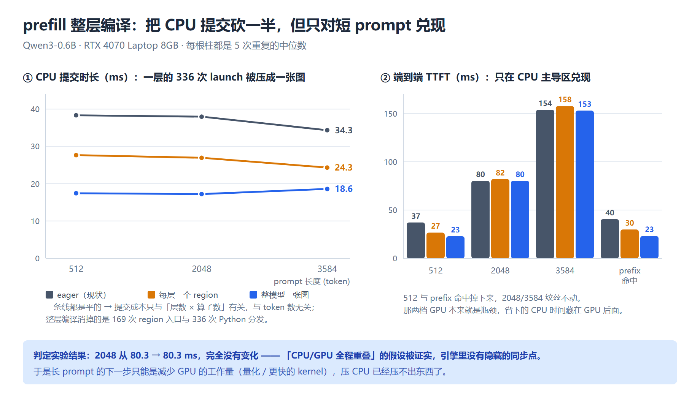

# prefill 整层编译：为什么短序列加速、长序列不加速

> 步 2（`Config.prefill_compile = model`）的收益边界说明。
> 这篇不讲"怎么改"，只讲"改完之后收益落在哪一档、为什么另一档拿不到"。
> 代码改动见 `git show v2-prefill-compile`，实测数据见 `results/step2_submit.csv` 与 `docs/REPORT.md` 表 8。
>
> **整理说明**：本文保留完整分析，但文中引用的探针脚本（`scripts/t_*.py`、`scripts/step2_*.py` 等）在整理时已裁掉；`Config.prefill_compile` 开关本身仍在 `nanovllm/config.py` 里可直接用。

## 一句话结论

**步 2 只缩短了「CPU 提交段」，而墙钟由两段相加构成。短序列 CPU 段占 97%，砍掉一半墙钟几乎跟着减半；长序列 CPU 段只占 23%，砍掉不改变总时长，还会因为 inductor 让 GPU 变慢而净亏。**

---

## 1. 墙钟由两段构成

每次 prefill 的墙钟是两段相加（`step2_submit.csv` 的 `submit_ms` 与 `tail_ms` 两列就是这两段）：

```
墙钟 = CPU 提交段 + 之后还要等的 GPU 尾巴
```

- **CPU 提交段**：从进 `forward` 到最后一个 kernel 提交完毕。169 个 Python 入口、2456 个 CPU 事件、376 次 kernel launch。
- **GPU 尾巴**：提交完了，计算还没完，只能等。

关键在于**这两段的增长规律完全不同**：

| | 增长规律 | 实测（14 个长度，RESULTS 8.12） |
|---|---|---|
| CPU 提交段 | **常数**，与 token 数无关 | 36.15 ± 0.81 ms（256→3584 完全平线） |
| GPU 段 | **近似线性**，GEMM 为主 | L≥1280 可直接读墙钟：0.043~0.047 ms/token；2048→3584 是 ×1.99 |

CPU 段之所以恒定，是因为它数的是「28 层 × 6 个函数 = 169 个入口」，不管序列是 512 还是 3584，都要走完这 169 次入口、跑一遍同样的 guard、发一遍同样多的 dispatch。**像寄快递：包裹多重不影响填 169 张单子的时间。**

**「GPU 段」怎么读，是这份文档最容易出错的地方。** 只有 GPU 主导的档位（L ≥ 1280）才能把墙钟当作 GPU 时间；L ≤ 1024 时 GPU 跑在提交后面、`tail` 只剩 1.3 ms 的地板，此时 GPU 工作量只能给上界（≤ 提交时长），不是实测值。

早先这里写的是「GPU 时间 39.5 → 116.9，×2.96，几乎正好是平方」—— 那是拿 `tail` 当 GPU 时间算的。用墙钟算（77.5 → 151.9）是 **×1.95**，log-log 斜率 1.23。正确的模型是：**prefill 的 GPU 时间以 GEMM 为主（O(L)），attention 的 O(L²) 只贡献那 0.2 的超线性。**

---

## 2. 短序列：CPU 段占 97%，砍掉就直接兑现

512 token，eager：

```
CPU 提交  ████████████████████████████████████  38.3 ms   ← 占 97%
GPU 尾巴  █                                        1.3 ms
                                          ─────────────
                                    墙钟   39.6 ms
```

GPU 1.3 ms 就算完了，CPU 要花 38 ms 才把指令发完 —— **这 38 ms 里 GPU 基本是闲着的**，利用率 3%。

编译后：

```
CPU 提交  ██████████████████                     17.4 ms   ← 入口 170 → 2
GPU 尾巴  ████                                      3.5 ms   ← 略涨
                                          ─────────────
                                    墙钟   19.4 ms   ← −20.2 ms
```

CPU 砍掉 20.9 ms，GPU 尾巴只涨 2.2 ms，**净得 20.2 ms，传导率 97%**。

原理：**CPU 段是墙钟的 97%，它缩多少，墙钟就缩多少。** 整层编译把 169 次「排队填单」压成 1 次，省下的时间全额变成墙钟收益，没有东西抵消它。

---

## 3. 长序列：CPU 段只占 23%，砍了也看不见

3584 token，eager：

```
CPU 提交  ██████████                              34.3 ms   ← 占 23%
GPU 尾巴  ██████████████████████████████████     116.9 ms   ← 占 77%
                                          ─────────────
                                    墙钟  150.9 ms
```

瓶颈完全在 GPU 那边。CPU 34.3 → 18.6 省下 15.8 ms，**但这 15.8 本来就藏在 GPU 后面**，砍掉之后墙钟只能从 150.9 掉到 135.1，而实际上连这个都拿不到。

因为 GPU 尾巴反而变长了：

```
编译后    CPU 提交  █████                18.6 ms
          GPU 尾巴  ██████████████████████████████████████  134.7 ms  ← +17.8
                                          ─────────────
                                    墙钟  152.9 ms   ← +2.0 ms
```

省 15.8、赔 17.8，**净多 2.0 ms**。

### GPU 为什么变慢

整层编译把 28 层展开进同一张图，而每层的 `weight` 是**不同的张量**。eager 时 28 层共用同一份字节码（权重作为运行时参数传入，代码只 trace 一次）；展开进图后，这 28 段又被 28 次 matmul 切开，各段因权重不同无法去重，inductor 只能逐段 codegen。

（准确的分工是：**matmul 切段是前提，权重不同是不能去重的原因**。纯 elementwise 的段没有 matmul 切分时，28 层能跨层融成 1 个 kernel —— 对照实验见 `scripts/t_share_code.py`，机制见第 8 节。）

同口径实测（跑完一次真实 prefill 之后）：**`eager` 28 个 kernel，`model` 445 个**，差 15.9 倍；只看启动时则是 11 vs 298（27 倍）。这 445 份各自做了一次独立 autotune，运行时轮流换入导致指令缓存冷启动。

（对照实验见 `scripts/t_kernel_cmp.py`，结论记录在 `RESULTS.md` 8.10；23.4 ms 在这几笔里各占多少尚未逐 kernel 归因，本机 CUPTI 采不到 GPU 事件。）

### 所以长序列是净亏

不是「没收益」，是「**倒赔**」。你为 CPU 侧付的钱（43 s 启动 + GPU 变慢），在这一档收不回来。

---

## 4. 2048 是最难看的档位

两段几乎相等，任何一侧的变动都直接撞上另一侧：

| | CPU 提交 | tail | 墙钟（= GPU 时间） |
|---|---|---|---|
| eager | 38.0 | 39.5 | 77.5 |
| 编译后 | **17.2**（−20.8） | **62.9**（+23.4） | **78.6**（+1.1） |

这里最容易被读错：**`tail` 不是 GPU 时间**。`wall = submit + tail` 是恒等式 —— 提交短了 20.8 ms，同一份 GPU 工作自然要多等 20.8 ms，所以 tail 变大是「提交变早」的另一面，不是 GPU 变慢的证据。

GPU 时间在 L ≥ 1280 时就是墙钟本身，而两档墙钟只差 **+1.1 ms**。结论要改成：**编译没有让 GPU 变慢，它只是对这一段完全无效** —— 也意味着「让 inductor 追平手调 kernel 就能省回 20 ms」是不成立的，那里根本没有可回收的亏空。

这也是步 2 判定实验能成立的原因。开工前写下的判据是：

> **若 TTFT@2048 掉到 68 ms 以下，说明「CPU/GPU 重叠」模型是错的。**

实测 80.3 → 80.3（bench 口径），一毫秒没动。这条判据严格证实了「长 prompt 由 GPU 决定，CPU 侧怎么优化都推不动它」。

---

## 5. 把分界点算出来

直接扫长度把两条曲线测出来（14 个长度、off/model 交替两轮，`scripts/step2_sweep.sh` → RESULTS 8.12）：

| L | 墙钟 eager | 墙钟 编译后 | Δ墙钟 | 传导率 |
|---|---|---|---|---|
| 256 | 37.7 | **17.6** | −20.2 | 100% |
| 512 | 35.3 | **19.6** | −15.7 | 78% |
| 768 | 37.8 | **27.8** | −10.0 | 50% |
| 896 | 37.1 | **32.5** | −4.7 | 23% |
| 1024 | 37.1 | 37.0 | −0.1 | 0% |
| 1280 | 44.7 | 45.8 | +1.2 | −6% |
| 2048 | 76.3 | 77.7 | +1.5 | −7% |
| 3584 | 151.9 | 153.0 | +1.1 | −5% |

**分界长度 ≈ 1039**（Δ墙钟过零的线性插值）。比早先按平方拟合给的 2035 低一倍 —— 旧的数字建立在「tail = GPU 时间」这个错前提上，见上文。

分界点为什么落在 1040 而不是别处：GPU 时间随 L 近似线性增长（0.045 ms/token），跑到 ≈36 ms（正好等于 eager 的提交时长）就是 1040 token 左右。低于它，墙钟由 CPU 的 36 ms 拍板；高于它，墙钟由 GPU 拍板，编译省下的 20 ms 只是让 GPU 更早开工、更早开始等。

**这个数字揭示了一件反直觉的事：步 2 缩小了自己的适用范围。** 两档的墙钟可以写成 `max(提交, GPU)`：

- L < ~420（GPU 时间掉到 16 ms 以下）：两档都受 CPU 限制，编译**省满 20 ms**；
- 420 < L < 1040：编译后墙钟 = GPU 时间，只能省「36 − GPU」，随 L 线性衰减 —— 这正是实测的 78%（512）、50%（768）、23%（896）；
- L > 1040：两边都由 GPU 拍板，编译**归零**。

换句话说，编译把「纯赚」的区间从 1040 压到 ~420，中间那 600 多 token 变成「赚一点、越往上赚得越少」。这就是为什么只看 512 和 2048 两个点会得出互相矛盾的结论。

---

## 6. 顺带解释 prefix 命中为什么收益特别好

prefix 命中（2048 稳态）TTFT 从 40.5 掉到 22.9，−43%。

原因和短序列完全同构：**prefix 命中意味着 GPU 只处理未命中的尾部（token 很少），GPU 段很短，而 CPU 提交段仍然是恒定的那 40 ms。** 本质上把 2048 的负载变成了 512 的形态，于是它落回了「CPU 主导区」。

这也说明判断该不该开这个开关，看的不是 prompt 有多长，而是**「这一档 GPU 要算多少 token」**。

---

## 7. 使用规则

| 负载 | 判定 | 理由 |
|---|---|---|
| 短 prompt（≤512）、低并发 | **开** | CPU 占 90%+，收益几乎全额兑现 |
| prefix 命中 / 多轮对话 / RAG | **开** | GPU 段短，等价于短 prompt 形态 |
| 1040 token 以上 | **关** | CPU 不是瓶颈，实测净亏 0~1.5 ms（L≥1280 均值 +1.1%）|
| 高并发批处理（C=64） | **关** | 吞吐 2949.6 → 2946.2，无收益 |
| 一次性脚本 / 频繁重启 | **关** | 43 s/进程 摊不平（见 RESULTS 8.8） |

一句话：**看的是「这一档 GPU 干多少活」，不是「prompt 多长」。**

---

## 8. CPU 提交段的 20.9 ms，具体省在哪

前面几节只说"CPU 段占多少、砍掉能兑现多少"。这一节说"砍的到底是什么"——否则很容易误以为编译让计算变少了。

### 省的不是调用，是"每次调用都要过的那道门"

一次 `layer(...)` 到 GPU 真正开跑，中间有四段：

| 段 | 内容 | 量级 | 按什么收钱 |
|---|---|---|---|
| ① | Python 帧切换 | ~0.1 µs | 调用次数 |
| ② | Dynamo 准入：查缓存 + 求值 guard | **~100 µs** | 调用次数 |
| ③ | inductor wrapper：重算 symbolic shape、打包参数 | 数十 µs | 调用次数 |
| ④ | `cuLaunchKernel` | ~4 µs | kernel 数 |

①②③ 按**调用次数**收，④ 按 **kernel 数**收。编译只动 ①②③。

② 是最大的一笔。guard 干的事是"证明这次的输入和上次编译时假设的一样"——`x.shape`、`x.dtype`、`x.stride()`、`x.device`、梯度开关、`self.eps`、每个 module 属性的版本号，逐条比对。改任何一个都要重编译，所以它必须每次都查。

eager 时每层绕不开这套检查。一层里有 4 个 `@torch.compile` 装饰点（`rms_forward`、`add_rms_forward`、`SiluAndMul.forward`、`RotaryEmbedding.forward`），profiler 口径下每层记 6 个入口事件，28 层加上 sampler 合计 **169 次**。也就是 169 次 guard 求值。

这里要澄清一个常见误解：**省下的绝不是"代码份数"。** eager 时 28 层本来就已经共用同一份 Triton 代码——28 个实例调同一个被装饰的方法，dynamo 只 trace 一次（`unique_graphs = 1`），只生成 1 个 kernel，因为 guard 只检查 shape/dtype/device，而权重是运行时参数、不是编译常量（实测见 `scripts/t_share_code.py`）。所以"共用字节码"是既有事实，不是被优化掉的东西。

### 循环在追踪时被真的跑了一遍

整层编译的入口是这一个函数：

```python
def _prefill_body(self, input_ids, positions, caches, ...):
    hidden_states = self.embed_tokens(input_ids)
    residual = None
    for i, layer in enumerate(self.layers):        # ← 关键在这一行
        hidden_states, residual = layer.forward_prefill(
            positions, hidden_states, residual,
            caches[2 * i], caches[2 * i + 1], slot_mapping, ...)
    hidden_states, _ = self.norm(hidden_states, residual)
    return hidden_states
```

外面只包一次：

```python
self._pc_fn = torch.compile(self._prefill_body, dynamic=True)
```

Dynamo 不是"看懂"这个循环，而是**解释执行**它：`self.layers` 是具体的 `ModuleList`，`enumerate` 返回真实迭代器，于是 28 次迭代全部真的被执行了一遍；每次 `layer.forward_prefill(...)` 因为是 `nn.Module.__call__`，默认被 **inline 展开**进图，而不是生成一个"调用"节点。

所以一次 trace 的产物是**一张 28 段串联的 FX 图**，不是一个"循环 28 次"的节点。运行期调用路径变成：

```
self._pc_fn(...)  →  1 次准入 + 1 次 guard  →  整张图交给 wrapper 按序执行
```

**28 次过门，变成 1 次过门 + 一张 28 段的长图。门后要干的活一点没少。**

### 三笔账（`scripts/t_launches.py`，一次 512-token prefill）

| CPU 侧动作 | eager | 编译后 | 变化 |
|---|---|---|---|
| Dynamo 入口 + guard | 170 | **2** | −99% |
| Python 字节码事件（属性访问、方法绑定、tuple 拆包） | 1234 | **≈0** | 全消失 |
| `aten::` 算子分发 | 1170 | 354 | −70% |
| kernel 发射（Triton + ATen + cuBLAS） | 376 | 319 | −15% |

省下的 20.9 ms 拆开是：**约 18.5 ms 来自那 1234 个 Python 事件消失**（≈15 µs/个），**只有 2.9 ms 来自 kernel 发射减少**。

### 为什么 kernel 发射只降了 15%

因为矩阵乘一个都没少。113 次 `aten::mm`（28 层 × 4 + 1）走的是 cuBLAS，属于 extern kernel，inductor 融不进去；`cudaLaunchKernel` 146 → 145，几乎没动。真正被融掉的只有每层两个 RMSNorm 的归约 kernel（Triton 部分 230 → 174）。

这印证了 ①②③ 与 ④ 是两套账：

- **提交成本 ∝ 调用次数**（Python 层有多少次"过门"）
- **发射成本 ∝ kernel 数**（GPU 队列里有多少个 kernel）

所以"编译减少了提交"的准确含义是：**减少了 Python 解释器在图外调度 1170 个算子的次数，而不是减少了 GPU 发射 kernel 的次数。**

### 剩下那 17.2 ms 为什么消不掉

它已经是"1 次调用"内部的钱了：inductor 生成的 wrapper 本身是 Python 代码，每次进去要重算 symbolic shape、走一遍输入守卫、再把 319 个 kernel 逐个 launch。**编译优化不掉自己的 wrapper**——只能换机制，也就是步 9 的 CUDA graph：把这段 wrapper 整个录成一次 replay，连 Python 都不进。

### graph break：这条路唯一的翻车方式

如果 `_prefill_body` 里出现任何 dynamo 追不下去的东西——`.item()`、依赖张量数值的 `if`、没被封装的第三方 kernel——dynamo 会在那里 **graph break**，那段代码退回 Python 解释执行，28 次过门立刻回来；更糟的是多了一层"图内/图外"来回切换，可能比纯 eager 还慢。

这就是 attention 必须包成 `@torch.library.custom_op("nanovllm::prefill_attn", ...)` 的第二个理由：第一个理由是隔离 KV cache 的变异（见 `RESULTS.md` 8.7 的三个坑），第二个理由是**保证 flash-attn 那段不被 dynamo 试图追踪然后断开**。

---

## 9. 数据来源

| 用途 | 文件 |
|---|---|
| submit / tail / wall 三列原始数据 | `results/step2_submit.csv` |
| 拟合、判定实验的成形结论 | `docs/REPORT.md` 表 8（8.1–8.10） |
| 图 | `results/figs/png/fig8_prefill_compile.png` |
| launch 账本（170→2、376→319） | `scripts/t_launches.py` |
| 大图改变代码复用的对照实验 | `scripts/t_kernel_cmp.py` |
| 共用字节码 vs 整层展开 vs 权重打包 | `scripts/t_share_code.py` |


